# ECG arrhythmia detection

[](https://github.com/ryanqi588-code/ecg-arrhythmia-detection/actions/workflows/tests.yml)

R-peak (heartbeat) detection and atrial fibrillation (AF) screening on
public PhysioNet and hospital ECG databases. Beat detection is written
from scratch with NumPy and SciPy and benchmarked against an established
detector. AF screening uses RR-interval and atrial-activity features with
logistic regression, for Holter recordings, handheld recordings and 10 s
clinical 12-lead ECGs.

| Task | Tested on (never used in development) | Result |
|---|---|---|
| Beat detection | 36 held-out MIT-BIH records | sensitivity **99.57%**, precision **99.57%** (wfdb's XQRS: 98.82%, 99.96%) |
| AF on Holter recordings, 60 s windows | 84 new patients (Long-Term AF Database) | sensitivity **96.4%**, specificity 81.8%; with ectopic beats removed 95.8%, **84.3%** (original two-threshold rule: 94.3%, 59.1%) |
| AF on 10 s clinical 12-lead ECGs | 15,113 ECGs from Shandong Provincial Hospital | sensitivity **98.4%** (95% CI 97.1–99.1%); false alarms **9.5%** on atrial premature beats, **0.1%** on normal ECGs |
| Atrial flutter on 10 s clinical 12-lead ECGs | 99 flutter and 711 sinus tachycardia ECGs (Shandong) | **83.8%** of flutter caught as AF or flutter (AF model alone: 54.5%), 70.7% named flutter; 3.7% of sinus tachycardia flagged |
| AF on handheld recordings | – (no unused data left) | cross-validation only: 92.7% sensitivity |

These took ten tests on fresh data, several of which failed; all of them
are in the [test log](#test-log).

## How the tests were run

- **Development and test data are kept apart.** Every design decision is
  made on data that has already been used (by cross-validation grouped by
  record or patient). Each test uses data that was never used before.
- **Each test is registered and run once.** The test script, including
  how recordings are chosen (from labels or headers only), the models and
  their cutoffs, is committed before the test data is downloaded or
  opened, then run once. Its results are reported whatever they are.
  Analyses after a run only describe the errors; nothing is changed in
  response. A new idea needs new data.
- **Checks before a run.** Downloaded files are checked against their
  expected sizes and incomplete ones re-fetched (3 for Georgia, 17 for
  PTB-XL); later scripts were first dry-run on stand-in files.
- **Cutoffs aim at 95% sensitivity.** A missed AF episode matters more than
  a false alarm, which a clinician can dismiss by looking at the strip.
  Cutoffs are set on out-of-fold probabilities with records weighted
  equally ([`af.fit_with_cutoff`](af.py); why is explained
  [below](#how-the-holter-model-got-here)).
- **Confidence intervals** are 95% Wilson intervals.
- **Exceptions**, each disclosed where it happens: the AFDB later-hours
  results are a second look; the P-wave override threshold was chosen
  while looking at SVDB; a dry run accidentally scored 19 CPSC-extra test
  recordings.

### Test log

| # | Test data | What was tested | Sensitivity | False alarms | Verdict |
|---|---|---|---|---|---|
| 1 | LTAFDB, 84 Holter patients | 5-feature logistic regression | 96.4% | specificity 81.8% | sensitivity transfers, specificity doesn't |
| 2 | SVDB, 78 patients with atrial ectopy | `p_match` P-wave feature | – (no AF labels) | 402 vs 390 windows | didn't help |
| 3 | Challenge 2017, handheld | P-wave override | 76.0% | "Other" rhythms 20.3% → 16.3% | override works; handheld sensitivity poor |
| 4 | CPSC 2018, clinical | override; handheld training | 92.3% | PAC 18.4% → 10.4% | override confirmed; handheld training didn't transfer |
| 5 | CPSC 2018 extra | clinical cutoff | 88.9% | specificity 95.8% | small change |
| 6 | Georgia, 10 s 12-lead | 12-lead clinical model | 68.5% | PAC 7.3% | failed; AF labels mostly don't describe the strip |
| 7 | PTB-XL | same models, cleaner labels | 87.4% | PAC 10.3% | labels explained Georgia; still short of 95% |
| 8 | Chapman-Shaoxing | more training data, strictest cutoff | 98.9% | PAC 24.0% | target met, but only by moving the cutoff |
| 9 | Shandong (SPH) | 12-lead P waves, f-wave ratio, multi-lead beats | **98.4%** | **PAC 9.5%**, normal 0.1% | better at both ends |
| 10 | Shandong (SPH) flutter, sinus tachycardia | flutter model alongside the AF model | flutter **83.8%** (AF model alone 54.5%) | sinus tachycardia 3.7% | as developed; SVT untested |

## 1. Beat detection

[`ecg.py`](ecg.py) contains the detector:

1. **Band-pass filter** (0.5–40 Hz Butterworth, zero-phase) removes
   baseline wander and high-frequency noise.
2. **Adaptive threshold.** A peak must exceed 40% of the largest
   |signal| value within a sliding 2 s window, with a floor so the
   threshold can't collapse onto noise during pauses. Using |signal|
   catches beats whose QRS complex points downwards, which is common for
   premature ventricular beats.
3. **T-wave rejection** (from Pan & Tompkins, 1985). A candidate within
   360 ms of the previous beat whose steepest slope is under half that
   beat's is a T wave, not a new beat.

A detection counts as correct if it is within 150 ms of an annotated
beat. Ventricular flutter episodes contain no separate beats, so they
are left out of scoring, as the ANSI/AAMI EC57 standard specifies.

### Why a fixed threshold isn't enough

The first version used a single threshold at half the record's maximum.
One tall beat or artefact then sets the bar too high for everything
else. On record 215 it detected only 5% of beats:

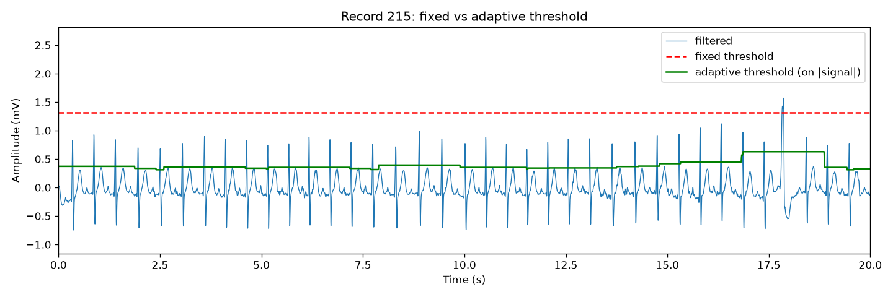

### Results

The detector was developed while looking at 10 records (100, 101, 103,
105, 108, 200, 203, 207, 210, 215) and scored on the other 36. Records
102 and 104 have no MLII lead and are skipped. Each record is scored on
its first 5 minutes.

| Detector | Dev sens. | Dev prec. | Held-out sens. | Held-out prec. | Held-out missed / false |
|---|---|---|---|---|---|
| Fixed threshold | 61.13% | 99.10% | 91.90% | 97.72% | 1092 / 289 |
| **Adaptive (ours)** | 98.19% | 99.26% | **99.57%** | 99.57% | **58** / 58 |
| XQRS (`wfdb`) | 97.06% | 96.72% | 98.82% | **99.96%** | 159 / **6** |

On held-out data the two detectors make different trade-offs. Ours
misses about a third as many beats, and XQRS produces about a tenth as
many false detections. Ours is also about 25× faster (0.3 s against
7.8 s for all 36 records), though speed wasn't a design goal. Record 203,
very noisy with ventricular beats of many shapes, is its weakest (91.6%
sensitivity).

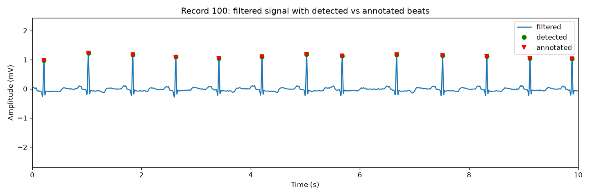

## 2. AF on Holter recordings

In AF the heartbeat becomes irregularly irregular. The AF scripts run
the beat detector on the
[MIT-BIH Atrial Fibrillation Database](https://physionet.org/content/afdb/1.0.0/)
(AFDB: 23 records of about 10 hours each) and measure how irregular the RR
intervals (times between beats) are in each 60 s window:

| Feature | Definition | AUC alone (dev) |
|---|---|---|
| **CV** | standard deviation of RR / mean RR | 0.895 |
| **nRMSSD** | root-mean-square of successive RR differences / mean RR | 0.896 |
| **Shannon entropy** | entropy of a 16-bin histogram of RR intervals between the window's 5th and 95th percentiles, scaled to 0–1 | 0.831 |
| **TPR** (turning points ratio) | fraction of RR intervals that are a local peak or trough (≈ 2/3 for a random series) | 0.843 |
| **pNN50** | fraction of successive RR differences over 50 ms | 0.957 |

A window is labelled AF if at least half of it is annotated `(AFIB`;
atrial flutter and junctional rhythm count as non-AF.

| Set | Data | Used for |
|---|---|---|
| **Development** ([`afib.py`](afib.py)) | AFDB, first 2 h of all 23 records (2759 windows, 610 AF) | every design decision, by leave-one-record-out cross-validation |
| **AFDB later hours** ([`afib_test.py`](afib_test.py)) | AFDB, hours 2 to end (11,180 windows, 4955 AF) | first held-out test; same patients, later in their recordings |
| **New patients** ([`afib_test.py`](afib_test.py)) | [Long-Term AF Database](https://physionet.org/content/ltafdb/1.0.0/), first 2 h of all 84 records (9895 windows, 4790 AF) | test 1: different people, a different recorder, 128 Hz instead of 250 Hz |

**Classifiers:**

1. **Threshold rule** (the first version): AF when both CV and nRMSSD
   exceed grid-searched thresholds.
2. **Logistic regression** on CV + nRMSSD, and on all 5 features. CV and
   nRMSSD are log-transformed, since they span two orders of magnitude.
   Inputs are standardized and classes weighted equally.
3. **Logistic regression on pNN50 alone**, added *after* seeing that
   pNN50 alone scored as well as an earlier 5-feature model, so a
   follow-up comparison, not a planned one.
4. **Logistic regression on 5 features, with ectopic beats removed.**

### How the Holter model got here

**1. Entropy outliers (found on development data).** At first, entropy's
histogram bins spanned each window's full RR range. On record 07859, which
is AF throughout, a few outlier intervals per window stretched that range
about 2.6× and pulled AF windows' entropy from about 0.93 down to 0.69, so
the model missed 80 of its AF windows. Dropping intervals outside the
5th–95th percentiles first, as Dash et al. (2009) do, fixed it. The
5-feature model's development AUC rose from 0.951 to 0.979.

**2. A cutoff that didn't transfer (found on the first held-out test).**
The first run on AFDB's later hours reached only **92.5%** sensitivity
against the 95% target, with 98.0% specificity and AUC 0.990. The model
ranked windows well, but the cutoff carried over from development landed
too high. Investigating on development data only, I found two causes:

- The cutoff was set on the same windows the model was trained on, where
  its probabilities are overconfident. Setting it on **out-of-fold**
  probabilities instead (each training record scored by a model that
  didn't see it) moved development sensitivity from 93.8% to 95.2%.
- Four records supply about 73% of development AF windows, so a cutoff
  that catches 95% of *windows* mostly reflects them. **Weighting records
  equally** raised development sensitivity to 97.7%, and the worst record's
  from 63% to 83%.

**3. Ectopic beats.** Frequent extra beats make a normal rhythm look
irregular. [`ecg.flag_ectopic`](ecg.py) flags a beat if its shape
correlates under 0.9 with the median of its neighbours (ventricular
ectopics have a wide, different QRS; AF beats keep their normal shape), or
if it comes early (< 0.8× the local RR) and is followed by a pause
(> 1.15×). Against MIT-BIH's hand-labelled beats (first 5 minutes of 46
records, the same data the thresholds were picked on), it catches
**97.6% of ventricular ectopics** and wrongly flags 3.5% of normal beats,
but only **5% of atrial ectopics**, which look normal and are often only
slightly early. RR intervals touching a flagged beat are dropped before
computing the features; if fewer than 20 remain, the window uses its
unfiltered intervals, so every window is still scored.

### Results

| Classifier | Development (LORO) sens. / spec. | AFDB later hours* sens. / spec. | New patients sens. / spec. | New patients false alarms | New patients AUC |
|---|---|---|---|---|---|
| Threshold rule (CV, nRMSSD) | 92.1% / 79.1% | 95.9% / 83.0% | 94.3% / 59.1% | 2089 | – |
| Logistic (CV, nRMSSD) | 93.1% / 76.5% | – | – | – | – |
| Logistic (pNN50 only) | 98.5% / 86.6% | 97.4% / 89.9% | 94.9% / 68.5% | 1607 | 0.879 |
| **Logistic (5 features)** | 97.7% / 92.6% | 95.9% / 96.0% | **96.4%** / 81.8% | 927 | **0.938** |
| **Logistic (5 features, ectopic beats removed)** | 96.6% / **95.3%** | **97.0%** / **97.3%** | 95.8% / **84.3%** | **803** | 0.935 |

\* A second look: the cutoff method was changed after this data was first
used (first look, 5 features: 92.5% / 98.0%), so treat it as somewhat
optimistic. Development AUCs: 0.889, 0.953, 0.979, 0.982 for the four
logistic models.

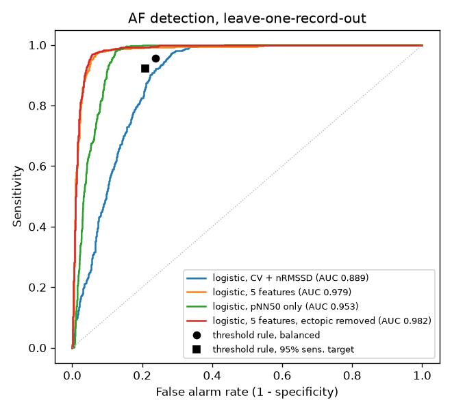
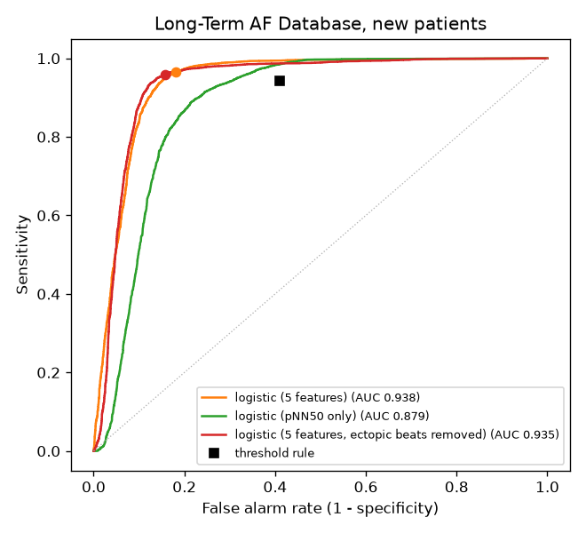

- **Sensitivity transfers.** Both 5-feature models catch about 96% of AF
  windows in people they've never seen.
- **Specificity doesn't.** It falls from about 96% to 82–84%, and AUC
  from 0.99 to 0.94: new patients' non-AF rhythms are much more varied
  than anything in the 23 development records.
- **Ectopic removal helps less than in development.** It cut development
  false alarms by 38% (record 08219, the worst ectopy case, went from 69%
  to 95% accuracy) but new-patient false alarms by 13% (927 → 803), for
  29 more missed AF windows. The filter flags about 13% of beats inside AF
  windows, because its timing rule fires by chance on irregular rhythm.
- **pNN50 alone doesn't generalize** (AUC 0.879 vs 0.938 on new patients).
- **The 5-feature models beat the original rule by a wide margin**, at
  higher sensitivity and with less than half its false alarms.

### Where the new-patient false alarms come from

[`ltaf_errors.py`](ltaf_errors.py) breaks the 927 false alarms down by
record, using the database's beat and rhythm labels. **73% of them come
from 10 of the 84 records**, in three groups:

1. **Atrial ectopy and other irregular non-AF rhythms** (records 23, 01,
   58): 27–30% of beats are atrial premature beats, with atrial bigeminy
   and supraventricular tachyarrhythmia labelled, exactly what the ectopic
   filter can't detect.
2. **Beat-detector errors on noisy recordings** (records 45, 56, 24, 03):
   precision falls to 47% on record 45 and 74–84% on the others. Across
   all 84 records the detector finds 98.8% of beats, but only 94.4% of its
   detections are real, against 99.6% on MIT-BIH.
3. **A probable labelling gap** (record 64): its only rhythm labels are at
   hour 18.9 (`(VT`, then `(AFIB` to the end), so its first 18.9 hours
   count as non-AF here, though its first 2 hours look like AF (CV 0.15,
   pNN50 0.58, entropy 0.87). It accounts for 76 false alarms. Excluding
   it, a choice made after seeing the results, specificity is 82.9%
   (5 features) and 85.6% (ectopic removed).

### Notes on the Holter model

**Coefficients** of the 5-feature model fitted on all development
windows, in log-odds of AF per standard deviation, with the range across
the 23 cross-validation folds: log CV +2.43 (+2.12 to +3.50), log nRMSSD
−0.62 (−0.99 to −0.29), entropy +2.97 (+2.59 to +4.01), TPR −0.15 (−0.38
to +0.03), pNN50 +2.43 (+2.27 to +2.66). Entropy, pNN50 and CV carry the
model; once outliers are trimmed, entropy is almost uncorrelated with CV
(r = 0.03). The negative nRMSSD weight shouldn't be read at face value:
log CV and log nRMSSD are 97% correlated, so the model splits "overall
variability" between them; on its own nRMSSD rises with AF. TPR's weight
is small and changes sign across folds; pNN50 largely covers it (r = 0.66).

**Ectopy in the development data.** In the first 48 minutes of AFDB record
08378 the RR intervals split into two bands, short and long: ectopy, not
AF, but irregular. For the threshold rule this is a limit of the method,
not of the beat detector: PhysioNet's reference beat positions give
similar results (79.4% specificity, 91.1% sensitivity).

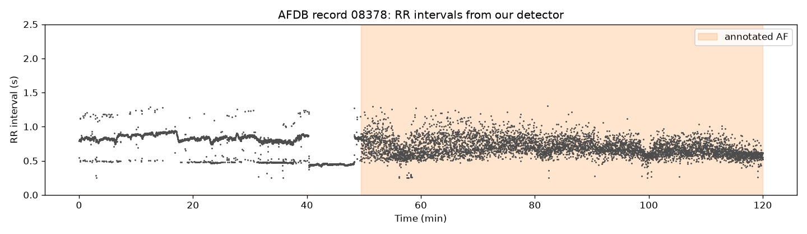
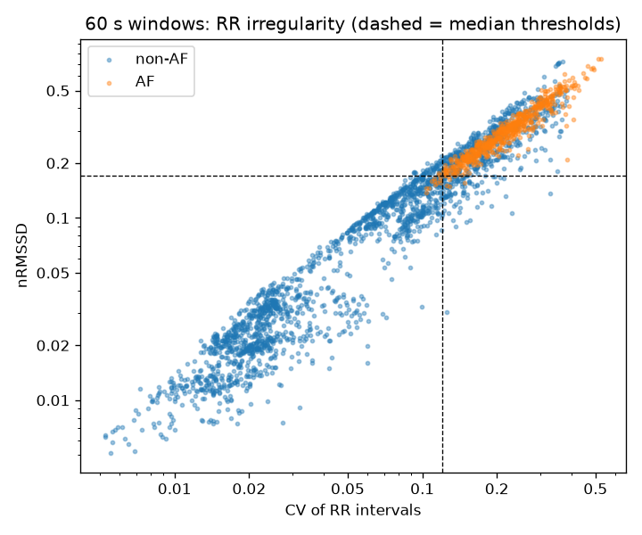

**A wrong reference annotation.** Against PhysioNet's `qrs` beat
annotations for AFDB, our detector scores 96.6%. Those annotations were
made by a computer program and never checked by hand; on record 07162 most
of them fall between heartbeats, while our detections land on each QRS
complex. Excluding 07162, beat detection scores 99.10% sensitivity and
98.93% precision.

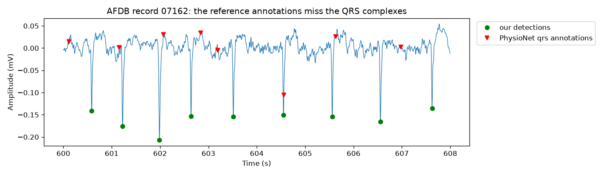

## 3. Atrial ectopy and P waves

AF has no P waves, only chaotic fibrillatory activity. Atrial ectopy is
mostly normal beats *with* P waves. Both attempts below look at the
300–60 ms before each R peak.

**Detecting individual atrial ectopic beats** ([`ecg.flag_atrial_ectopic`](ecg.py))
works poorly on one lead: on the full 30 minutes of 46 MIT-BIH records
(excluding record 232, whose long pauses distort timing) it catches 55% of
supraventricular ectopics but flags 2.3% of normal beats, so only about
10% of its flags are real, and it flags 15% of beats inside AF windows.
**No model uses it.**

**P-wave presence per window** ([`af.p_wave_features`](af.py)): `p_match`
is the fraction of a window's beats whose pre-QRS stretch correlates
> 0.5 with the window's median one. On its own it separates AF from non-AF
development windows with **AUC 0.937** (median 0.94 non-AF, 0.38 AF); as a
model feature it changed almost nothing (AUC 0.985 vs 0.982), but AFDB's
development records contain little atrial ectopy. (A second measure,
`p_snr`, was 85% correlated with it and was dropped.)

### Test 2: SVDB, 78 patients with frequent atrial ectopy

The [MIT-BIH Supraventricular Arrhythmia Database](https://physionet.org/content/svdb/1.0.0/)
(30 minutes each, 128 Hz, 12,188 labelled supraventricular ectopic beats),
[`afib_svdb_test.py`](afib_svdb_test.py):

| Classifier (78 patients, 2340 windows) | Specificity | False alarms |
|---|---|---|
| Threshold rule (CV, nRMSSD) | 59.4% | 951 |
| Logistic (5 features) | 78.4% | 506 |
| **Logistic (5 features, ectopic beats removed)** | **83.3%** | **390** |
| Logistic (5 features + `p_match`, ectopic beats removed) | 82.8% | 402 |

- **`p_match` didn't reduce false alarms.** Removing ventricular ectopics
  did, by 23%.
- **Atrial ectopy drives the false alarms:** 40% in the 14 records where
  over 10% of beats are supraventricular ectopics, 12% in the other 64.
- **Why `p_match` fails:** ectopic beats bring their own, different P
  waves. When 20–30% of beats are ectopic, `p_match` falls to about 0.7,
  which overlaps real AF windows in development (0.4–0.85).
- The beat-level atrial detector catches 54% of supraventricular ectopics
  here and flags 1.8% of normal beats (41% of its flags are real, since
  ectopics are common here); the ventricular detector catches 84% of
  ventricular ectopics, against 97.6% on the MIT-BIH data it was tuned on.

**A caveat I should have caught beforehand:** SVDB has **no rhythm labels**
(one `(N` annotation in all 78 records), and the registered rule counted
unlabelled windows as non-AF. If any patient was in AF (record 804,
flagged in all 30 windows with no ectopic beats, is a candidate), true
specificity is higher than shown. The comparison between models is
unaffected.

### The P-wave override

`p_match` failed because ectopic beats have odd P waves. The *regular*
beats between them (not early, not ventricular ectopic) still share one
sinus P wave, while in AF none do. `p_match_regular`
([`af.regular_beats`](af.py)) has AUC **0.962** alone on AFDB development
windows, and a median of 0.97 in SVDB's high-ectopy records (`p_match`:
0.81). As a model feature it barely helped (SVDB false alarms 409 vs 390),
because AFDB training data has almost no "irregular, but with P waves"
windows to learn from. So, since AF means no P waves, it's applied as a
**rule** ([`af.p_wave_override`](af.py)): a window isn't called AF if at
least 95% of its regular beats share its typical P wave.

| Override threshold | AFDB sensitivity | AFDB false alarms | SVDB false alarms |
|---|---|---|---|
| none | 96.6% | 100 | 390 |
| **0.95** | **96.1%** | **71** | **277** |
| 0.90 | 93.3% | 60 | 251 |
| 0.85 | 89.2% | 47 | 217 |

0.95 is the lowest threshold that keeps AFDB sensitivity above 95%. It was
chosen while looking at SVDB, so SVDB's 29% drop isn't independent
evidence; test 3 is.

### Test 3: PhysioNet/CinC Challenge 2017 (handheld)

8528 single-lead handheld recordings (300 Hz, 9–61 s), labelled Normal,
AF, Other rhythm or Noisy; each scored as one window
([`afib_cinc_test.py`](afib_cinc_test.py)). 7903 scored (279 noisy
excluded, 346 with fewer than 20 usable beats).

| Classifier | Catches AF | False alarms, Normal | False alarms, Other | False alarms | Missed AF | ROC AUC |
|---|---|---|---|---|---|---|
| Threshold rule | 87.9% | 40.5% | 59.5% | 3361 | 84 | – |
| Logistic (5 features) | **79.2%** | 12.3% | 19.1% | 1045 | **145** | **0.881** |
| Logistic (5 features, ectopic removed) | 77.8% | 12.4% | 20.3% | 1077 | 155 | 0.868 |
| **+ P-wave override** | 76.0% | **10.3%** | **16.3%** | **882** | 167 | – |

- **The override does what it was built for:** false alarms on "Other"
  rhythms fall by 20%, for 12 more missed AF recordings.
- **But the pipeline transfers poorly to handheld recordings:** about 78%
  sensitivity, AUC 0.87–0.88 against 0.94–0.99 on Holter data.

**Why sensitivity falls:** not mainly length (81% on 50–61 s recordings,
77% on 20–35 s ones). The missed AF is less irregular (median CV 0.126,
pNN50 0.47, against 0.19 and 0.72). About 30 beats can't fill a 16-bin
histogram the way a minute of Holter beats does, so AF entropy falls from
0.92 to 0.86 for purely technical reasons. And the handheld device shows
more P-wave-like activity during AF (median `p_match_regular` 0.48 vs
0.33), which is probably why the override cost some sensitivity.

## 4. Short recordings and devices

**Two changes, developed on the now-used data** (Challenge 2017 by 5-fold
cross-validation, AFDB leave-one-record-out):

1. **`entropy_norm`**: entropy divided by that of a random series of the
   same length (a random 20-interval series scores only 0.82; 60
   intervals: 0.95). Challenge AF medians by length go from 0.77 / 0.85 /
   0.90 to 0.94 / 0.95 / 0.95. On its own it mostly moved the operating
   point (handheld sensitivity 77.8% → 83.5%, AUC unchanged).
2. **Training on AFDB plus all Challenge 2017 recordings**, with a
   separate cutoff for short recordings
   ([`af.fit_with_source_cutoffs`](af.py)); one shared cutoff cut AFDB
   specificity from 95% to 83–86%, per-source cutoffs kept it at about 91%.
   Handheld development sensitivity with the override: **92.4%** (76.0%
   before), with more false alarms (normal 18.4%, other 30.4%).

### Test 4: CPSC 2018 (clinical, lead I)

From the [PhysioNet/CinC Challenge 2020](https://physionet.org/content/challenge-2020/1.0.2/)
data ([`afib_cpsc_test.py`](afib_cpsc_test.py)): short clinical 12-lead
recordings (500 Hz), lead I only, one window per recording. 931 chosen
(single diagnosis of AF, PAC or normal sinus rhythm, at least 15 s); 777
scored, 154 had fewer than 20 usable RR intervals (mostly slow normal
rhythms).

| Model (777 recordings: 286 AF, 212 PAC, 279 normal) | Catches AF | False alarms, PAC | False alarms, normal | ROC AUC |
|---|---|---|---|---|
| Previous (AFDB only, 5 features) | 92.3% | 18.4% | 4.7% | **0.952** |
| **Previous + P-wave override** | 92.3% | **10.4%** | **3.2%** | – |
| New (AFDB + Challenge, `entropy_norm`, short-recording cutoff) | **98.3%** | 50.5% | 22.2% | 0.917 |
| New + P-wave override | 97.9% | 24.1% | 5.0% | – |

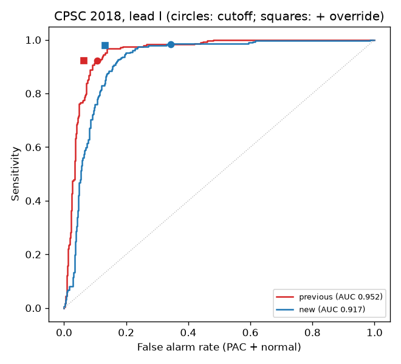

- **The P-wave override is confirmed:** it halves false alarms on PAC
  recordings at essentially no sensitivity cost. Both override points
  (squares) sit above and to the left of their model's whole ROC curve,
  because P waves are information the RR features don't have.
- **The handheld training didn't transfer:** sensitivity 98% but triple
  the false alarms and a *lower* AUC. Grouping recordings by *length* was
  the mistake: these are short like handheld ones, but their signal
  quality is close to Holter. Handheld recordings need their own model by
  *device*.

### Routing by device

| Device | Model | Cutoff |
|---|---|---|
| Holter | AFDB-trained | from AFDB |
| Clinical 12-lead | AFDB-trained (it ranked CPSC best) | 95% sensitivity on the 777 used CPSC 2018 recordings: 0.398, against 0.552 from AFDB |
| Handheld | trained on Challenge 2017 only | from Challenge 2017 |

All three apply the P-wave override. **Handheld** can only be checked by
5-fold cross-validation on Challenge 2017
([`afib_handheld_cv.py`](afib_handheld_cv.py)), since no unused handheld
AF data is left: 92.7% sensitivity, false alarms 14.8% normal and 28.5%
other, against 93.0% / 19.2% / 31.8% for the AFDB + Challenge model.
(`entropy_norm` makes no difference within one device.)

### Test 5: CPSC 2018 extra (clinical cutoff)

A second, unused batch from the same challenge
([`afib_cpscx_test.py`](afib_cpscx_test.py)). AF only occurs alongside
other diagnoses there, so AF = "AF among the diagnoses" and non-AF =
"neither AF nor atrial flutter"; lead I, at least 15 s. *Disclosure:* a
dry run accidentally used the first 25 downloaded test files instead of
stand-ins (19 scored: 1 AF, 18 non-AF, all correct for every model).
Nothing was changed after it.

| CPSC-extra (917 recordings: 45 AF, 32 PAC, 840 other) | Catches AF (95% CI) | Specificity | False alarms, PAC | False alarms, other | Missed AF |
|---|---|---|---|---|---|
| Holter cutoff | 86.7% (74–94%) | 95.0% | 6.2% | 5.0% | 6 |
| Holter cutoff + override | 86.7% (74–94%) | **96.0%** | 6.2% | 3.9% | 6 |
| Clinical cutoff | 88.9% (77–95%) | 94.0% | 15.6% | 5.6% | 5 |
| **Clinical cutoff + override** | **88.9% (77–95%)** | 95.8% | 9.4% | 4.0% | **5** |

The clinical cutoff caught one more AF recording, well within the noise
for 45 AF recordings; neither reaches 95%. The model ranks well (AUC
0.96), and the override cut false alarms by 20–30% for the third time on
unseen data. The missed AF has mixed causes: frequent PVCs (one recording
has 30% of beats flagged ectopic), a fairly regular ventricular response
(CV 0.087), one labelled "AF and flutter", and two just under the cutoff.

## 5. A clinical 12-lead model

### Test 6: Georgia, with lead II P waves and V1 f-waves

Clinical recordings have 12 leads, so atrial activity can be read where
it's clearest: P-wave consistency over regular beats in **lead II**, and
fibrillatory-wave activity in **V1** ([`ecg.f_wave_activity`](ecg.py):
subtract the median beat, then measure the 4–9 Hz activity left, relative
to beat size), in a model trained on clinical recordings
([`af.clinical_features`](af.py)).

**Development** ([`afib_clinical_dev.py`](afib_clinical_dev.py)): the used
CPSC 2018 and CPSC-extra recordings cut into 10 s crops (3942 crops, 654
AF), 5-fold cross-validation grouped by recording.

| Model (development) | AUC | Sensitivity | False alarms |
|---|---|---|---|
| AFDB model, clinical cutoff | 0.959 | 95.6% | 13.0% |
| Clinical model, RR only | 0.950 | 95.4% | 11.5% |
| Clinical model, RR + P waves (II) | 0.976 | 95.7% | 5.1% |
| **Clinical model, RR + P waves (II) + f-waves (V1)** | **0.978** | **95.9%** | **4.7%** |

Lead II P waves work as a model feature here, unlike with AFDB training,
because clinical training data includes PAC and other rhythms. For 10 s
recordings the RR minimum is 6 intervals and `p_match_regular` needs 3
regular beats (with 5, many normal recordings had too few).

**The test** ([`afib_georgia_test.py`](afib_georgia_test.py)): 2942 10 s
recordings from the Challenge 2020 Georgia set. AF = AF among the
diagnoses (570); PAC = PAC without AF or flutter (620); normal = sinus
rhythm as the only diagnosis (1752).

| Georgia (2938 scored: 569 AF, 618 PAC, 1751 normal) | Catches AF (95% CI) | False alarms, PAC | False alarms, normal | ROC AUC |
|---|---|---|---|---|
| Current (AFDB model, clinical cutoff) | **75.2%** (72–79%) | 35.0% | 3.6% | 0.844 |
| Current + P-wave override | 71.0% (67–75%) | 12.9% | 1.1% | – |
| Clinical model (registered primary) | 68.5% (65–72%) | **7.3%** | **0.9%** | **0.881** |
| Clinical model + P-wave override | 67.7% (64–71%) | 6.3% | 0.8% | – |

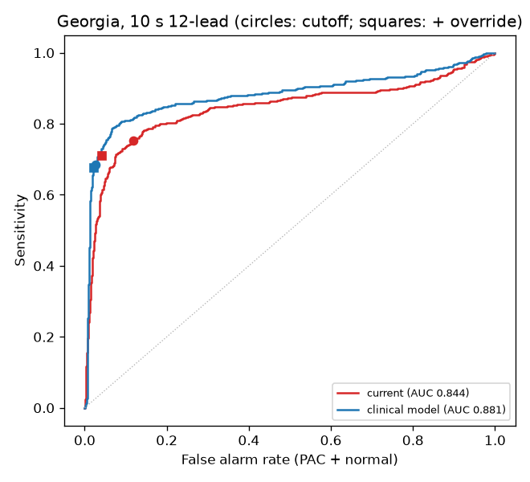

**The fix failed its main goal.** The clinical model ranks better and cuts
PAC false alarms from 35% to 7%, but catches *less* AF, and both models do
far worse than in development (AUC 0.98).

**Why:** many of the missed "AF" recordings don't look like AF. Their
median CV is 0.067 and pNN50 0.23, close to normal rhythm, and their median
`p_match_regular` is 1.000. 67 of the 179 missed are perfectly regular
(CV < 0.05) with consistent P waves. Four of them, at random:

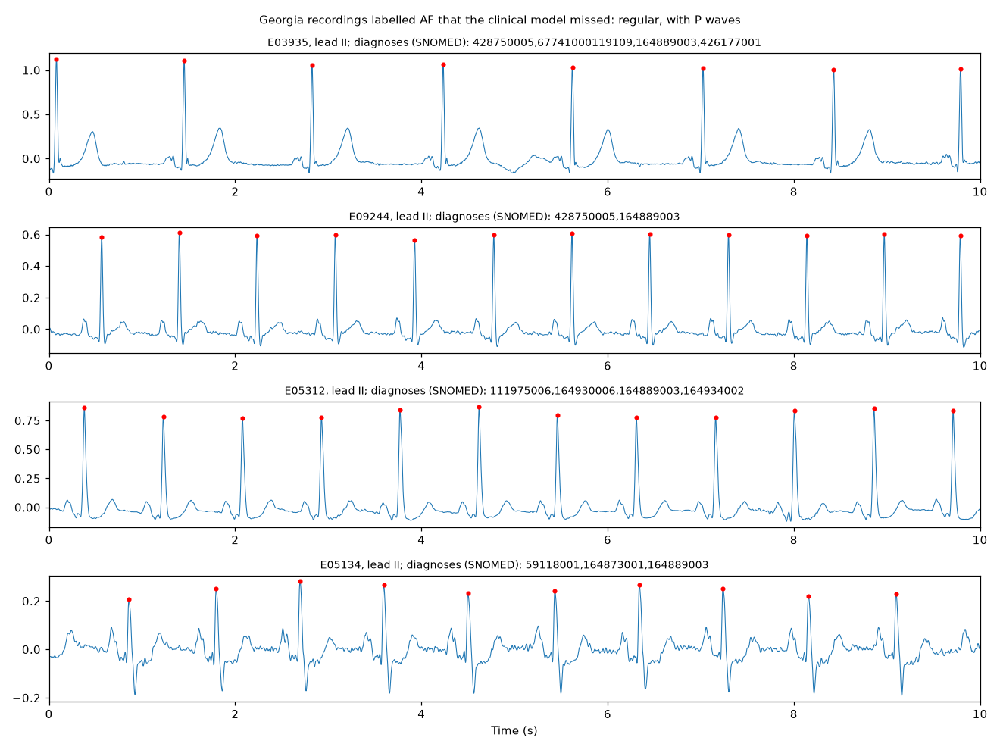

Georgia lists every diagnosis attached to the patient's ECG, so "AF" may
mean AF elsewhere in the patient's history rather than in this 10 s. One
of the four (E03935) is coded with both AF and sinus bradycardia, which
can't both describe one strip. I'm not a cardiologist and haven't excluded
these recordings: dropping them after the fact would remove exactly the
cases the model gets wrong. A fair verdict needs labels that describe the
rhythm in each recording.

### Test 7: PTB-XL, whose labels describe each recording

[PTB-XL](https://physionet.org/content/ptb-xl/1.0.3/)
([`afib_ptbxl_test.py`](afib_ptbxl_test.py)): 10 s 12-lead recordings at
500 Hz, cardiologist-validated reports only, rhythm statements about the
ECG itself. AF = AFIB without atrial flutter (all 984); PAC = PAC without
AF or flutter (all 391); sinus = SR with no AF, flutter, ectopy or pacing
(1500 drawn at random, seed 0). Exactly the Georgia models.

| PTB-XL (2867 scored: 978 AF, 389 PAC, 1500 sinus) | Catches AF (95% CI) | False alarms, PAC | False alarms, sinus | ROC AUC |
|---|---|---|---|---|
| Current (AFDB model, clinical cutoff) | **92.4%** (91–94%) | 46.8% | 6.6% | 0.942 |
| Current + P-wave override | 87.2% (85–89%) | 14.9% | 0.9% | – |
| Clinical model (registered primary) | 87.4% (85–89%) | **10.3%** | **1.0%** | **0.976** |
| Clinical model + P-wave override | 86.2% (84–88%) | 8.7% | 0.8% | – |

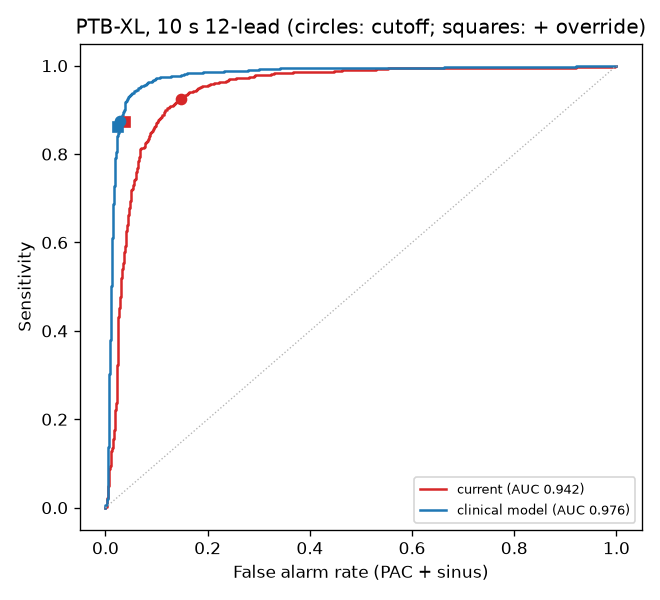

- **The labels explain most of the Georgia gap.** The clinical model's AUC
  is 0.976, as in development, and only 4 of its 123 missed AF recordings
  are regular with consistent P waves (Georgia: 67 of 179).
- **It still misses the 95% target** (87.4%, in line with CPSC-extra's
  88.9%). Catching 95% here would have needed a cutoff of 0.27 instead of
  0.61, raising PAC false alarms to 25% (worked out after the run).
- The missed AF is clearly irregular (median CV 0.13, pNN50 0.56) but
  scores high on `p_match_regular` (0.90; caught AF: 0.43).

### Test 8: Chapman-Shaoxing, with more training data

**Development** ([`afib_pwave_dev.py`](afib_pwave_dev.py)) on CPSC crops
and PTB-XL (6809 units, 1632 AF). [`ecg.p_wave_consistency`](ecg.py)
tested two suspected causes of the high P-wave scores: matching each beat
against a median that includes itself (fixed by leave-one-out), and the
previous beat's T wave passing for a P wave (fixed by subtracting the
median QRS-T complex first).

| Model: RR + P-wave measure + f-waves (CV) | AUC | Sens., CPSC | Sens., PTB-XL | False alarms, PAC | False alarms, sinus |
|---|---|---|---|---|---|
| `p_match_regular`, shared cutoff | 0.975 | 98.2% | 93.1% | 12.3% | 1.3% |
| leave-one-out, all beats | 0.975 | 98.0% | 93.7% | 12.8% | 1.4% |
| leave-one-out + QRS-T removed | 0.973 | 97.9% | 93.9% | 17.9% | 1.6% |
| `p_match_regular`, **strictest per-source cutoff** | 0.975 | 98.5% | **94.6%** | 16.9% | 1.8% |

The P-wave idea was wrong: neither fix helped. Training data mattered
more: with PTB-XL in training, cross-validated PTB-XL sensitivity is
93.1% (87.4% in test 7). Taking the *strictest* of the per-source 95%
cutoffs makes every training source reach 95%, at the cost of more PAC
false alarms.

**The test** ([`afib_chapman_test.py`](afib_chapman_test.py)):
Chapman-Shaoxing from the Challenge 2021 data, 10 s 12-lead recordings at
500 Hz with rhythm labelled per ECG by physicians. Every qualifying
recording: AF without flutter (1780), PAC without AF or flutter (258),
sinus rhythm with no AF, flutter, ectopy or pacing (1777).

| Chapman-Shaoxing (3813 scored: 1778 AF, 258 PAC, 1777 sinus) | Catches AF (95% CI) | False alarms, PAC | False alarms, sinus | ROC AUC |
|---|---|---|---|---|
| **Retrained, strictest-source cutoff (registered primary)** | **98.9%** (98.3–99.3%) | 24.0% | 1.5% | 0.990 |
| Retrained, shared cutoff | 98.3% (97.5–98.8%) | 19.4% | 1.3% | – |
| Previous clinical model | 94.1% (92.9–95.1%) | **9.7%** | **0.8%** | **0.991** |

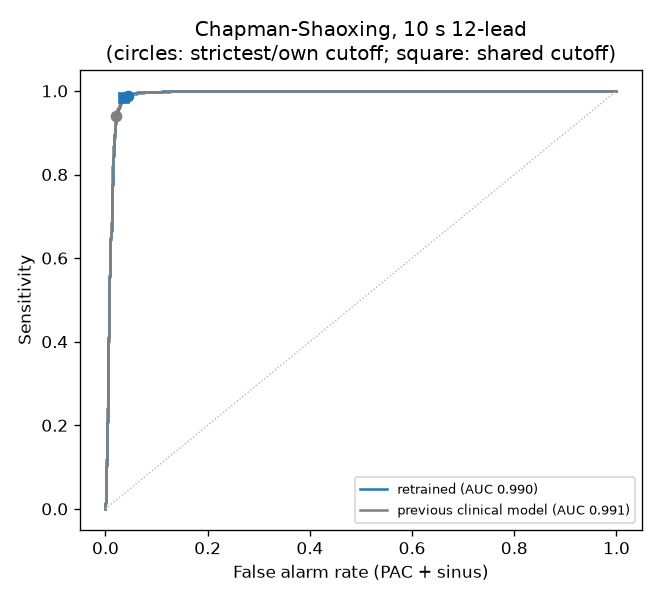

The 95% target is met (20 missed AF, against 105), but it's the same
trade, not a better model: both rank equally well (AUC 0.990 vs 0.991),
the gain comes from a lower cutoff (0.42 vs 0.61), and 24% of PAC
recordings are now called AF. Chapman is also easier than PTB-XL: the
previous model reaches 94.1% here.

### Test 9: Shandong (SPH), telling AF from atrial premature beats

**Development** ([`afib_pac_dev.py`](afib_pac_dev.py)) on CPSC crops,
PTB-XL and Chapman (10,628 units, 3416 AF, 1177 PAC), with the strictest
per-source cutoff throughout:

| Model (CV) | Sens. CPSC / PTB-XL / Chapman | False alarms, PAC | False alarms, sinus | False alarms, other |
|---|---|---|---|---|
| Model tested on Chapman (lead II beats) | 98.5 / 94.8 / 98.9% | 18.6% | 1.7% | 8.5% |
| + RR-pattern features ([`af.rr_pattern_features`](af.py)) | 98.5 / 95.0 / 99.0% | 19.9% | 1.6% | 7.7% |
| Beats from three leads ([`ecg.detect_peaks_multilead`](ecg.py)) | 98.8 / 95.4 / 99.2% | 20.1% | 0.9% | 6.4% |
| **+ 12-lead P waves, f-wave ratio in II and V1 (`CLINICAL_FEATURES_12`)** | 98.2 / 94.9 / 98.5% | **11.6%** | **0.4%** | **4.5%** |

- **RR patterns didn't help.** Features for "regular apart from a few
  early beats, each followed by a pause" separate AF from PAC well alone
  (AUC up to 0.88), but the P-wave feature already carried that.
- **Beat detection was causing false irregularity.** Plots of PAC
  recordings called AF showed lead II detection picking up wiggles when
  the lead was small and jumping between the R and S waves of biphasic
  beats. Detecting beats from the combined slope of leads I, II and V1
  halved false alarms on sinus and other rhythms, but not on PAC.
- **More atrial evidence fixed PAC.** `p_match` over regular beats,
  averaged over all 12 leads ([`af.atrial_features`](af.py)), is a
  steadier sign of a real P wave than lead II alone in 10 s; and
  [`ecg.f_wave_ratio`](ecg.py), the share of beat-free activity at AF's
  4–9 Hz, separates fibrillatory waves from slow baseline and P waves.
  Using the 12 per-lead values separately did only slightly better
  (10.5%) with 9 more features, so the mean was kept.

**The test** ([`afib_sph_test.py`](afib_sph_test.py)): the Shandong
Provincial Hospital database, 12-lead ECGs at 500 Hz labelled per ECG with
AHA statements, first 10 s of each. Every qualifying recording: AF without
flutter (675), atrial premature complexes without AF or flutter (539),
"Normal ECG" as the only statement (13,905). The archive's MD5 matched
figshare's. (Ningbo, the other Challenge 2021 set, was considered first,
but it has 7607 recordings coded atrial flutter and none coded AF in both
of its releases, so its AF labels couldn't be trusted.)

| SPH (15,113 scored: 671 AF, 537 PAC, 13,905 normal; 14,636 patients) | Catches AF (95% CI) | False alarms, PAC (95% CI) | False alarms, normal | ROC AUC |
|---|---|---|---|---|
| **New 12-lead model (registered primary)** | **98.4%** (97.1–99.1%) | **9.5%** (7.3–12.3%) | **0.1%** | **0.996** |
| Model tested on Chapman | 96.9% (95.3–97.9%) | 21.0% (17.8–24.7%) | 1.0% | 0.993 |

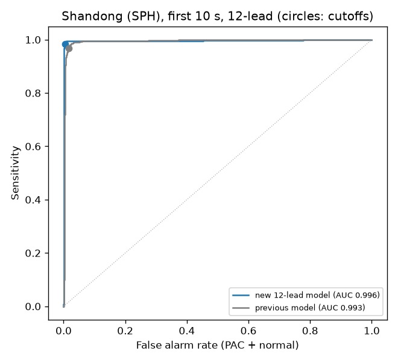

- **PAC false alarms more than halved**, with confidence intervals that
  don't overlap, as development predicted.
- **Sensitivity didn't pay for it:** 11 missed AF against 21, and false
  alarms on normal ECGs fell from 139 to 12 of 13,905.
- **This time the model itself got better** (AUC 0.996 vs 0.993), rather
  than the cutoff moving.

### Calibration: can the probabilities be read as risk?

[`afib_calibration.py`](afib_calibration.py) checks whether predicted
probabilities match how often AF actually occurs, using the saved outputs
of tests 6–9 (an analysis after the fact; nothing was refitted). The
models are trained with balanced class weights, so their raw
probabilities assume AF and non-AF are equally common. They're checked
that way (test data reweighted 50/50), and after the standard shift to
each test's own AF prevalence.

| Test, model | AF prevalence | ECE, 50/50 | Slope, 50/50 | Mean predicted vs observed, at prevalence | ECE, at prevalence | Slope, at prevalence |
|---|---|---|---|---|---|---|
| Georgia, clinical (lead II) | 19.4% | 0.126 | 0.52 | 13.1% vs 19.4% | 0.071 | 0.58 |
| PTB-XL, clinical (lead II) | 34.1% | 0.043 | 1.03 | 29.9% vs 34.1% | 0.045 | 1.00 |
| Chapman, retrained | 46.6% | 0.032 | 1.40 | 46.4% vs 46.6% | 0.032 | 1.38 |
| SPH, retrained | 4.4% | 0.038 | 1.47 | 3.4% vs 4.4% | 0.014 | 1.13 |
| **SPH, 12-lead (final)** | 4.4% | **0.019** | 1.38 | 3.6% vs 4.4% | **0.009** | 1.40 |

ECE is the expected calibration error (10 bins, weighted by recordings;
0 is perfect). The slope comes from regressing the outcome on the
model's log-odds: 1 is ideal, above 1 means the probabilities are too
cautious, below 1 too extreme.

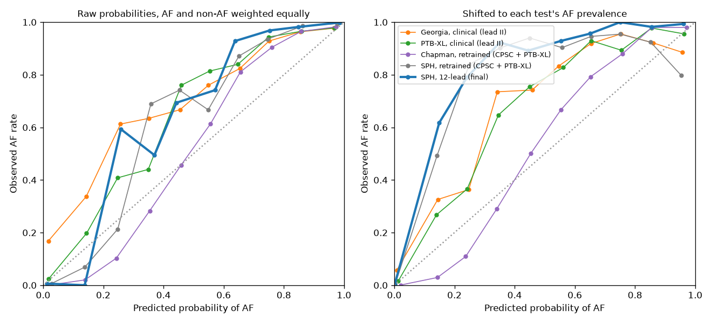

- **Overall error is small but hides the middle.** On SPH the final
  model's ECE is under 0.01 because 14,430 of 15,113 recordings get a
  probability near 0 and almost none of them are AF. The 116 recordings
  it scores between 10% and 50% (after the prevalence shift) are AF 80%
  of the time (93 AF, 19 PAC, 4 normal); at a predicted 15%, the observed
  AF rate is 62%.
- **The newer models are too cautious, not overconfident** (slope about
  1.4): the test recordings separate more cleanly than the harder training
  data (PTB-XL, CPSC's other rhythms) led the model to expect. Georgia is
  the opposite (slope 0.5), as its unreliable AF labels would predict.
- **Calibration depends on the hospital.** The same model is close to
  ideal on PTB-XL and Chapman but not on SPH, and AF prevalence and case
  mix differ between sites. The cutoffs and rankings stand, but the
  probabilities shouldn't be quoted as a patient's chance of AF without
  recalibrating on local data, which would need data from that site.

## 6. Atrial flutter

Every test above left flutter out. In flutter the atria beat in a regular
sawtooth at 250–350 a minute, and the ventricles follow every 2nd, 3rd or
4th wave, or a varying number. With fixed 2:1 block the pulse is regular
at about 150 bpm, like sinus tachycardia or SVT; with variable block it's
irregular, like AF. Clinically, flutter matters for the same main reason
as AF (stroke risk, so anticoagulation), and also for its own treatment.

**Development** ([`afib_flutter_dev.py`](afib_flutter_dev.py)), from
sources already used: the AF development units plus never-loaded flutter
and look-alike recordings from Chapman and PTB-XL (488 flutter, 900 sinus
tachycardia, 617 SVT, 120 atrial tachycardia), 5-fold cross-validation
grouped by recording or patient. [`ecg.flutter_features`](ecg.py) blanks
out the QRS complexes and measures, in leads II, aVF and V1: the
autocorrelation at flutter's cycle (0.15–0.27 s), how concentrated the
3–8 Hz spectrum is around its peak, that peak's frequency, and whether any
flat baseline remains.

| Development (CV) | Flutter caught as AF or flutter | Named flutter | AF named flutter | Sinus tach flagged | SVT flagged |
|---|---|---|---|---|---|
| AF model alone | 51.6% | – | – | 2.9% | 2.9% |
| + logistic flutter model, 80% sensitivity | 90.6% | 80.3% | 23.1% | 20.2% | 58.0% |
| **+ boosted flutter model, look-alike budget** | **83.6%** | 62.9% | 6.8% | 7.4% | 20.3% |

- **The AF model already catches half of flutter**, mostly variable block,
  which is irregular like AF, and misses most regular 2:1 flutter.
- **The flutter features carry the signal**: each alone separates flutter
  from the rest with AUC 0.77–0.81, and they lift a flutter model's AUC
  from 0.82 to 0.915 (boosted trees: 0.930).
- **2:1 flutter and SVT can look the same in 10 s.** Plots of the errors
  showed regular narrow-complex rhythms at 150–170 bpm on both sides,
  with flutter waves hidden in the QRS and T waves. So instead of a
  sensitivity target, the cutoff allows at most 10% of sinus tachycardia
  + SVT to be called flutter, and the flutter model is used *alongside*
  the AF model: "AF or flutter" if either fires, "flutter" if the flutter
  model does. Boosted trees were chosen over logistic regression because
  they can learn that a fast regular rate means flutter only with
  continuous atrial activity.

**Test 10** ([`afib_flutter_test.py`](afib_flutter_test.py)): SPH, first
10 s, chosen from `metadata.csv`: flutter without AF (99), sinus
tachycardia without AF or flutter and not in test 9 (711), junctional
tachycardia (13), all never opened; and test 9's AF recordings (675),
reused to measure how often real AF is named flutter. SPH has no SVT code,
so SVT false alarms can't be tested here.

| SPH | n | Called AF (AF model alone) | Called AF or flutter (95% CI) | Named flutter (95% CI) |
|---|---|---|---|---|
| **Flutter** | 99 | 54.5% | **83.8%** (75.3–89.8%) | **70.7%** (61.1–78.8%) |
| Sinus tachycardia | 711 | 0.6% | 3.7% (2.5–5.3%) | 3.1% |
| Junctional tachycardia | 13 | 7.7% | 7.7% | 0% |
| AF (reused) | 675 | 98.4% | 98.7% | 8.9% (7.0–11.3%) |

- **The flutter model works as developed.** With it, the screen catches
  83.8% of flutter instead of 54.5%, close to development's 83.6%, at the
  cost of flagging 3.7% of sinus tachycardia instead of 0.6%.
- **Naming flutter is less reliable.** 70.7% of flutter is named flutter,
  but so is 8.9% of AF; since AF is far more common than flutter, many
  "flutter" calls in practice would be AF. Both need the same urgent
  follow-up, so the combined "AF or flutter" call is the more useful one.
- **About 1 in 6 flutter recordings is still missed**, and with 99 flutter
  recordings the interval is wide (75–90%). Flutter AUC is 0.913 against
  everything, 0.937 against sinus tachycardia and 0.887 against AF.

## Reporting details (TRIPOD+AI)

This section collects items of the TRIPOD+AI reporting guideline that the
sections above don't cover. Subgroup and demographic numbers come from
[`afib_subgroups.py`](afib_subgroups.py), an analysis after the fact of
the saved test outputs; nothing was refitted.

### Data sources, participants and timing

| Data | Where | When | Labels | Used for |
|---|---|---|---|---|
| MIT-BIH Arrhythmia, AFDB, LTAFDB, SVDB | Holter recordings, Boston (USA) | 1975–1979 (MIT-BIH); others per their publications | beat and rhythm annotations by cardiologists (AFDB beat positions: automated) | beat detection; Holter AF (tests 1–2) |
| Challenge 2017 | AliveCor handheld device, USA | released 2017 | one label per recording by experts | test 3; handheld development |
| CPSC 2018 + extra | 11 hospitals, China | released 2018 | diagnosis codes per recording | tests 4–5; then clinical development |
| Georgia | Emory University, Atlanta (USA) | released 2020 | diagnosis codes per patient's ECG | test 6 |
| PTB-XL | Physikalisch-Technische Bundesanstalt, Germany | 1984–2001 (recording dates in the database) | cardiologist reports, validated by a second cardiologist | test 7; then clinical development |
| Chapman-Shaoxing | Shaoxing People's Hospital, Zhejiang (China) | not given in the release | rhythm per ECG by physicians | test 8; then clinical and flutter development |
| SPH | Shandong Provincial Hospital, Jinan (China) | August 2019 – August 2020 | AHA statements standardized from physicians' reports | tests 9–10 |

**Eligibility.** Recordings were chosen from labels or headers alone,
before any signal was looked at, by the rules in each test's section:
AF without atrial flutter; PAC without AF or flutter; and a normal or
sinus-rhythm group with no AF, flutter, ectopy or pacing. All recordings
in each test that met the rules were used, except PTB-XL's sinus group
(1500 drawn at random, seed 0). The clinical tests use the first 10 s
of each recording.

**Flow of recordings in each test.**

| Test | Selected | Excluded before scoring | Too few beats (unscored) | Scored |
|---|---|---|---|---|
| 1 LTAFDB | 84 patients, first 2 h | – | windows with < 20 RR intervals | 9895 windows |
| 2 SVDB | 78 patients | – | as test 1 | 2340 windows |
| 3 Challenge 2017 | 8528 | 279 labelled noisy | 346 | 7903 |
| 4 CPSC 2018 | 931 | – | 154 (mostly slow normal rhythms) | 777 |
| 5 CPSC 2018 extra | 1236 | – | 319 | 917 |
| 6 Georgia | 2942 | – | 4 | 2938 |
| 7 PTB-XL | 2875 | – | 8 (6 AF, 2 PAC) | 2867 |
| 8 Chapman-Shaoxing | 3815 | – | 2 (AF) | 3813 |
| 9 SPH | 15,119 | – | 6 (4 AF, 2 PAC) | 15,113 |
| 10 SPH | 1498 | – | 0 | 1498 |

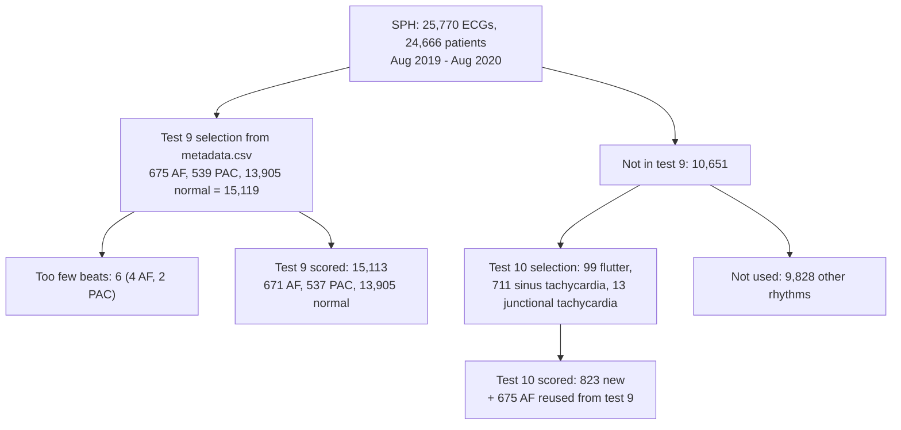

### Recordings that can't be scored

A recording is left unscored, with no AF call, if too few beats are
detected: fewer than 20 usable RR intervals in a Holter window or short
handheld/lead-I recording, fewer than 6 in a 10 s clinical ECG. The
tests treat these as missing and leave them out of every rate, and their
counts are reported above. For test 9, counting the unscored as wrong
(4 missed AF, 2 PAC false alarms) gives sensitivity 97.8% instead of
98.4%, and PAC false alarms 9.8% instead of 9.5%. In use, an unscored
recording should be read by a person.

### Sample size

No sample size was calculated before the tests; every qualifying recording
was used. The confidence intervals show the precision achieved. Test 9's
sensitivity (671 AF) is known to within about ±1 percentage point (95% CI
97.1–99.1%), and its PAC false alarm rate (537 PAC) to within about ±2.5
points (7.3–12.3%), enough to separate it clearly from the previous
model's 21.0% (17.8–24.7%). The flutter test (99 flutter recordings) is
much less precise (75–90%), and the subgroup estimates below (as few as
12–56 recordings in some cells) are only rough.

### Development and test populations

| Data | Recordings | Age, median (IQR) | Female |
|---|---|---|---|
| CPSC 2018 + extra (development) | 2167 | 63 (48–74) | 53% |
| PTB-XL (development) | 3249 | 70 (56–79)* | 54% |
| Chapman-Shaoxing (development) | 5568 | 66 (52–77) | 48% |
| SPH test 9 | 15,113 | 48 (37–59) | 45% |
| SPH test 10 (new recordings) | 823 | 49 (33–64) | 52% |

\* 102 PTB-XL ages are missing or recorded only as "over 89".

How SPH differs from the development data:

- **Place and time.** One tertiary hospital in northern China (Jinan),
  2019–2020; development came from several hospitals in China (CPSC,
  Shaoxing) and one German institute (PTB-XL, 1984–2001).
- **Labels.** SPH's AHA statements come from physicians' reports for each
  ECG; development labels were diagnosis codes (CPSC), cardiologist-
  validated reports (PTB-XL) and physicians' rhythm labels (Chapman).
- **Case mix.** AF is 4.4% of test 9 against 32% of the development units,
  and SPH's comparison group is mostly normal ECGs from younger patients
  (median age 46, against 67 for its AF patients).
- **Recordings.** All at 500 Hz, but from different machines; SPH records
  run 10–56 s and only the first 10 s were used.

### Subgroups

| SPH subgroup | AF caught (test 9) | PAC called AF | Normal called AF | AUC | Flutter caught as AF or flutter (test 10) | Sinus tachycardia flagged |
|---|---|---|---|---|---|---|
| All | 98.4% (97–99%), n=671 | 9.5% (7–12%), n=537 | 0.1%, n=13,905 | 0.996 | 83.8% (75–90%), n=99 | 3.7% (3–5%), n=711 |
| Female | 97.6% (95–99%), n=251 | 11.6% (8–17%), n=216 | 0.1%, n=6284 | 0.998 | 81.2% (65–91%), n=32 | 3.3% (2–6%), n=389 |
| Male | 98.8% (97–99%), n=420 | 8.1% (6–12%), n=321 | 0.1%, n=7621 | 0.995 | 85.1% (75–92%), n=67 | 4.0% (2–7%), n=322 |
| Age 18–49 | 100% (94–100%), n=56 | 10.6% (6–18%), n=94 | 0.1%, n=8091 | 1.000 | 91.7% (65–99%), n=12 | 3.2% (2–5%), n=403 |
| Age 50–64 | 98.7% (96–100%), n=228 | 9.9% (6–16%), n=131 | 0.0%, n=4115 | 0.998 | 86.1% (71–94%), n=36 | 3.0% (1–7%), n=166 |
| Age 65–79 | 97.6% (95–99%), n=289 | 7.1% (4–11%), n=212 | 0.2%, n=1478 | 0.993 | 83.9% (67–93%), n=31 | 3.9% (2–9%), n=128 |
| Age 80+ | 99.0% (94–100%), n=98 | 13.0% (8–21%), n=100 | 0.5% (0–3%), n=221 | 0.992 | 75.0% (53–89%), n=20 | 21.4% (8–48%), n=14 |

- **AF detection holds across sex and age**: sensitivity is 97.6–100% in
  every group, with overlapping intervals.
- **Possible gaps, too small to confirm:** PAC false alarms are a little
  higher in women (11.6% vs 8.1%) and in patients over 80 (13.0%); in
  patients over 80, flutter detection is lower (75%) and 3 of 14 sinus
  tachycardia recordings were flagged. None of these differences is
  outside its interval.
- **Who is underrepresented.** The final model was tested only on adults
  (18–95) at one hospital in China. Its development data adds other
  Chinese hospitals and one German institute; earlier model versions were
  also tested on US (Georgia) and German (PTB-XL) data, but the final
  model wasn't. No dataset records ethnicity, so performance in African,
  South Asian, Hispanic, Indigenous and other populations is unknown, as
  it is in children, in primary care, ambulance or wearable settings, on
  other ECG machines, and in low-resource settings.

### Final model specification

**AF model** ([`af.CLINICAL_FEATURES_12`](af.py), trained on 10,628
development units, 3416 AF, from CPSC crops, PTB-XL and Chapman).
Beats are found by [`ecg.detect_peaks_multilead`](ecg.py) on leads I, II
and V1; features are computed by [`af.clinical_features`](af.py) with all
12 leads. Logistic regression on standardized inputs, with balanced class
weights:

| Feature | Model input | Training mean | Training SD | Coefficient per SD | Coefficient on the input |
|---|---|---|---|---|---|
| CV | log(CV) | −3.1059 | 1.2442 | +1.7513 | +1.4076 |
| nRMSSD | log(nRMSSD) | −2.8872 | 1.3514 | −0.4355 | −0.3223 |
| `entropy_norm` | as is | 0.9614 | 0.1312 | +0.3703 | +2.8230 |
| TPR | as is | 0.5512 | 0.1872 | −0.0091 | −0.0486 |
| pNN50 | as is | 0.3192 | 0.3554 | +0.3908 | +1.0998 |
| `p_match_regular` (lead II) | as is | 0.8076 | 0.2892 | −0.5845 | −2.0214 |
| `log_f_wave` (V1) | as is | −4.0769 | 0.9584 | +0.5723 | +0.5971 |
| `p_match_mean` (12 leads) | as is | 0.7995 | 0.2422 | −1.8558 | −7.6636 |
| `f_ratio_II` | as is | 0.2247 | 0.1139 | +0.2036 | +1.7882 |
| `f_ratio_V1` | as is | 0.2305 | 0.1377 | +0.7513 | +5.4548 |
| Intercept | | | | −1.5316 | +7.4059 |

Probability of AF = 1 / (1 + e^−z), with z = intercept + Σ coefficient ×
input (last column). **AF is called when the probability is at least
0.4736**, the strictest of the per-source 95%-sensitivity cutoffs (CPSC
0.777, PTB-XL 0.474, Chapman 0.771). Missing `log_f_wave`, `f_ratio_II`
or `f_ratio_V1` (fewer than 3 complete beats) are filled with the
development medians −4.2321, 0.2049 and 0.1983. The table is also saved
as [`results/final_af_model.csv`](results/final_af_model.csv). As the
calibration section shows, the probabilities are not calibrated risks.

**Flutter model** ([`afib_flutter_dev.fit_flutter`](afib_flutter_dev.py)):
gradient-boosted trees (scikit-learn `HistGradientBoostingClassifier`,
depth 4, learning rate 0.05, 400 iterations, balanced class weights,
`random_state=0`) on the 21 `FLUTTER_FEATURES`, trained on 12,753
development units (488 flutter). **Flutter is named when its probability
is at least 0.7199**, the level that calls 10% of development sinus
tachycardia + SVT flutter. Trees can't be written as a table; the model
is fully determined by the code, the training recordings and the
library version (scikit-learn 1.9.1).

### Usability

- **Input:** a 10 s, 12-lead ECG with leads in the standard order (I, II,
  III, aVR, aVL, aVF, V1–V6). All 12 leads are needed: the loaders reject
  recordings without them, and the P-wave and flutter features use leads
  across the ECG. Only 500 Hz recordings were tested.
- **Output:** "AF", "flutter" (which also counts as "AF or flutter"),
  "neither", or "unscored". The probabilities shouldn't be read as risks.
- **Poor-quality input:** there is no separate noise check. Recordings
  with too few detected beats are left unscored. Noise that adds false
  beats, a flat or disconnected lead, or a lead swap isn't detected and
  can produce a wrong call; these cases weren't tested. Development
  showed that a small or biphasic lead II used to cause false
  irregularity, which the three-lead beat detector reduced.

### Open science and ethics

- **Use of AI tools:** Code and documentation were written with assistance
  from Claude Code (Anthropic). I designed the testing protocol, chose the
  datasets and evaluation criteria, and reviewed and interpreted all
  results.
- **Funding:** none.
- **Competing interests:** none.
- **Protocol:** for each fresh-data test, the test script, which fixes
  the recordings, models, cutoffs and primary results, was committed
  before the test data were opened, and the test was run once. Commits
  (author time, US Central): test 2 `efc7dfa` 2026-10-11 01:12; test 3
  `d52e2f5` 01:45; test 4 `5f92136` 02:25; test 5 `23da508` 11:55;
  test 6 `e1b24b9` 14:59; test 7 `dba1e05` 15:18; test 8 `fa9efa8` 19:42;
  test 9 `759d00c` 22:26; test 10 `85c65d2` 2026-10-12 00:12. Each is
  followed by its results commit. For tests 8–10 the registration commit
  was also pushed to GitHub before the data were opened; for tests 2–7 it
  was pushed together with the results, so only the commit time records
  the order. Test 1 (LTAFDB) has no separate registration commit.
- **Registration:** the study was not formally registered (for example
  on OSF or a trial registry); the commits above are the only protocol
  record.
- **Patient and public involvement:** none. No patients or members of the
  public were involved in the design, conduct or reporting of this work.
- **Ethics:** this study used only de-identified, publicly available ECG
  databases (PhysioNet and figshare), used under their licences; no new
  data were collected and no individual could be identified. Ethics
  approvals for the original data collection are described in each
  source's publication.

## Running it

```bash
pip install -r requirements.txt
python qrs_benchmark.py       # beat detection; ~5 min, MIT-BIH streamed from PhysioNet
python afib.py                # Holter development; first run downloads 2 h of each AFDB record (slow)
python afib_test.py           # Holter tests: AFDB later hours + LTAFDB (~2-3 h of downloads the first time)
python ltaf_errors.py         # breakdown of the new-patient false alarms
python afib_svdb_test.py      # test 2; first run downloads ~55 MB
python afib_cinc_test.py      # test 3
python afib_cpsc_test.py      # test 4
python afib_handheld_cv.py    # handheld-only model, 5-fold CV on Challenge 2017
python afib_cpscx_test.py     # test 5
python afib_clinical_dev.py   # clinical model development (CPSC crops)
python afib_georgia_test.py   # test 6
python afib_ptbxl_test.py     # test 7
python afib_pwave_dev.py      # P-wave measure and cutoff development (CPSC + PTB-XL)
python afib_chapman_test.py   # test 8
python afib_pac_dev.py        # AF-vs-PAC development (CPSC + PTB-XL + Chapman, 12 leads)
python afib_sph_test.py       # test 9
python afib_calibration.py    # calibration of the saved test 6-9 outputs
python afib_flutter_dev.py    # flutter development (needs SELECTED_FLUTTER_DEV for Chapman and PTB-XL)
python afib_flutter_test.py   # test 10
python afib_subgroups.py      # demographics and subgroup results of tests 9-10
```

Results are written to [`results/`](results/) (the `*_recordings.csv`
files list every recording scored) and plots to [`figures/`](figures/).
MIT-BIH, AFDB, LTAFDB and SVDB are fetched automatically and cached in
`data/`. The others need downloading first; "chosen as above" means by
the definitions in that test's section, from headers or label tables
only, written to a `SELECTED` file of one `record label` pair per line.

| Data | Download | Into | Notes |
|---|---|---|---|
| Challenge 2017 | [`training2017.zip`](https://physionet.org/files/challenge-2017/1.0.0/training2017.zip) (99 MB), [`REFERENCE-v3.csv`](https://physionet.org/files/challenge-2017/1.0.0/REFERENCE-v3.csv) | `data/cinc2017/` | unzip there |
| CPSC 2018 | [`training/cpsc_2018/g1`–`g7`](https://physionet.org/content/challenge-2020/1.0.2/training/cpsc_2018/) `.hea`, then the chosen `.mat` (~280 MB) | `data/cpsc2018/` | `SELECTED`: record names only (labels come from the headers) |
| CPSC 2018 extra | [`training/cpsc_2018_extra/g1`–`g4`](https://physionet.org/content/challenge-2020/1.0.2/training/cpsc_2018_extra/) (1236 recordings, ~370 MB) | `data/cpsc2018_extra/` | `SELECTED`: record names only |
| Georgia | [`training/georgia/g1`–`g11`](https://physionet.org/content/challenge-2020/1.0.2/training/georgia/) (2942, ~350 MB) | `data/georgia/` | |
| PTB-XL | [`ptbxl_database.csv`](https://physionet.org/files/ptb-xl/1.0.3/ptbxl_database.csv), then the chosen `records500/` `.hea` and `.dat` (2875, ~350 MB) | `data/ptbxl/` | records named `records500/xxxxx/yyyyy_hr`; flutter development recordings in `SELECTED_FLUTTER_DEV` (374 more) |
| Chapman-Shaoxing | Challenge 2021 [`training/chapman_shaoxing/g1`–`g11`](https://physionet.org/content/challenge-2021/1.0.3/training/chapman_shaoxing/) `.hea`, then the chosen `.mat` (3815, ~460 MB) | `data/chapman/` | named `gN/JSxxxxx`; each folder's `RECORDS` also lists the first recording of the next folder, which lives there; flutter development recordings in `SELECTED_FLUTTER_DEV` (1753 more) |
| SPH | `metadata.csv` and `records.tar.gz` (2.3 GB, a plain tar despite the name) from [figshare](https://doi.org/10.6084/m9.figshare.c.5779802) | `data/sph/` | `tar -xf records.tar.gz`; the test chooses from `metadata.csv` itself; needs `h5py` |

### Tests

```bash
pip install pytest
pytest
```

The 35 tests in [`tests/`](tests/) use synthetic ECG and RR series, so
they run offline in about a second. They check the detectors (upside-down
beats, T waves, one tall spike, a small biphasic lead), scoring, each
feature on series where the answer is known (e.g. TPR = 1 for alternating
intervals, ≈ 2/3 for random ones), the ectopic and atrial-ectopic flags,
the P-wave, f-wave and flutter-wave measures (a 300/min sawtooth against
sinus rhythm), the override, and per-source cutoffs.
GitHub Actions runs them on Python 3.11 and 3.12 on every push.

## Limitations

- Beat detection is scored on the first 5 minutes of each MIT-BIH record.
  One very tall beat or artefact still hides the beats within about 1 s
  of it from the adaptive detector.
- The Holter model is trained on 23 patients and uses one lead; on 84 new
  patients specificity falls to 82–84%, mostly from atrial ectopy, noisy
  recordings and one probable labelling gap.
- The ectopic-beat filter catches ventricular ectopics but almost no
  atrial ones, and its thresholds were chosen on the same MIT-BIH data
  used to measure it.
- On handheld recordings the only evidence for the handheld model is
  cross-validation (92.7%); there's no unused handheld AF data left.
- The 12-lead clinical model was tested at one hospital (SPH). PTB-XL was
  the hardest source in development (94.9% sensitivity), so it may do
  worse elsewhere. It needs all 12 leads, and about 1 in 10 PAC
  recordings is still called AF.
- Flutter: about 1 in 6 flutter recordings is still missed, regular 2:1
  flutter and SVT can't be reliably told apart in 10 s (20% of SVT was
  flagged in development, and the test had no SVT to check this), and
  the flutter test had only 99 flutter recordings from one hospital.
- The models' probabilities are not calibrated risks: on SPH they're too
  cautious in the middle range (a predicted 15% is AF 62% of the time),
  and calibration varies by hospital.
- Recordings with too few beats can't be scored (fewer than 20 usable RR
  intervals in a 60 s window or a short recording, 6 in a 10 s clinical
  ECG).
- This is a learning project, not a medical device.

## Data

- Moody GB, Mark RG. *The impact of the MIT-BIH Arrhythmia Database.*
  IEEE Eng Med Biol 20(3):45-50 (2001).
- Moody GB, Mark RG. *A new method for detecting atrial fibrillation
  using R-R intervals.* Computers in Cardiology 10:227-230 (1983).
- Goldberger AL et al. *PhysioBank, PhysioToolkit, and PhysioNet.*
  Circulation 101(23):e215-e220 (2000).
- Pan J, Tompkins WJ. *A real-time QRS detection algorithm.*
  IEEE Trans Biomed Eng 32(3):230-236 (1985).
- Petrutiu S, Sahakian AV, Swiryn S. *Abrupt changes in fibrillatory
  wave characteristics at the termination of paroxysmal atrial
  fibrillation in humans.* Europace 9(7):466-470 (2007). (Long-Term AF
  Database)
- Greenwald SD, Patil RS, Mark RG. *Improved detection and
  classification of arrhythmias in noise-corrupted electrocardiograms
  using contextual information.* Computers in Cardiology 461-464 (1990).
  (Supraventricular Arrhythmia Database)
- Clifford GD, Liu C, Moody B, et al. *AF classification from a short
  single lead ECG recording: the PhysioNet/Computing in Cardiology
  Challenge 2017.* Computing in Cardiology 44 (2017).
- Liu F, Liu C, Zhao L, et al. *An open access database for evaluating
  the algorithms of electrocardiogram rhythm and morphology abnormality
  detection.* J Med Imaging Health Inform 8(7):1368-1373 (2018). (CPSC
  2018)
- Perez Alday EA, Gu A, Shah AJ, et al. *Classification of 12-lead ECGs:
  the PhysioNet/Computing in Cardiology Challenge 2020.* Physiol Meas
  41(12):124003 (2020).
- Wagner P, Strodthoff N, Bousseljot RD, et al. *PTB-XL, a large
  publicly available electrocardiography dataset.* Sci Data 7:154 (2020).
- Zheng J, Zhang J, Danioko S, et al. *A 12-lead electrocardiogram
  database for arrhythmia research covering more than 10,000 patients.*
  Sci Data 7:48 (2020). (Chapman-Shaoxing)
- Reyna MA, Sadr N, Perez Alday EA, et al. *Will two do? Varying
  dimensions in electrocardiography: the PhysioNet/Computing in
  Cardiology Challenge 2021.* Computing in Cardiology 48 (2021).
- Liu H, Chen D, Chen D, et al. *A large-scale multi-label 12-lead
  electrocardiogram database with standardized diagnostic statements.*
  Sci Data 9:272 (2022). (Shandong Provincial Hospital, SPH)
- Dash S, Chon KH, Lu S, Raeder EA. *Automatic real time detection of
  atrial fibrillation.* Ann Biomed Eng 37(9):1701-1709 (2009).
