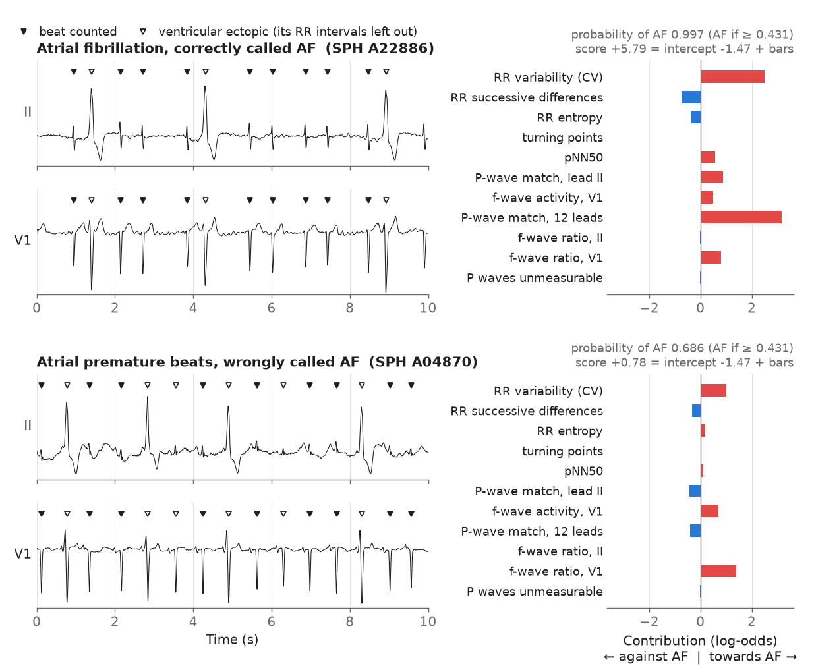
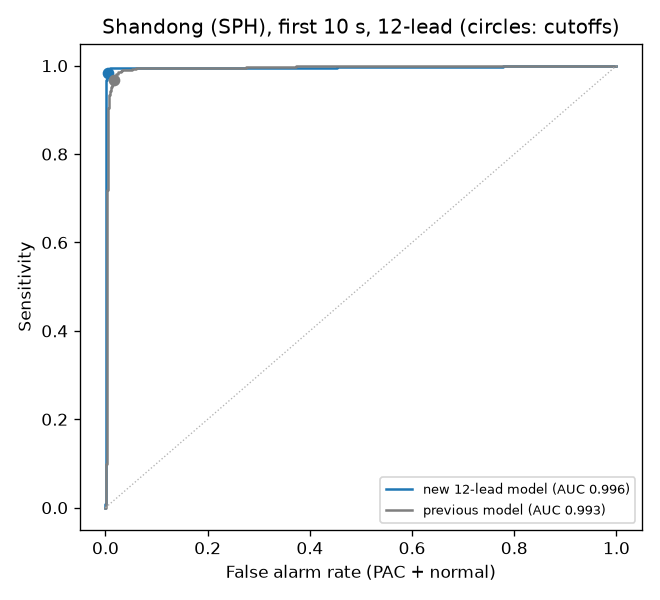
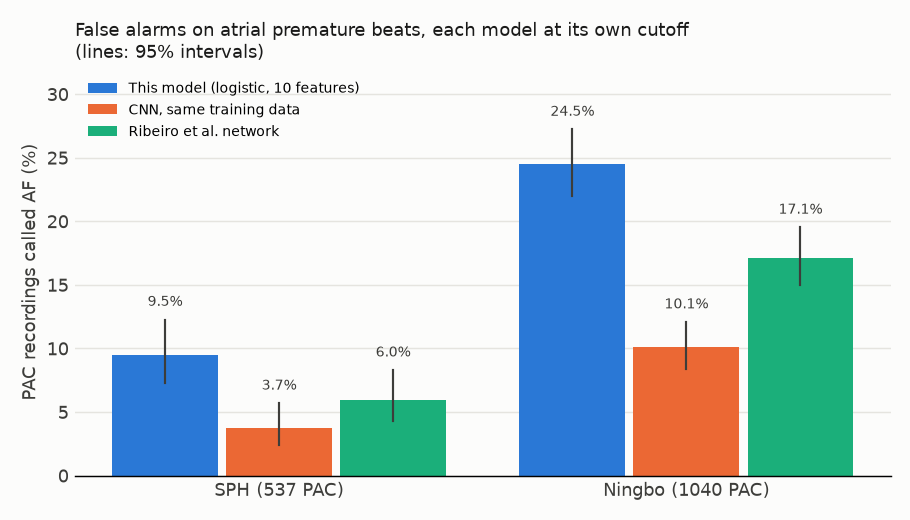

# An interpretable AF detector for 12-lead ECGs, compared head-to-head with deep learning and doctors

[](https://github.com/ryanqi588-code/ecg-arrhythmia-detection/actions/workflows/tests.yml)
[](https://doi.org/10.5281/zenodo.24238489)

**Question.** Atrial fibrillation (AF) is the most common serious heart
rhythm problem, and deep neural networks now detect it on ECGs about as
well as cardiologists. But a network can't say *why* it called AF. How
close can a model whose every input has a clinical name get, and where
does it fall short?

**Approach.** A logistic regression on 11 named features of a 10 s
12-lead ECG: how irregular the heartbeat is, whether a consistent P wave
comes before each beat, and how much fibrillatory activity is left
between beats. Every test was fixed in a commit before its data were
opened, and run once.

**Results.**

| Test | Data (never used in development) | Result |
|---|---|---|
| 9: AF detection¹ | 15,113 ECGs, Shandong Provincial Hospital (China) | sensitivity **98.4%** (95% CI 97.1–99.1%); false alarms **9.5%** on atrial premature beats, **0.1%** on normal ECGs; AUC 0.996 |
| 11: against deep learning¹ | the same ECGs, plus Ningbo (China) and CODE-15% (Brazil) | **worse at telling AF from atrial premature beats**: AF-vs-PAC AUC 0.988 against 0.996 for both a published deep network and a CNN trained on the same data, so **about three times as many AF–PAC pairs ranked the wrong way round** (1.2% vs 0.4%; calculated after the test), and 1.4–2.6 times as many false alarms on atrial premature beats. Registered primary: overall AUC within the pre-set 0.01 of both networks (0.996 vs 0.998 and 1.000) |
| 11: against doctors¹ | 793 Brazilian ECGs read by cardiologists, residents and students | caught as much AF as the best readers (12 of 13), at lower specificity (96.4% vs 98.8–100%) |
| 12: fixing a failure test 11 exposed² | 18,875 ECGs, CODE-15% part 1 (Brazil) | false alarms 3.8% → **3.3%**, sensitivity unchanged (91.7%), AUC 0.960 → 0.971; adopted |
| 17: follow-up to 12² | 18,883 ECGs, CODE-15% part 3 (Brazil) | when P waves can't be measured, "needs review" instead of a call: 215 false AF calls became "needs review", at the cost of 65 new flags and 16 AF calls; recordings needing a human look 1040 → 1105; adopted as an honest "can't tell" |
| 18: test 11's AF-vs-PAC finding, registered | 2950 new US patients, MIMIC-IV-ECG (979 AF, 1971 PAC; machine labels) | **confirmed: worse than both networks at telling AF from PACs**, AUC 0.907 against 0.934 (CNN) and 0.935 (Ribeiro), differences −0.027 (95% CI −0.038 to −0.016) and −0.028 (−0.039 to −0.017); 1.4 times the ranking errors here, against about 3 times at SPH (after the test); PAC false alarms 14.7% against 8.9% and 11.5% |

¹ The model version before the fix (commit `d8c5ce2`, cutoff 0.4736).

² Test 12 compares that version with the adopted model, which adds the fix for unmeasurable P waves (cutoff 0.4309; [specification](#final-model-specification)). Test 17 adds the "needs review" output to the adopted model.

**Conclusion.** The interpretable model's real cost is atrial premature
beats (PACs): it ranks AF against PACs worse than either network and
makes more PAC false alarms. First seen after test 11 (about three times
the ranking errors at SPH), this was then registered and confirmed on
2950 new patients at a US hospital (test 18), where the gap was smaller
(1.4 times the ranking errors). Its overall
AUC is close to theirs only because normal ECGs, which every model gets
right, make up most of the data. The gap is clearest on recordings with
atrial premature complexes alone (8.1% called AF against 2.6% and 1.3%).
Mixed atrial and ventricular ectopy is the worst case for every model,
and this model's worst of all: it called 14 of 26 such recordings AF,
against 5 for each network (a split after the test). Each of its errors
can be traced to a named feature.

This paper reports tests 9, 11 and 12, test 17 (a follow-up to 12) and test 18 (test 11's AF-vs-PAC finding, registered). The project ran eighteen tests in
all, several of which failed; the beat detector, the earlier Holter,
handheld and clinical models, atrial flutter, and a hybrid with a CNN
are in the [supplement](SUPPLEMENT.md), with the
[full test log](SUPPLEMENT.md#s1-full-test-log).

## 1. Methods

### How the tests were run

- **Development and test data are kept apart.** Every design decision is
  made on data that has already been used (by cross-validation grouped by
  record or patient). Each test uses data that was never used before.
- **Each test is registered and run once.** The test script, including
  how recordings are chosen (from labels or headers only), the models and
  their cutoffs, is committed before the test data is downloaded or
  opened, then run once. Its results are reported whatever they are.
  Analyses after a run only describe the errors; nothing is changed in
  response. A new idea needs new data.
- **Cutoffs aim at 95% sensitivity.** A missed AF episode matters more than
  a false alarm, which a clinician can dismiss by looking at the strip.
  Every model, including the neural networks, gets its cutoff by the same
  rule: the strictest of the per-source 95%-sensitivity cutoffs on
  out-of-fold development probabilities, with records weighted equally
  ([`af.fit_with_cutoff`](af.py); why is explained in the
  [supplement](SUPPLEMENT.md#how-the-holter-model-got-here)).
- **Confidence intervals** are 95% Wilson intervals for rates and paired
  bootstrap intervals, resampling patients, for differences between models.

### Development data

10,628 ten-second units (3416 AF, 1177 PAC) from three sources, all used
up as test sets of earlier model versions (tests 4–8, in the
[supplement](SUPPLEMENT.md#s5-the-road-to-the-12-lead-model-tests-68-test-9-development)):
CPSC 2018 (China, cut into 10 s crops), PTB-XL (Germany) and
Chapman-Shaoxing (China).

### The model

Beats are found on the combined slope of leads I, II and V1
([`ecg.detect_peaks_multilead`](ecg.py)), which avoids false
irregularity when lead II is small or biphasic. The features
([`af.clinical_features`](af.py)) are what a cardiologist looks for:

| Feature | What it measures | Points towards AF when |
|---|---|---|
| CV | spread of the times between beats (RR intervals), relative to their mean | high |
| nRMSSD | size of the changes from one RR interval to the next | (shares "variability" with CV) |
| `entropy_norm` | how disordered the RR intervals are, scaled for the recording's length | high |
| TPR | how often the RR series turns from rising to falling | (small weight) |
| pNN50 | share of successive RR changes over 50 ms | high |
| `p_match_regular` | lead II: share of regular beats whose pre-QRS stretch matches the typical P wave | low |
| `p_match_mean` | the same, averaged over all 12 leads | low (the strongest feature) |
| `log_f_wave` | lead V1: 4–9 Hz activity left after subtracting the typical beat | high |
| `f_ratio_II`, `f_ratio_V1` | share of beat-free activity at AF's 4–9 Hz, which tells fibrillatory waves from slow baseline and P waves | high |
| `p_unmeasured` | fewer than 3 regular beats, so P waves can't be measured (added after test 12) | slightly |

In development, adding the 12-lead P-wave and f-wave features cut PAC
false alarms from 20.1% to 11.6%, with every source kept at about 95%
sensitivity by the same cutoff rule. How this model was
arrived at, including the versions that failed, is in the
[supplement](SUPPLEMENT.md#s5-the-road-to-the-12-lead-model-tests-68-test-9-development).
Its full specification is [below](#final-model-specification).



*Each call can be read off its features. Two SPH recordings scored by
the adopted model ([`predict.py`](predict.py)); leads II and V1 shown,
all 12 used. Markers show the beats the model found (on leads I, II and
V1); open markers are beats flagged as ventricular ectopic, whose RR
intervals are left out of the rhythm features. Each bar is a feature's
contribution to the log-odds of AF (its
coefficient times its standardized value); the bars plus the intercept
give the score. Red pushes towards AF, blue away. **Top:** AF, correctly
called (probability 0.997), mainly because P waves don't match across
the 12 leads and the RR intervals vary. **Bottom:** atrial premature
beats wrongly called AF (0.686). The P-wave match correctly pushes
against AF, but V1's fibrillatory-wave measures (the low-amplitude
activity between beats in V1) and the RR variability of the counted
beats outweigh it. The beats are small in lead II but clear in V1; the
smaller wiggles between them were not counted. This recording is
labelled occasional atrial premature complexes *and* frequent
ventricular premature complexes: the four large complexes about every
2 s are ventricular ectopics, and the detector flags them as such (6 of
its 15 beats are flagged, including two narrow ones). The PAC group
allows other findings, including ventricular ectopy (test 9 methods).
The examples were chosen by a rule,
not by eye: the median-probability recording among SPH AF called AF
(667 of 675) and among SPH PAC called AF (50 of 539)
([`afib_example_figure.py`](afib_example_figure.py)).*

## 2. Test 9: AF detection on 15,113 hospital ECGs

**The test** ([`afib_sph_test.py`](afib_sph_test.py)): the Shandong
Provincial Hospital database, 12-lead ECGs at 500 Hz labelled per ECG with
AHA statements, first 10 s of each. Every qualifying recording: AF without
flutter (675), atrial premature complexes without AF or flutter (539),
"Normal ECG" as the only statement (13,905). In the AF and PAC groups
other findings, including ventricular ectopy, are allowed: 235 of the
PAC recordings have no other statement, and 28 also have ventricular
premature complexes (AF: 252 with no other statement, 54 with
ventricular premature complexes). The archive's MD5 matched
figshare's. (Ningbo, the other Challenge 2021 set, was considered first,
but it has 7607 recordings coded atrial flutter and none coded AF in both
of its releases, so its AF labels couldn't be trusted.)

| SPH (15,113 scored: 671 AF, 537 PAC, 13,905 normal; 14,636 patients) | Catches AF (95% CI) | False alarms, PAC (95% CI) | False alarms, normal | ROC AUC |
|---|---|---|---|---|
| **12-lead model (registered primary)** | **98.4%** (97.1–99.1%) | **9.5%** (7.3–12.3%) | **0.1%** | **0.996** |
| Previous version (beats and P waves from lead II only; test 8) | 96.9% (95.3–97.9%) | 21.0% (17.8–24.7%) | 1.0% | 0.993 |



- **PAC false alarms more than halved**, with confidence intervals that
  don't overlap, as development predicted.
- **Mixed ectopy causes a large share of them** (split after the test;
  it describes the same results, not a new test). Recordings with
  atrial premature complexes only were called AF 8.1% of the time (19 of
  235), and those with other findings but no ventricular ectopy 6.5% (18
  of 276). But when ventricular premature complexes were also present the
  rate was 53.8% (14 of 26 scored, 95% CI 35.5–71.2%). Those 26 recordings
  are 5% of the PAC group but gave 14 of its 51 false alarms.
- **Sensitivity didn't pay for it:** 11 missed AF against 21, and false
  alarms on normal ECGs fell from 139 to 12 of 13,905.
- **The model itself got better** (AUC 0.996 vs 0.993), rather than the
  cutoff moving.

## 3. Test 11: against deep learning and doctors

Every earlier comparison was against this project's own earlier versions.
Test 11 compares the 12-lead model with:

- **Ribeiro et al.'s deep neural network** (Nature Communications 2020),
  published with its weights and trained on 2.3 million Brazilian
  12-lead ECGs ([`afib_compare_dnn.py`](afib_compare_dnn.py)).
- **A 1D residual CNN trained on exactly this model's development data**
  ([`afib_cnn.py`](afib_cnn.py)), with the same class weighting and
  cutoff rule. Its architecture and training settings were fixed before
  it was trained and not tuned; the trained network is in
  [`models/`](models/). This is the fairest test of what a black box
  gains, since only the model differs.
- **Doctors**: on the CODE test set (827 Brazilian ECGs; gold standard
  from two cardiologists, a third deciding disagreements), the AF calls
  of the two cardiologists, two 4th-year cardiology residents, two
  3rd-year emergency residents and two 5th-year medical students,
  released with that dataset.

Every model got its cutoff from the same development data by the same
rule, and all were scored on the same recordings: those this model could
score. The plan ([`afib_comparison_test.py`](afib_comparison_test.py))
was committed and pushed before any test set was opened, with the primary
question fixed: is this model within 0.01 ROC AUC of each black box on
SPH (lower bound of the paired bootstrap 95% interval of the difference
above −0.01)? The test sets:

| Set | Recordings scored | Fresh for |
|---|---|---|
| SPH (test 9's recordings) | 15,113: 671 AF, 537 PAC, 13,905 normal | both networks (this model's numbers there are test 9's) |
| Ningbo (Challenge 2021) | 2540: 1040 PAC, 1500 sinus (1 unscorable) | all three; false alarms only, since Ningbo's AF codes can't be trusted |
| CODE-15%, part 0 (Brazil, mostly primary care, 2010–2016) | 18,851: 424 AF (1149 unscorable by this model) | this model and the CNN; Ribeiro's network was trained on CODE, so it's left out |
| CODE test set | 793: 13 AF (34 unscorable) | this model and the CNN; it's Ribeiro's own test set |

**Results at each model's cutoff** (95% intervals):

| | This model | Same-data CNN | Ribeiro's network |
|---|---|---|---|
| SPH AF-vs-PAC AUC (after the test) | **0.988** | 0.996 | 0.996 |
| SPH AF–PAC pairs ranked wrong (after the test) | **1.24%** | 0.45% | 0.40% |
| SPH ROC AUC (registered primary) | 0.996 | 1.000 | 0.998 |
| SPH AF caught | 98.4% (97.1–99.1) | 99.7% (98.9–99.9) | 99.0% (97.9–99.5) |
| SPH PAC called AF | 9.5% (7.3–12.3) | **3.7%** (2.4–5.7) | 6.0% (4.3–8.3) |
| SPH normal called AF | 0.1% | 0.0% | 0.0% |
| Ningbo PAC called AF | 24.5% (22.0–27.2) | **10.1%** (8.4–12.1) | 17.1% (14.9–19.5) |
| Ningbo sinus called AF | 1.9% | 1.3% | 0.4% |
| CODE-15% ROC AUC | 0.964 | 0.973 | – |
| CODE-15% AF caught | 92.0% (89.0–94.2) | 92.5% (89.5–94.6) | – |
| CODE-15% non-AF called AF | 4.2% | 4.6% | – |



- **The networks tell AF from atrial premature beats better**
  (calculated after the test, so not registered here; test 18 below registered it and confirmed it on new patients;
  [`afib_comparison_afpac.py`](afib_comparison_afpac.py)). On SPH's 671
  AF and 537 PAC recordings this model's AF-vs-PAC AUC is 0.988, against
  0.996 for both networks (difference 0.008, 95% CI 0.002 to 0.016
  against Ribeiro's and 0.001 to 0.016 against the CNN). It ranks 1.24%
  of AF–PAC pairs the wrong way round against 0.40% and 0.45%, which is
  3.1 and 2.8 times as many errors (95% CI 1.3 to 8.9 and 1.2 to 8.7).
  The overall AUC below hides this because 13,905 of SPH's 15,113
  recordings are normal ECGs that every model ranks correctly.
- **Registered primary result: close.** On SPH this model's AUC is
  0.0040 below the CNN's (95% CI −0.0086 to −0.0005) and 0.0026 below
  Ribeiro's (−0.0077 to +0.0022). Both intervals stay above −0.01, so it
  meets the pre-set closeness margin against both. But against the CNN
  the gap is statistically real: the black box does rank better.
- **The gap is in atrial premature beats.** At their own cutoffs both
  networks catch at least as much AF and call far fewer PAC recordings
  AF: on SPH 3.7% and 6.0% against 9.5%, and on Ningbo, a hospital none
  of the models had seen, 10.1% and 17.1% against 24.5%. At the same
  sensitivity as this model (98.4%) on SPH, the networks call 1.7–1.9%
  of PAC recordings AF against its 7.6% (worked out after the run).
- **The gap holds on plain PACs, and mixed ectopy is everyone's worst
  case** (split by the other statements on each SPH PAC recording, after
  the test; [`afib_comparison_ectopy.py`](afib_comparison_ectopy.py)):

  | SPH PAC recordings | This model | Ribeiro's network | Same-data CNN |
  |---|---|---|---|
  | PAC only (235): called AF | **8.1%** | 2.6% | 1.3% |
  | PAC only: AF-vs-PAC AUC | 0.987 | 0.997 | 1.000 |
  | Other findings, no ventricular ectopy (276): called AF | 6.5% | 7.6% | 4.3% |
  | Ventricular premature complexes too (26): called AF | **53.8%** | 19.2% | 19.2% |
  | Ventricular premature complexes too: AF-vs-PAC AUC | 0.964 | 0.989 | 0.962 |

  On PAC-only recordings both networks are clearly better: this model has
  5.5 and 6.8 more false alarms per 100 (95% CI +2.3 to +8.9 and +3.6 to
  +10.4), and both AUC differences exclude 0. With other findings but no
  ventricular ectopy there is no clear difference. Mixed atrial and
  ventricular ectopy is the hardest group for all three models. This
  model's false-alarm rate there is far higher (difference +34.6 points
  against each network, CI +9.5 to +57.7 against Ribeiro's), but the CNN
  ranks this group no better (AUC 0.962). It has only 26 recordings.
- **Test 18 registered the AF-vs-PAC finding and confirmed it on new
  patients.** The AF-vs-PAC comparison above was calculated after the
  test, so it was registered as a prediction ([`afib_afpac_test.py`](afib_afpac_test.py),
  `9d6edc8`, with the list of recordings, before any signal was
  downloaded): on new MIMIC-IV-ECG patients (Boston, USA; one recording
  each, chosen from the machine reports by test 16's rules, leaving out
  every patient of tests 14–16 and development), the interpretable
  model's AF-vs-PAC AUC is lower than both networks', with the interval's
  upper bound below 0 against both. All three models ran unchanged.

  | MIMIC-IV-ECG, new patients (979 AF, 1971 PAC) | This model | Same-data CNN | Ribeiro's network |
  |---|---|---|---|
  | AF-vs-PAC AUC | **0.907** | 0.934 | 0.935 |
  | This model minus network (95% CI) | | −0.027 (−0.038 to −0.016) ✓ | −0.028 (−0.039 to −0.017) ✓ |
  | Pairs ranked wrong | 9.3% | 6.6% | 6.5% |
  | PAC called AF (own cutoff) | 14.7% | 8.9% | 11.5% |
  | AF caught (own cutoff) | 86.1% | 86.9% | 84.6% |

  **Confirmed against both networks.** The gap is real but smaller than
  SPH's: 1.4 times the ranking errors, not about 3 times. MIMIC's labels
  are the ECG machine's, and on the 159 AF recordings confirmed by
  another AF ECG of the patient within 24 hours the differences shrink
  and their intervals include 0 (−0.004, −0.017 to +0.010 against the
  CNN; −0.008, −0.019 to +0.004 against Ribeiro's), so part of the gap
  may come from doubtful machine labels. Used MIMIC data (tests 14 and
  15, shown in the plan) had already pointed the same way.
- **PAC false alarms depend heavily on the hospital** for every model:
  this model's 9.5% at SPH is 24.5% at Ningbo, so the SPH figure
  shouldn't be quoted as general.
- **In Brazilian primary care the gap looks small, but the labels may
  flatter this model.** On CODE-15% this model's AUC is 0.009 below the
  CNN's (−0.019 to +0.001), with the same sensitivity and slightly fewer
  false alarms (4.2% vs 4.6%). But CODE's AF label wasn't simply the
  cardiologist's: when the cardiologist reported AF and the automatic
  analysis didn't, it was kept only if the RR intervals varied enough;
  otherwise the exam went to review by medical students, and a rejected AF
  counts as not-AF (Ribeiro et al. 2020, Methods). So AF on a regular
  rhythm, which this model misses, can be counted as not-AF here. Checks
  after the test ([`afib_code15_labels.py`](afib_code15_labels.py)) point
  the same way:
  - **Regular AF is the difference between the models.** On regular AF
    (RR CV < 0.05) this model catches 3 of 11 at SPH and 3 of 21 in
    CODE-15%; the CNN catches 11 of 11 and 10 of 21. On irregular AF they
    are level (CODE-15%: 96.0% vs 94.8%).
  - **The CNN's extra false alarms are on regular recordings**: it calls
    430 regular CODE-15% not-AF recordings AF (2.9%) against this
    model's 107 (0.7%), mostly abnormal ECGs (11% labelled normal
    against 41% of regular not-AF). Some of these may be
    cardiologist-reported AF that the label rule turned into not-AF; without the reports there's
    no way to tell how many.

  So the CODE-15% comparison can't show the gap is small, only that the
  two models are level on irregular AF. All models do worse there
  (AUC 0.96–0.97) than at SPH. 5.7% of its recordings (many 7 s long) had
  too few beats for this model.

**Against doctors** (CODE test set, the 793 recordings this model could
score; 13 AF, so every sensitivity has a wide interval):

| Reader | AF caught | Specificity |
|---|---|---|
| Cardiologist 1 | 10/13 | 100% |
| Cardiologist 2 | 12/13 | 99.7% |
| Cardiology residents | 10/13 | 99.6% |
| Emergency residents | 8/13 | 99.7% |
| Medical students | 12/13 | 98.8% |
| Ribeiro's network, its published threshold | 10/13 | 100% |
| Ribeiro's network, this project's cutoff rule | 12/13 | 99.1% |
| Same-data CNN | 13/13 | 93.2% |
| **This model** | **12/13** | **96.4%** |

This model catches as many of the 13 AF cases as the best readers, but
it's set for 95% sensitivity, and its specificity (96.4%, 28 false alarms
in 780) is below every doctor's (98.8–100%). It can't trade down to the
doctors' operating point: at least 8 non-AF ECGs score higher than every
AF case.

**Why (error analysis after the run; nothing was changed in response).**
Most of those confident false alarms have `p_match_mean` of exactly 0.
That isn't measured absence of P waves: a recording with fewer than 3
regular, non-ectopic beats is *scored* as P-wave-free, which reads as
AF-like. Noisy, very fast and bundle-branch-block recordings (whose wide
beats are flagged as ectopic) fall into that rule and are pushed to AF.
The networks don't have this failure mode. Because the model is
interpretable, this cause could be found by reading its inputs, and it
led directly to test 12.

## 4. Test 12: fixing the failure test 11 exposed

**The fix.** A recording with fewer than 3 regular, non-ectopic beats
used to get `p_match` = 0, "no P waves", which reads as AF. The fix adds
an indicator, `p_unmeasured`, and fills `p_match_regular` and
`p_match_mean` with the median of measured recordings instead of 0, so
the model learns what "unmeasured" really predicts.

**Development** ([`afib_fa_dev.py`](afib_fa_dev.py)) on all seven sources
used so far (CPSC crops, PTB-XL, Chapman, SPH, Ningbo, CODE-15% part 0,
CODE test set; 47,925 units), by 5-fold cross-validation grouped by
patient, every model with the same cutoff rule (cutoffs set on CPSC,
PTB-XL and Chapman only):

| Development (CV) | AUC | AF vs PAC AUC | PAC called AF | CODE-15% non-AF called AF | CODE test non-AF |
|---|---|---|---|---|---|
| Model of tests 9–11 | 0.985 | 0.966 | 16.1% | 4.2% | 3.7% |
| **+ unmeasured-P fix** | **0.993** | 0.974 | 16.2% | **3.6%** | **3.1%** |
| Trained on all 7 sources | 0.986 | 0.965 | 18.7% | 4.5% | 3.6% |
| All 7 sources + fix + RR-pattern features | 0.994 | 0.975 | 17.8% | 3.4% | 2.7% |

**The test** ([`afib_unmeasured_test.py`](afib_unmeasured_test.py)): the
fix against the model of tests 9–11 on CODE-15% part 1 (Brazil; chosen
before download, never opened; 20,000 exams, 18,875 scored, 351 AF). The
fix was to be adopted only if false alarms fell (95% interval of the
paired difference entirely below 0) and sensitivity didn't drop by more
than 2 points.

| CODE-15% part 1 | Model of tests 9–11 | With the fix |
|---|---|---|
| ROC AUC | 0.960 | **0.971** |
| AF caught | 91.7% (88.4–94.2) | 91.7% (88.4–94.2) |
| Non-AF called AF | 3.8% (695 of 18,524) | **3.3%** (614) |
| Non-AF with unmeasurable P waves called AF | 100% (266 of 266) | **75.9%** (202) |
| AF with unmeasurable P waves caught | 13 of 13 | 13 of 13 |

- **Both conditions met; the fix is adopted.** False alarms fell by 0.44
  points (95% CI −0.57 to −0.31) with sensitivity unchanged (difference
  0.00, CI −0.86 to +0.83); AUC rose by 0.011 (CI 0.010 to 0.013).
- **It doesn't touch PAC false alarms**, which CODE-15% can't measure (it
  has no PAC label), and three in four unmeasurable non-AF recordings are
  still called AF.

**Test 17: when P waves can't be measured, say "needs review" instead of guessing.**
Development on the used data showed why the fix stops short. Within
recordings whose P waves can't be measured, no available feature tells
AF from non-AF well (AUC 0.64), and the `p_unmeasured` flag itself pushes
towards AF (+2.29 log-odds), because in the original training sources
such recordings were mostly AF (66 of 100); in Brazilian primary care
they're mostly not (12 of 337). No model change helped. Dropping the flag
lost a quarter of these AF and raised PAC false alarms from 16.2% to
20.1%, and retraining on all seven used sources removed only 35 of 286
such false alarms. So the rule tested was to make no call: such a
recording gets **"needs review"**, with the model otherwise unchanged
([`afib_abstain_test.py`](afib_abstain_test.py), registered `8884656`
before CODE-15% part 3 was downloaded; previews on parts 0–2 are in the
script). Two limits were fixed in advance: false AF calls must fall by
more than half a point (interval below −0.5), and fewer than 3% of
recordings may go to review (Wilson upper bound). The first was nearly
guaranteed: abstaining can only remove calls, and the previews had
already shown drops of 1.1–1.3 points.

| CODE-15% part 3 (18,883 scored: 397 AF, 18,486 non-AF) | Adopted model | With "needs review" |
|---|---|---|
| Non-AF called AF | 671 (3.6%) | 456 (2.5%); change −1.16 points (−1.32 to −1.00) ✓ |
| Non-AF sent to review | – | 280: 215 had been called AF, 65 correctly not AF |
| **Non-AF needing a human look** (called AF or review) | **671 (3.6%)** | **736 (4.0%)** |
| All recordings needing a look (AF calls and review) | 1040 | 1105 |
| Sent to review | – | 296 (1.57%; upper bound 1.75%) ✓ |
| AF caught | 369 (92.9%) | 353 (88.9%) if review counts as a miss; 16 AF sent to review |

- **This mostly relabels false alarms; it doesn't remove them.** 215
  false AF calls became "needs review", at the cost of 65 new flags on
  recordings the model had correctly called not AF, and 16 AF
  recordings that lost their AF call. Where every positive call is
  checked by a clinician anyway (the setting the 95%-sensitivity cutoff
  assumes), "needs review" still needs a person, so the workload goes up
  slightly: 1105 recordings to look at instead of 1040.
- **What it buys is honesty, not fewer looks.** For these recordings the
  model can't tell AF from non-AF (AUC 0.64 within the group), so "I
  can't tell" is more accurate than a confident call that's wrong three
  times in four. Both pre-set limits were met, so "needs review" is part
  of the recommended model's output ([`predict.py`](predict.py)); tests
  9–16 keep their numbers.
- **The 16 AF recordings sent to review aren't missed** if someone reads
  the review group (1.6% of recordings); counted as misses, sensitivity
  falls from 92.9% to 88.9%.
- The adopted model's specification is [below](#final-model-specification).
  Tests 9–11 used the earlier version (commit `d8c5ce2`); its numbers
  there stand.

## 5. Discussion

**What interpretability costs, measured instead of assumed.** The cost
is in telling AF from atrial premature beats: the transparent model
ranks AF–PAC pairs wrong about three times as often as either network
(calculated after the test), and the networks make 40–70% as many PAC
false alarms. It does meet the registered criterion (overall AUC within
0.01 of both black boxes), catches as much AF as the best human readers,
and its errors can be traced to a named feature and a specific rule, as
test 11's false alarms were. Against doctors it pays for its sensitivity
with lower specificity.

**What it buys.** Each call comes with reasons a clinician can check on
the strip (irregular RR intervals, missing P waves, fibrillatory
activity). When it fails, the cause can be read off its inputs and
fixed, as test 11's false alarms led to test 12's fix; a network's
errors don't point to their cause this directly.

**Closing the PAC gap.** Seven further attempts with hand-made features
didn't move PAC false alarms beyond about 2 points. A hybrid, in which
the CNN may veto the interpretable model's less confident AF calls, cut
them by about a third on 1977 new US patients while catching slightly
more AF (tests 13–15), but at the price of letting the black box make
most decisions. Both are in the
[supplement](SUPPLEMENT.md#s8-reducing-pac-false-alarms-hand-made-features-then-a-hybrid-tests-1315).

## 6. Reporting details (TRIPOD+AI)

This section collects items of the TRIPOD+AI reporting guideline that the
sections above don't cover. Subgroup and demographic numbers come from
[`afib_subgroups.py`](afib_subgroups.py), an analysis after the fact of
the saved test outputs; nothing was refitted. The matching details for
the supplementary tests are in
[supplement S9](SUPPLEMENT.md#s9-reporting-details-for-the-supplementary-tests).

### Data sources, participants and timing

| Data | Where | When | Labels | Used for |
|---|---|---|---|---|
| CPSC 2018 + extra | 11 hospitals, China | released 2018 | diagnosis codes per recording | development |
| PTB-XL | Physikalisch-Technische Bundesanstalt, Germany | 1984–2001 (recording dates in the database) | cardiologist reports, validated by a second cardiologist | development |
| Chapman-Shaoxing | Shaoxing People's Hospital, Zhejiang (China) | not given in the release | rhythm per ECG by physicians | development |
| SPH | Shandong Provincial Hospital, Jinan (China) | August 2019 – August 2020 | AHA statements standardized from physicians' reports | tests 9 and 11 |
| Ningbo | Ningbo First Hospital (China), via Challenge 2021 | not given in the release | diagnosis codes (AF/flutter codes unreliable) | test 11 (PAC and sinus only) |
| CODE-15% | Telehealth Network of Minas Gerais, Brazil, mostly primary care | 2010–2016 | cardiologist reports (text-mined) combined with automatic analysis; AF reported only by the cardiologist was kept only if the RR intervals varied enough, otherwise it was reviewed by medical students, and rejected AF counts as not-AF | tests 11 (part 0) and 12 (part 1) |
| CODE test set | as CODE-15% | as CODE-15% | two cardiologists, a third deciding disagreements | test 11 |

**Eligibility.** Recordings were chosen from labels or headers alone,
before any signal was looked at, by the rules in each test's section:
AF without atrial flutter; PAC without AF or flutter; and a normal or
sinus-rhythm group with no AF, flutter, ectopy or pacing. All recordings
in each test that met the rules were used. The tests use the first 10 s
of each recording.

**Flow of recordings in each test.**

| Test | Selected | Too few beats (unscored) | Scored |
|---|---|---|---|
| 9 SPH | 15,119 | 6 (4 AF, 2 PAC) | 15,113 |
| 11 Ningbo | 2541 | 1 | 2540 |
| 11 CODE-15% part 0 | 20,000 | 1149 (22 AF) | 18,851 |
| 11 CODE test set | 827 | 34 (0 AF) | 793 |
| 12 CODE-15% part 1 | 20,000 | 1125 (17 AF) | 18,875 |

### Recordings that can't be scored

A 10 s ECG is left unscored, with no AF call, if fewer than 6 usable RR
intervals are detected. The tests treat these as missing and leave them
out of every rate, and their counts are reported above. For test 9,
counting the unscored as wrong (4 missed AF, 2 PAC false alarms) gives
sensitivity 97.8% instead of 98.4%, and PAC false alarms 9.8% instead of
9.5%. In use, an unscored recording should be read by a person.

### Sample size

No sample size was calculated before the tests; every qualifying recording
was used. The confidence intervals show the precision achieved. Test 9's
sensitivity (671 AF) is known to within about ±1 percentage point (95% CI
97.1–99.1%), and its PAC false alarm rate (537 PAC) to within about ±2.5
points (7.3–12.3%), enough to separate it clearly from the previous
model's 21.0% (17.8–24.7%). The comparison with doctors rests on only 13
AF cases, and the subgroup estimates below (as few as 56 recordings in
some cells) are only rough.

### Development and test populations

| Data | Recordings | Age, median (IQR) | Female |
|---|---|---|---|
| CPSC 2018 + extra (development) | 2167 | 63 (48–74) | 53% |
| PTB-XL (development) | 3249 | 70 (56–79)* | 54% |
| Chapman-Shaoxing (development) | 5568 | 66 (52–77) | 48% |
| SPH test 9 | 15,113 | 48 (37–59) | 45% |

\* 102 PTB-XL ages are missing or recorded only as "over 89".

How SPH differs from the development data:

- **Place and time.** One tertiary hospital in northern China (Jinan),
  2019–2020; development came from several hospitals in China (CPSC,
  Shaoxing) and one German institute (PTB-XL, 1984–2001).
- **Labels.** SPH's AHA statements come from physicians' reports for each
  ECG; development labels were diagnosis codes (CPSC), cardiologist-
  validated reports (PTB-XL) and physicians' rhythm labels (Chapman).
- **Case mix.** AF is 4.4% of test 9 against 32% of the development units,
  and SPH's comparison group is mostly normal ECGs from younger patients
  (median age 46, against 67 for its AF patients).
- **Recordings.** All at 500 Hz, but from different machines; SPH records
  run 10–56 s and only the first 10 s were used.

### Subgroups

| SPH subgroup (test 9) | AF caught | PAC called AF | Normal called AF | AUC |
|---|---|---|---|---|
| All | 98.4% (97–99%), n=671 | 9.5% (7–12%), n=537 | 0.1%, n=13,905 | 0.996 |
| Female | 97.6% (95–99%), n=251 | 11.6% (8–17%), n=216 | 0.1%, n=6284 | 0.998 |
| Male | 98.8% (97–99%), n=420 | 8.1% (6–12%), n=321 | 0.1%, n=7621 | 0.995 |
| Age 18–49 | 100% (94–100%), n=56 | 10.6% (6–18%), n=94 | 0.1%, n=8091 | 1.000 |
| Age 50–64 | 98.7% (96–100%), n=228 | 9.9% (6–16%), n=131 | 0.0%, n=4115 | 0.998 |
| Age 65–79 | 97.6% (95–99%), n=289 | 7.1% (4–11%), n=212 | 0.2%, n=1478 | 0.993 |
| Age 80+ | 99.0% (94–100%), n=98 | 13.0% (8–21%), n=100 | 0.5% (0–3%), n=221 | 0.992 |

- **AF detection holds across sex and age**: sensitivity is 97.6–100% in
  every group, with overlapping intervals.
- **Possible gaps, too small to confirm:** PAC false alarms are a little
  higher in women (11.6% vs 8.1%) and in patients over 80 (13.0%). None
  of these differences is outside its interval.
- **Who is underrepresented.** The model was tested on adults at two
  hospitals in China (SPH, Ningbo) and in Brazilian public primary care
  (CODE-15% and the CODE test set). Its development data adds other
  Chinese hospitals and one German institute; earlier versions were also
  tested on US data (supplement). No dataset records ethnicity, so
  performance in African, South Asian, Indigenous and many other
  populations is unknown, as it is in children, ambulance or wearable
  settings, and on most ECG machines. The subgroup results above are for
  SPH only.

### Final model specification

**AF model**, as adopted after test 12 (`CLINICAL_FEATURES_12` plus
`p_unmeasured`, fitted by [`afib_fa_dev.fit`](afib_fa_dev.py) on 10,628
development units, 3416 AF, from CPSC crops, PTB-XL and Chapman). Beats
are found by [`ecg.detect_peaks_multilead`](ecg.py) on leads I, II and
V1; features are computed by [`af.clinical_features`](af.py) with all 12
leads. Logistic regression on standardized inputs, with balanced class
weights:

| Feature | Model input | Training mean | Training SD | Coefficient per SD | Coefficient on the input |
|---|---|---|---|---|---|
| CV | log(CV) | −3.1059 | 1.2442 | +1.6341 | +1.3134 |
| nRMSSD | log(nRMSSD) | −2.8872 | 1.3514 | −0.4307 | −0.3187 |
| `entropy_norm` | as is | 0.9614 | 0.1312 | +0.3327 | +2.5365 |
| TPR | as is | 0.5512 | 0.1872 | +0.0040 | +0.0214 |
| pNN50 | as is | 0.3192 | 0.3554 | +0.3005 | +0.8456 |
| `p_match_regular` (lead II) | as is | 0.8171 | 0.2788 | −0.6384 | −2.2895 |
| `log_f_wave` (V1) | as is | −4.0769 | 0.9584 | +0.5823 | +0.6075 |
| `p_match_mean` (12 leads) | as is | 0.8083 | 0.2296 | −2.3527 | −10.2455 |
| `f_ratio_II` | as is | 0.2247 | 0.1139 | +0.2086 | +1.8323 |
| `f_ratio_V1` | as is | 0.2305 | 0.1377 | +0.7451 | +5.4097 |
| `p_unmeasured` | 1 if fewer than 3 regular, non-ectopic beats, else 0 | 0.0094 | 0.0965 | +0.2234 | +2.3139 |
| Intercept | | | | −1.4702 | +9.9167 |

Probability of AF = 1 / (1 + e^−z), with z = intercept + Σ coefficient ×
input (last column). **AF is called when the probability is at least
0.4309**, the strictest of the per-source 95%-sensitivity cutoffs on
CPSC, PTB-XL and Chapman (from 10-fold out-of-fold probabilities grouped
by recording). When `p_unmeasured` is 1, `p_match_regular` and
`p_match_mean` are set to 1.0 and 0.9375 (the medians of measured
development recordings) instead of 0. Missing `log_f_wave`, `f_ratio_II`
or `f_ratio_V1` (fewer than 3 complete beats) are filled with the
development medians −4.2321, 0.2049 and 0.1983. The table is also saved
as [`results/final_af_model.csv`](results/final_af_model.csv), with the
fill values and the cutoff, so it works on its own
([`export_final_model.py`](export_final_model.py) refits the model and
checks it against the published coefficients).
[`predict.py`](predict.py) scores one 12-lead ECG from that table alone
(AF, not AF, or unscored) and lists each feature's contribution, its
coefficient times its standardized input in log-odds; on 42 test 16
recordings it reproduced the saved probabilities exactly. The
version tested in tests 9–11 had no `p_unmeasured` and a cutoff of
0.4736; its coefficients are in that file at commit `d8c5ce2`. Since
test 17, a recording with `p_unmeasured` = 1 gets "needs review" instead
of a call. `p_unmeasured` is now set from the count of usable beats
(`n_p_beats` < 3, from [`af.p_unmeasured`](af.py)), not from
`p_match_mean` = 0. The two differ only if P waves are measured on 3 or
more beats and match in no lead, meaning truly absent, not unmeasurable.
Tests 12 and 17 used the old definition; on CODE-15% parts 2 and 3 all
593 recordings it flagged had fewer than 3 usable beats (at most 2;
[`check_unmeasured_definition.py`](check_unmeasured_definition.py), counts
per recording in
[`results/unmeasured_definition_check.csv`](results/unmeasured_definition_check.csv)),
so their results are the same either way. Training (`afib_fa_dev.py`,
`export_final_model.py`) and the registered scripts of tests 12 and 17
still use the old rule, to reproduce past results; a retrained model
should use `af.p_unmeasured` so training and scoring agree. The probabilities are not calibrated risks
([supplement S6](SUPPLEMENT.md#s6-calibration)).

### Usability

- **Input:** a 10 s, 12-lead ECG with leads in the standard order (I, II,
  III, aVR, aVL, aVF, V1–V6). All 12 leads are needed: the loaders reject
  recordings without them, and the P-wave features use leads across the
  ECG. Recordings at 400 and 500 Hz were tested.
- **Output:** "AF", "not AF", "needs review" (P waves can't be measured,
  so no call; test 17), or "unscored" (too few beats). Both of the last
  two should be read by a person. The probabilities shouldn't be read as
  risks.
- **Poor-quality input:** there is no separate noise check. Recordings
  with too few detected beats are left unscored. Noise that adds false
  beats, a flat or disconnected lead, or a lead swap isn't detected and
  can produce a wrong call; these cases weren't tested. Development
  showed that a small or biphasic lead II used to cause false
  irregularity, which the three-lead beat detector reduced.

### Open science and ethics

- **Use of AI tools:** Code and documentation were written with assistance
  from Claude Code (Anthropic). I designed the testing protocol, chose the
  datasets and evaluation criteria, and reviewed and interpreted all
  results.
- **Funding:** none.
- **Competing interests:** none.
- **Protocol:** for each fresh-data test, the test script, which fixes
  the recordings, models, cutoffs and primary results, was committed
  before the test data were opened, and the test was run once.
  Registration commits: test 2 `efc7dfa`, 3 `d52e2f5`, 4 `5f92136`,
  5 `23da508`, 6 `e1b24b9`, 7 `dba1e05`, 8 `fa9efa8`, 9 `759d00c`,
  10 `85c65d2`, 11 `d8c5ce2`, 12 `6da6e6b`, 13 `007f6ab`, 14 `9d82cbf`,
  15 `041a560`, 16 `ba3839e`, MIMIC label check `e14302f`, 17 `8884656`, 18 `9d6edc8`, each followed
  by its results commit. Test 1 (LTAFDB) has no separate registration
  commit. The exceptions to the protocol in the earlier tests are
  disclosed in the supplement where they happen.
- **Checking the registrations:** git commit times are set by the
  author's computer, so on their own they prove nothing.
  [`check_registrations.py`](check_registrations.py) checks the claims
  against GitHub's server-side log of pushes, which the author can't
  edit; CI runs it on every push, and anyone can run it in a full clone
  (`python check_registrations.py`, standard library only). It shows
  ([table](SUPPLEMENT.md#checking-the-registrations)):
  - for tests 8–18 and the label check, the registration was public on
    GitHub in an earlier push than the results (98 seconds to 2.3 hours
    earlier); for tests 2–7 both arrived in the same push, so only the
    commit times record the order;
  - the repository's only force push was on 9 October 2026, before the
    first registration, so no registration has been rewritten since;
  - no registered test logic changed between registration and results.
    The code changes in that window (two error analyses appended after
    the run and marked as such, a unit test, a figure script, one
    constant moved in test 14's selection script, and, for test 17, the
    "needs review" output added to `predict.py` after the test passed)
    are listed in the supplement.
  - For tests 14–16 the registration commit also holds the list of test
    recordings, chosen by seeded code from the public machine reports, and
    re-running the selection (`python afib_mimic_select.py`, `... test15`,
    `python afib_slowaf_test.py select`) reproduces each list exactly.
    Test 13's INCART list is in its registration commit too, but the code
    that made it is not in the repository.

  What it can't show is when the data were downloaded or opened: the
  data sources keep no public download log.

  **Archived outside GitHub.** [`registration_evidence/`](registration_evidence/)
  holds a copy of GitHub's push log, the full commit log and a git
  bundle of the history, with checksums
  ([`export_registration_evidence.py`](export_registration_evidence.py)).
  Releases of this repository are archived on Zenodo
  ([doi:10.5281/zenodo.24238489](https://doi.org/10.5281/zenodo.24238489), all versions; v1.0 is
  [doi:10.5281/zenodo.24238490](https://doi.org/10.5281/zenodo.24238490), archived 2026-11-15 03:58 UTC),
  so the evidence survives even if GitHub's record changes. `git clone repo.bundle`
  rebuilds the history, and every commit hash above can be checked
  against it.
- **Registration:** the study was not formally registered (for example
  on OSF or a trial registry); the commits above are the only protocol
  record.
- **Patient and public involvement:** none. No patients or members of the
  public were involved in the design, conduct or reporting of this work.
- **Ethics:** this study used only de-identified, publicly available ECG
  databases (PhysioNet, figshare and Zenodo), used under their licences;
  no new data were collected and no individual could be identified.
  Ethics approvals for the original data collection are described in
  each source's publication.

## 7. Limitations

- Atrial premature beats are the model's weak point: about 1 in 10 PAC
  recordings at SPH and 1 in 4 at Ningbo is called AF, and both neural
  networks do clearly better (test 11).
- PAC false alarms vary by hospital (9.5% at SPH, 24.5% at Ningbo), and
  PTB-XL was the hardest development source (94.9% sensitivity), so
  results may be worse at other sites.
- The comparison with doctors rests on 13 AF cases.
- Recordings whose P waves can't be measured (fewer than 3 usable
  regular beats) can't be called reliably: after the test 12 fix, 76% of
  such non-AF recordings were still called AF. Since test 17 they get
  "needs review" (1.6% of recordings in primary care, including 4% of
  AF). That makes the uncertainty honest but doesn't remove the work: a
  person still has to read them, and slightly more recordings need a
  look than before (test 17). And 5.6–5.7%
  of CODE-15% recordings (many 7 s long) couldn't be scored at all.
- AF on a regular rhythm is mostly missed (3 of 11 at SPH, 3 of 21 in
  CODE-15%), where the CNN catches most of it. CODE-15%'s label rule can
  count such AF as not-AF, so the CODE-15% comparison may understate the
  gap between this model and the CNN.
- At a US hospital (MIMIC-IV-ECG, supplement tests 14–16) the model
  caught only about 84% of AF, missing slow AF most (28% under 60 beats a
  minute, 7% above 100). But MIMIC's AF labels are the ECG machine's,
  not a doctor's
  ([supplement](SUPPLEMENT.md#why-the-model-misses-af-at-the-us-hospital-mimic-iv-ecg)).
  In a registered label check, when another ECG within 24 hours also
  showed AF, the model caught **94.3%** of AF (545 recordings; 92.5% under
  80 a minute), against 75.8% when only sinus rhythm was recorded nearby
  ([supplement](SUPPLEMENT.md#better-labels-is-the-machines-af-confirmed-by-the-patients-other-ecgs)).
  So much of the gap is probably label error, though confirmed AF is
  also likely easier AF; only cardiologist labels, which need
  credentialed access, can settle it. A fix adding per-beat P-wave
  presence caught more AF (82.5% → 84.6%) but raised PAC false alarms by
  more than its pre-set limit allowed, so it wasn't adopted (supplement,
  test 16).
- The model needs all 12 leads, and leaves out atrial flutter (handled
  by a separate model in the supplement).
- The probabilities are not calibrated risks: on SPH they're too cautious
  in the middle range (a predicted 15% is AF 62% of the time), and
  calibration varies by hospital.
- Deployment Status: This pipeline is an open-source research prototype intended for retrospective algorithmic validation and educational analysis under the MIT License. It is not currently cleared for prospective clinical diagnostic use.

## 8. Running it

```bash
pip install -r requirements.txt
python predict.py path/to/record   # score one 12-lead ECG (WFDB, or CSV with --fs)
python afib_pac_dev.py        # development of the 12-lead model (CPSC + PTB-XL + Chapman)
python afib_sph_test.py       # test 9
python afib_subgroups.py      # demographics and subgroup results
python afib_comparison_test.py   # test 11, after the two TensorFlow steps below
python afib_comparison_figure.py # test 11 figure
python afib_fa_dev.py         # false-alarm fixes, development on all seven used sources
python afib_unmeasured_test.py   # test 12; needs CODE-15% exams_part1 (as part 0)
```

Test 11's neural networks need a separate TensorFlow environment
(`pip install -r requirements-dnn.txt`, tested with Python 3.12 on an
Apple M3):

```bash
python afib_cnn.py            # trains the same-data CNN (models/cnn_model.keras is the registered one)
python afib_compare_dnn.py    # both networks' probabilities on every comparison set
```

Results are written to [`results/`](results/) (the `*_recordings.csv`
files list every recording scored) and plots to [`figures/`](figures/).
The data need downloading first; "chosen as above" means by the
definitions in that test's section, from headers or label tables only,
written to a `SELECTED` file of one `record label` pair per line. The
supplementary analyses and their data are in
[supplement S10](SUPPLEMENT.md#s10-running-the-supplementary-analyses).

| Data | Download | Into | Notes |
|---|---|---|---|
| CPSC 2018 | [`training/cpsc_2018/g1`–`g7`](https://physionet.org/content/challenge-2020/1.0.2/training/cpsc_2018/) `.hea`, then the chosen `.mat` (~280 MB) | `data/cpsc2018/` | `SELECTED`: record names only (labels come from the headers) |
| CPSC 2018 extra | [`training/cpsc_2018_extra/g1`–`g4`](https://physionet.org/content/challenge-2020/1.0.2/training/cpsc_2018_extra/) (1236 recordings, ~370 MB) | `data/cpsc2018_extra/` | `SELECTED`: record names only |
| PTB-XL | [`ptbxl_database.csv`](https://physionet.org/files/ptb-xl/1.0.3/ptbxl_database.csv), then the chosen `records500/` `.hea` and `.dat` (2875, ~350 MB) | `data/ptbxl/` | records named `records500/xxxxx/yyyyy_hr` |
| Chapman-Shaoxing | Challenge 2021 [`training/chapman_shaoxing/g1`–`g11`](https://physionet.org/content/challenge-2021/1.0.3/training/chapman_shaoxing/) `.hea`, then the chosen `.mat` (3815, ~460 MB) | `data/chapman/` | named `gN/JSxxxxx`; each folder's `RECORDS` also lists the first recording of the next folder, which lives there |
| SPH | `metadata.csv` and `records.tar.gz` (2.3 GB, a plain tar despite the name) from [figshare](https://doi.org/10.6084/m9.figshare.c.5779802) | `data/sph/` | `tar -xf records.tar.gz`; the test chooses from `metadata.csv` itself; needs `h5py` |
| Ningbo | Challenge 2021 [`training/ningbo/g1`–`g35`](https://physionet.org/content/challenge-2021/1.0.3/training/ningbo/) `.hea`, then the chosen `.mat` (2541, ~300 MB) | `data/ningbo/rec/` | `data/ningbo/SELECTED` lists `gN/JSxxxxx label` |
| CODE-15% | `exams.csv`, `exams_part0.zip` and `exams_part1.zip` (2.7 GB each) from [Zenodo](https://doi.org/10.5281/zenodo.4916206) | `data/code15/` | unzip to `exams_part0.hdf5` (test 11) and `exams_part1.hdf5` (test 12) |
| CODE test set and Ribeiro's network | `data.zip` (218 MB, [Zenodo](https://doi.org/10.5281/zenodo.3625006)) and `model.zip` (336 MB, [Zenodo](https://doi.org/10.5281/zenodo.3625017)) | `data/ribeiro/` | unzip both there |

### Tests

```bash
pip install pytest
pytest
```

The 37 tests in [`tests/`](tests/) use synthetic ECG and RR series, so
they run offline in about a second. They check the detectors (upside-down
beats, T waves, one tall spike, a small biphasic lead), each feature on
series where the answer is known (e.g. TPR = 1 for alternating
intervals, ≈ 2/3 for random ones), the ectopic and atrial-premature beat
rules, the P-wave, f-wave and flutter-wave measures, and per-source
cutoffs. GitHub Actions runs them on Python 3.11 and 3.12 on every push.

## References

Main paper:

- Liu H, Chen D, Chen D, et al. *A large-scale multi-label 12-lead
  electrocardiogram database with standardized diagnostic statements.*
  Sci Data 9:272 (2022). (Shandong Provincial Hospital, SPH)
- Ribeiro AH, Ribeiro MH, Paixão GMM, et al. *Automatic diagnosis of the
  12-lead ECG using a deep neural network.* Nat Commun 11:1760 (2020).
  (The deep network, the CODE test set and its doctor annotations)
- Lima EM, Ribeiro AH, Paixão GMM, et al. *Deep neural network-estimated
  electrocardiographic age as a mortality predictor.* Nat Commun 12:5117
  (2021). (CODE-15%)
- Reyna MA, Sadr N, Perez Alday EA, et al. *Will two do? Varying
  dimensions in electrocardiography: the PhysioNet/Computing in
  Cardiology Challenge 2021.* Computing in Cardiology 48 (2021).
  (Chapman-Shaoxing and Ningbo releases)
- Zheng J, Zhang J, Danioko S, et al. *A 12-lead electrocardiogram
  database for arrhythmia research covering more than 10,000 patients.*
  Sci Data 7:48 (2020). (Chapman-Shaoxing)
- Wagner P, Strodthoff N, Bousseljot RD, et al. *PTB-XL, a large
  publicly available electrocardiography dataset.* Sci Data 7:154 (2020).
- Liu F, Liu C, Zhao L, et al. *An open access database for evaluating
  the algorithms of electrocardiogram rhythm and morphology abnormality
  detection.* J Med Imaging Health Inform 8(7):1368-1373 (2018). (CPSC
  2018)
- Perez Alday EA, Gu A, Shah AJ, et al. *Classification of 12-lead ECGs:
  the PhysioNet/Computing in Cardiology Challenge 2020.* Physiol Meas
  41(12):124003 (2020).
- Goldberger AL et al. *PhysioBank, PhysioToolkit, and PhysioNet.*
  Circulation 101(23):e215-e220 (2000).
- Pan J, Tompkins WJ. *A real-time QRS detection algorithm.*
  IEEE Trans Biomed Eng 32(3):230-236 (1985).
- Dash S, Chon KH, Lu S, Raeder EA. *Automatic real time detection of
  atrial fibrillation.* Ann Biomed Eng 37(9):1701-1709 (2009).

Supplement only:

- Moody GB, Mark RG. *The impact of the MIT-BIH Arrhythmia Database.*
  IEEE Eng Med Biol 20(3):45-50 (2001).
- Moody GB, Mark RG. *A new method for detecting atrial fibrillation
  using R-R intervals.* Computers in Cardiology 10:227-230 (1983).
- Petrutiu S, Sahakian AV, Swiryn S. *Abrupt changes in fibrillatory
  wave characteristics at the termination of paroxysmal atrial
  fibrillation in humans.* Europace 9(7):466-470 (2007). (Long-Term AF
  Database)
- Greenwald SD, Patil RS, Mark RG. *Improved detection and
  classification of arrhythmias in noise-corrupted electrocardiograms
  using contextual information.* Computers in Cardiology 461-464 (1990).
  (Supraventricular Arrhythmia Database)
- Clifford GD, Liu C, Moody B, et al. *AF classification from a short
  single lead ECG recording: the PhysioNet/Computing in Cardiology
  Challenge 2017.* Computing in Cardiology 44 (2017).
- Tihonenko V, Khaustov A, Ivanov S, Rivin A, Yakushenko E. *St
  Petersburg INCART 12-lead Arrhythmia Database.* PhysioBank,
  PhysioToolkit, and PhysioNet (2008). doi:10.13026/C2V88N
- Gow B, Pollard T, Nathanson LA, et al. *MIMIC-IV-ECG: Diagnostic
  Electrocardiogram Matched Subset* (version 1.0). PhysioNet (2023).
  doi:10.13026/4nqg-sb35
