# Supplement

This supplement holds the work behind the main paper ([README](README.md)),
which reports one story: an interpretable 12-lead AF model, compared
head-to-head with deep learning and doctors (tests 9, 11 and 12). Here are
the beat detector it builds on, the earlier Holter, handheld and clinical
models and the tests they failed or passed (tests 1–8), the calibration
check, atrial flutter (test 10), a hybrid with a CNN (tests 13–15), and an
attempt to catch the slow AF the model misses at a US hospital (test 16).
References are in the README.

- [S1. Full test log](#s1-full-test-log)
- [S2. Beat detection](#s2-beat-detection)
- [S3. AF on Holter recordings (test 1)](#s3-af-on-holter-recordings-test-1)
- [S4. Atrial ectopy, P waves and handheld recordings (tests 2–5)](#s4-atrial-ectopy-p-waves-and-handheld-recordings-tests-25)
- [S5. The road to the 12-lead model (tests 6–8, test 9 development)](#s5-the-road-to-the-12-lead-model-tests-68-test-9-development)
- [S6. Calibration](#s6-calibration)
- [S7. Atrial flutter (test 10)](#s7-atrial-flutter-test-10)
- [S8. Reducing PAC false alarms: hand-made features, then a hybrid (tests 13–15)](#s8-reducing-pac-false-alarms-hand-made-features-then-a-hybrid-tests-1315)
- [S9. Reporting details for the supplementary tests](#s9-reporting-details-for-the-supplementary-tests)
- [S10. Running the supplementary analyses](#s10-running-the-supplementary-analyses)
- [S11. Limitations of the supplementary work](#s11-limitations-of-the-supplementary-work)

## S1. Full test log

Every fresh-data test of the project, in order. Tests 9, 11, 12 and 17 are the
main paper's; the rest are below. All follow the main paper's protocol.
Downloaded files were checked against their expected sizes and
incomplete ones re-fetched (3 for Georgia, 17 for PTB-XL); later scripts
were first dry-run on stand-in files. **Exceptions**, each disclosed where
it happens: the AFDB later-hours results are a second look; the P-wave
override threshold was chosen while looking at SVDB; a dry run
accidentally scored 19 CPSC-extra test recordings; and the hybrid's
override threshold (test 15) was chosen after seeing test 14's data.

| # | Test data | What was tested | Sensitivity | False alarms | Verdict |
|---|---|---|---|---|---|
| 1 | LTAFDB, 84 Holter patients | 5-feature logistic regression | 96.4% | specificity 81.8% | sensitivity transfers, specificity doesn't |
| 2 | SVDB, 78 patients with atrial ectopy | `p_match` P-wave feature | – (no AF labels) | 402 vs 390 windows | didn't help |
| 3 | Challenge 2017, handheld | P-wave override | 76.0% | "Other" rhythms 20.3% → 16.3% | override works; handheld sensitivity poor |
| 4 | CPSC 2018, clinical | override; handheld training | 92.3% | PAC 18.4% → 10.4% | override confirmed; handheld training didn't transfer |
| 5 | CPSC 2018 extra | clinical cutoff | 88.9% | specificity 95.8% | small change |
| 6 | Georgia, 10 s 12-lead | 12-lead clinical model | 68.5% | PAC 7.3% | failed; AF labels mostly don't describe the strip |
| 7 | PTB-XL | same models, cleaner labels | 87.4% | PAC 10.3% | labels explained Georgia; still short of 95% |
| 8 | Chapman-Shaoxing | more training data, strictest cutoff | 98.9% | PAC 24.0% | target met, but only by moving the cutoff |
| 9 | Shandong (SPH) | 12-lead P waves, f-wave ratio, multi-lead beats | **98.4%** | **PAC 9.5%**, normal 0.1% | better at both ends |
| 10 | Shandong (SPH) flutter, sinus tachycardia | flutter model alongside the AF model | flutter **83.8%** (AF model alone 54.5%) | sinus tachycardia 3.7% | as developed; SVT untested |
| 11 | SPH, Ningbo, CODE-15%, CODE test | the final AF model against a published deep network, a same-data CNN, and doctors | 98.4% (SPH), 92.0% (CODE-15%) | PAC 9.5% (SPH), 24.5% (Ningbo) | worse at AF vs PAC than both networks (AUC 0.988 vs 0.996, after the test); registered primary met (overall AUC within 0.01) |
| 12 | CODE-15% part 1 (Brazil) | unmeasurable P waves marked as unmeasured, not absent | 91.7%, unchanged | non-AF 3.8% → **3.3%** | adopted |
| 13 | INCART PAC crops, CODE-15% part 2 | hybrid: interpretable model screens, CNN confirms | 93.6% (alone 93.2%) | INCART PAC 9.2% → **2.7%**; non-AF 3.8% → 2.7% | offered as an alternative |
| 14 | MIMIC-IV-ECG (USA), 1976 PAC and 976 AF patients | test 13's hybrid, unchanged, on many more patients | 84.6% (alone 85.3%) | PAC 14.3% → **8.8%** | PAC gain confirmed; sensitivity bar narrowly missed, so not confirmed |
| 15 | MIMIC-IV-ECG, 1977 PAC and 982 new AF patients | hybrid plus override: interpretable probability ≥ 0.9 calls AF without the CNN | **85.4%** (alone 83.5%) | PAC 15.1% → **10.3%** | passed; offered as the alternative |
| 16 | MIMIC-IV-ECG, 989 AF, 1971 PAC and 1986 sinus new patients | per-beat P-wave presence and a gated P-wave match, trained with MIMIC development data | **84.6%** (adopted 82.5%); under 80/min 76.1% (73.2%) | PAC 12.6% → 14.3%, sinus 0.8% unchanged | failed the PAC limit; adopted model stays |
| 17 | CODE-15% part 3 (Brazil), 397 AF, 18,486 non-AF | "needs review" instead of a call when P waves can't be measured | 353 of 397 AF still called AF; 16 sent to review | non-AF called AF 671 → 456, but 280 non-AF sent to review (215 former false alarms, 65 former correct calls): non-AF needing a look 671 → 736 | passed (limit 1 nearly guaranteed by design); adopted as an honest "can't tell", not a cut in workload |
| 18 | MIMIC-IV-ECG, 979 AF and 1971 PAC new patients | test 11's AF-vs-PAC finding as a registered prediction: interpretable model vs the CNN and Ribeiro's network, all unchanged | 83.0% called AF, 3.2% needs review (CNN 86.9%, Ribeiro 84.6%); 86.1% by probability alone, as registered | PAC 13.7% called AF, 1.0% needs review (CNN 8.9%, Ribeiro 11.5%); 14.7% by probability alone; AF-vs-PAC AUC 0.907 vs 0.934 and 0.935 | confirmed against both (main README, test 11 section); gap 1.4 times the ranking errors, smaller than SPH's |

After test 16, a registered label check re-scored tests 14–16's AF
recordings against the patient's other ECGs. It is not a new test. On
the 545 AF recordings that another AF ECG within 24 hours confirms, the
model catches **94.3%**, against 75.8% where only sinus rhythm was
recorded nearby
([details](#better-labels-is-the-machines-af-confirmed-by-the-patients-other-ecgs)).

### Checking the registrations

Output of [`check_registrations.py`](check_registrations.py) (also in
[`results/registration_check.csv`](results/registration_check.csv)).
Push times are GitHub's server record (UTC), not git's commit times,
which the author's computer sets.

| Test | Registration | Pushed (GitHub, UTC) | Results | Pushed (GitHub, UTC) | Separate, earlier push |
|---|---|---|---|---|---|
| 2 | `efc7dfa` | 2026-10-11 06:26:50 | `57c7e27` | same push | no |
| 3 | `d52e2f5` | 2026-10-11 06:59:35 | `2df82b5` | same push | no |
| 4 | `5f92136` | 2026-10-11 07:43:22 | `7b2b983` | same push | no |
| 5 | `23da508` | 2026-10-11 17:29:48 | `f923132` | same push | no |
| 6 | `e1b24b9` | 2026-10-11 20:09:34 | `f9d8fe7` | same push | no |
| 7 | `dba1e05` | 2026-10-11 22:40:10 | `290a3c5` | same push | no |
| 8 | `fa9efa8` | 2026-10-12 00:42:45 | `3f023d1` | 03:00:17 | yes |
| 9 | `759d00c` | 2026-10-12 03:26:21 | `a55d260` | 03:34:14 | yes |
| 10 | `85c65d2` | 2026-10-12 05:12:52 | `b11926a` | 05:15:43 | yes |
| 11 | `d8c5ce2` | 2026-11-14 19:06:34 | `cc3a4a8` | 19:20:28 | yes |
| 12 | `6da6e6b` | 2026-11-14 19:57:41 | `1ba7844` | 20:31:48 | yes |
| 13 | `007f6ab` | 2026-11-14 21:38:02 | `258bf77` | 22:01:52 | yes |
| 14 | `9d82cbf` | 2026-11-14 23:48:11 | `85017f0` | 2026-11-15 00:00:50 | yes |
| 15 | `041a560` | 2026-11-15 00:05:10 | `47339b8` | 00:13:42 | yes |
| 16 | `ba3839e` | 2026-11-15 00:55:14 | `2f9bf16` | 01:08:22 | yes |
| label check | `e14302f` | 2026-11-15 03:12:03 | `9cf49b2` | 03:13:41 | yes |
| 17 | `8884656` | 2026-11-19 20:39:53 | `f09d3d7` | 21:09:39 | yes |
| 18 | `9d6edc8` | 2026-11-19 21:32:24 | `36e30aa` | 21:50:07 | yes |

The repository's only force push was at 2026-10-09 01:21:01 UTC, before
the first registration. Code changed between a registration and its
results in six cases, none of them the registered test logic (see each
with `git diff <registration> <results> -- '*.py'`):

| Test | Changed | What |
|---|---|---|
| 3 | `afib_cinc_test.py` (+21, −0) | error analysis appended after the run, marked as such |
| 6 | `afib_georgia_test.py` (+32, −0); `tests/test_ecg.py` (+11, −2) | error analysis appended after the run, marked as such; a unit test for `f_wave_activity` |
| 11 | `afib_comparison_figure.py` (+48, new file) | figure of the results |
| 14 | `afib_mimic_select.py` (+2, −2) | `LEADS_12` defined in the file instead of imported, so it runs without sklearn (same list) |
| 17 | `predict.py` (+10, −5); `tests/test_predict.py` (+1, −0) | the "needs review" output, added because the test passed (as its plan says); `afib_abstain_test.py` unchanged |
| 18 | `afib_afpac_test.py` (+21, −2) | the download helper only: certificates (certifi) and retries after PhysioNet 502 errors; selection and analysis unchanged |

**Edits after the results.** The registered scripts were edited again
after their results, also without changing the test logic, so comparing a
registration commit with the current version shows these too (see each
with `git log <results>..HEAD -- <script>`):

| Commit | Date | Scripts (test: lines) | What |
|---|---|---|---|
| `041a560` | 2026-11-14 | `afib_mimic_test.py` (14: +2, −2) | `mimic_features` takes the list's name, defaulting to test 14's, so test 15 can reuse it |
| `163cc29` | 2026-11-19 | `afib_afpac_test.py` (18: +3, −2) | the differences file's `verdict` column filled on the primary rows only, not the secondary confirmed-AF rows |
| `3fe8f63` | 2026-11-22 | `afib_cpscx_test.py` (5), `afib_georgia_test.py` (6), `afib_ptbxl_test.py` (7), `afib_chapman_test.py` (8), `afib_comparison_test.py` (11) (+1, −1 each); `afib_hybrid_test.py` (13: +2, −2) | the recording lists read from the committed `results/<source>_selected.txt` (byte-identical copies) instead of the uncommitted `data/<source>/SELECTED` |
| `854d58b` | 2026-11-22 | `afib_afpac_test.py` (18: +13, −3) | `predict(..., checks=False)`, so the input checks added to `predict.py` afterwards don't apply; new "output:" columns counting the model's actual output, next to the registered ones (unchanged) |
| `a32adbe` | 2026-11-22 | all 18 registered scripts (+3, −2 to +6, −5 each) | each output written through `outputs.write_path`, so a re-run goes to `rerun/` instead of over the committed results |

Modules the scripts import changed in the same commits: `af.py`,
`afib_compare_dnn.py`, `afib_clinical_dev.py` and the other development
scripts read the committed lists, and `predict.py` gained padding
stripping and input checks (`0ab01fb`; a millivolt scale check in
`c9316fb`), which only `predict(..., checks=True)` applies; of the registered
scripts only test 18 calls `predict`, with `checks=False`. Re-run after
these edits, test 5 reproduces its summary file exactly, and test 18 its
differences file, every count and every call (its per-recording
probabilities differ by up to 4 × 10⁻⁸, from numpy 2.2.6 instead of the
1.26.4 it ran with). The other tests weren't re-run; their edits change
only where inputs are read from (identical files) and where outputs are
written.

## S2. Beat detection

[`ecg.py`](ecg.py) contains the detector:

1. **Band-pass filter** (0.5–40 Hz Butterworth, zero-phase) removes
   baseline wander and high-frequency noise.
2. **Adaptive threshold.** A peak must exceed 40% of the largest
   |signal| value within a sliding 2 s window, with a floor so the
   threshold can't collapse onto noise during pauses. Using |signal|
   catches beats whose QRS complex points downwards, which is common for
   premature ventricular beats.
3. **T-wave rejection** (from Pan & Tompkins, 1985). A candidate within
   360 ms of the previous beat whose steepest slope is under half that
   beat's is a T wave, not a new beat.

A detection counts as correct if it is within 150 ms of an annotated
beat. Ventricular flutter episodes contain no separate beats, so they
are left out of scoring, as the ANSI/AAMI EC57 standard specifies.

### Why a fixed threshold isn't enough

The first version used a single threshold at half the record's maximum.
One tall beat or artefact then sets the bar too high for everything
else. On record 215 it detected only 5% of beats:

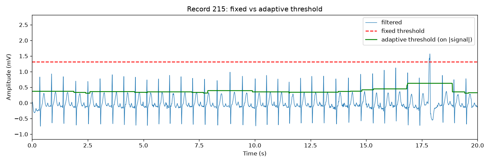

### Results

The detector was developed while looking at 10 records (100, 101, 103,
105, 108, 200, 203, 207, 210, 215) and scored on the other 36. Records
102 and 104 have no MLII lead and are skipped. Each record is scored on
its first 5 minutes.

| Detector | Dev sens. | Dev prec. | Held-out sens. | Held-out prec. | Held-out missed / false |
|---|---|---|---|---|---|
| Fixed threshold | 61.13% | 99.10% | 91.90% | 97.72% | 1092 / 289 |
| **Adaptive (ours)** | 98.19% | 99.26% | **99.57%** | 99.57% | **58** / 58 |
| XQRS (`wfdb`) | 97.06% | 96.72% | 98.82% | **99.96%** | 159 / **6** |

On held-out data the two detectors make different trade-offs. Ours
misses about a third as many beats, and XQRS produces about a tenth as
many false detections. Ours is also about 25× faster (0.3 s against
7.8 s for all 36 records), though speed wasn't a design goal. Record 203,
very noisy with ventricular beats of many shapes, is its weakest (91.6%
sensitivity).

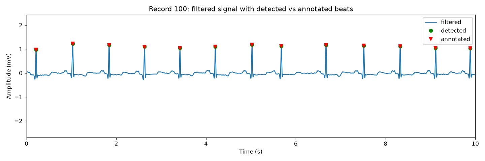

## S3. AF on Holter recordings (test 1)

In AF the heartbeat becomes irregularly irregular. The AF scripts run
the beat detector on the
[MIT-BIH Atrial Fibrillation Database](https://physionet.org/content/afdb/1.0.0/)
(AFDB: 23 records of about 10 hours each) and measure how irregular the RR
intervals (times between beats) are in each 60 s window:

| Feature | Definition | AUC alone (dev) |
|---|---|---|
| **CV** | standard deviation of RR / mean RR | 0.895 |
| **nRMSSD** | root-mean-square of successive RR differences / mean RR | 0.896 |
| **Shannon entropy** | entropy of a 16-bin histogram of RR intervals between the window's 5th and 95th percentiles, scaled to 0–1 | 0.831 |
| **TPR** (turning points ratio) | fraction of RR intervals that are a local peak or trough (≈ 2/3 for a random series) | 0.843 |
| **pNN50** | fraction of successive RR differences over 50 ms | 0.957 |

A window is labelled AF if at least half of it is annotated `(AFIB`;
atrial flutter and junctional rhythm count as non-AF.

| Set | Data | Used for |
|---|---|---|
| **Development** ([`afib.py`](afib.py)) | AFDB, first 2 h of all 23 records (2759 windows, 610 AF) | every design decision, by leave-one-record-out cross-validation |
| **AFDB later hours** ([`afib_test.py`](afib_test.py)) | AFDB, hours 2 to end (11,180 windows, 4955 AF) | first held-out test; same patients, later in their recordings |
| **New patients** ([`afib_test.py`](afib_test.py)) | [Long-Term AF Database](https://physionet.org/content/ltafdb/1.0.0/), first 2 h of all 84 records (9895 windows, 4790 AF) | test 1: different people, a different recorder, 128 Hz instead of 250 Hz |

**Classifiers:**

1. **Threshold rule** (the first version): AF when both CV and nRMSSD
   exceed grid-searched thresholds.
2. **Logistic regression** on CV + nRMSSD, and on all 5 features. CV and
   nRMSSD are log-transformed, since they span two orders of magnitude.
   Inputs are standardized and classes weighted equally.
3. **Logistic regression on pNN50 alone**, added *after* seeing that
   pNN50 alone scored as well as an earlier 5-feature model, so a
   follow-up comparison, not a planned one.
4. **Logistic regression on 5 features, with ectopic beats removed.**

### How the Holter model got here

**1. Entropy outliers (found on development data).** At first, entropy's
histogram bins spanned each window's full RR range. On record 07859, which
is AF throughout, a few outlier intervals per window stretched that range
about 2.6× and pulled AF windows' entropy from about 0.93 down to 0.69, so
the model missed 80 of its AF windows. Dropping intervals outside the
5th–95th percentiles first, as Dash et al. (2009) do, fixed it. The
5-feature model's development AUC rose from 0.951 to 0.979.

**2. A cutoff that didn't transfer (found on the first held-out test).**
The first run on AFDB's later hours reached only **92.5%** sensitivity
against the 95% target, with 98.0% specificity and AUC 0.990. The model
ranked windows well, but the cutoff carried over from development landed
too high. Investigating on development data only, I found two causes:

- The cutoff was set on the same windows the model was trained on, where
  its probabilities are overconfident. Setting it on **out-of-fold**
  probabilities instead (each training record scored by a model that
  didn't see it) moved development sensitivity from 93.8% to 95.2%.
- Four records supply about 73% of development AF windows, so a cutoff
  that catches 95% of *windows* mostly reflects them. **Weighting records
  equally** raised development sensitivity to 97.7%, and the worst record's
  from 63% to 83%.

**3. Ectopic beats.** Frequent extra beats make a normal rhythm look
irregular. [`ecg.flag_ectopic`](ecg.py) flags a beat if its shape
correlates under 0.9 with the median of its neighbours (ventricular
ectopics have a wide, different QRS; AF beats keep their normal shape), or
if it comes early (< 0.8× the local RR) and is followed by a pause
(> 1.15×). Against MIT-BIH's hand-labelled beats (first 5 minutes of 46
records, the same data the thresholds were picked on), it catches
**97.6% of ventricular ectopics** and wrongly flags 3.5% of normal beats,
but only **5% of atrial ectopics**, which look normal and are often only
slightly early. RR intervals touching a flagged beat are dropped before
computing the features; if fewer than 20 remain, the window uses its
unfiltered intervals, so every window is still scored.

### Results

| Classifier | Development (LORO) sens. / spec. | AFDB later hours* sens. / spec. | New patients sens. / spec. | New patients false alarms | New patients AUC |
|---|---|---|---|---|---|
| Threshold rule (CV, nRMSSD) | 92.1% / 79.1% | 95.9% / 83.0% | 94.3% / 59.1% | 2089 | – |
| Logistic (CV, nRMSSD) | 93.1% / 76.5% | – | – | – | – |
| Logistic (pNN50 only) | 98.5% / 86.6% | 97.4% / 89.9% | 94.9% / 68.5% | 1607 | 0.879 |
| **Logistic (5 features)** | 97.7% / 92.6% | 95.9% / 96.0% | **96.4%** / 81.8% | 927 | **0.938** |
| **Logistic (5 features, ectopic beats removed)** | 96.6% / **95.3%** | **97.0%** / **97.3%** | 95.8% / **84.3%** | **803** | 0.935 |

\* A second look: the cutoff method was changed after this data was first
used (first look, 5 features: 92.5% / 98.0%), so treat it as somewhat
optimistic. Development AUCs: 0.889, 0.953, 0.979, 0.982 for the four
logistic models.

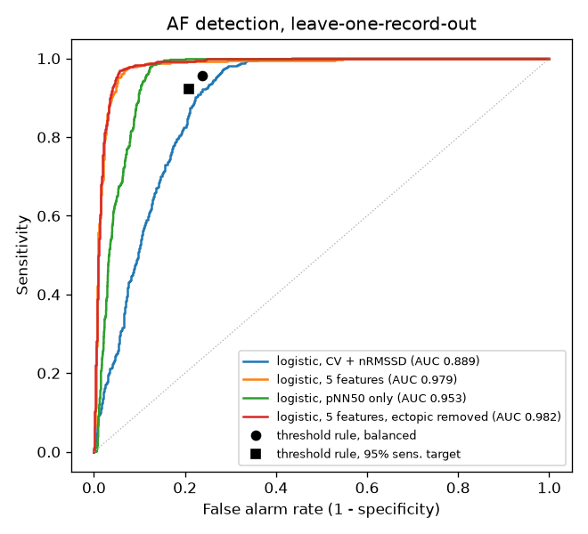
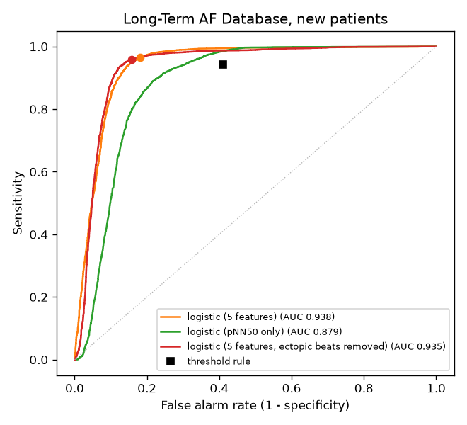

- **Sensitivity transfers.** Both 5-feature models catch about 96% of AF
  windows in people they've never seen.
- **Specificity doesn't.** It falls from about 96% to 82–84%, and AUC
  from 0.99 to 0.94: new patients' non-AF rhythms are much more varied
  than anything in the 23 development records.
- **Ectopic removal helps less than in development.** It cut development
  false alarms by 38% (record 08219, the worst ectopy case, went from 69%
  to 95% accuracy) but new-patient false alarms by 13% (927 → 803), for
  29 more missed AF windows. The filter flags about 13% of beats inside AF
  windows, because its timing rule fires by chance on irregular rhythm.
- **pNN50 alone doesn't generalize** (AUC 0.879 vs 0.938 on new patients).
- **The 5-feature models beat the original rule by a wide margin**, at
  higher sensitivity and with less than half its false alarms.

### Where the new-patient false alarms come from

[`ltaf_errors.py`](ltaf_errors.py) breaks the 927 false alarms down by
record, using the database's beat and rhythm labels. **73% of them come
from 10 of the 84 records**, in three groups:

1. **Atrial ectopy and other irregular non-AF rhythms** (records 23, 01,
   58): 27–30% of beats are atrial premature beats, with atrial bigeminy
   and supraventricular tachyarrhythmia labelled, exactly what the ectopic
   filter can't detect.
2. **Beat-detector errors on noisy recordings** (records 45, 56, 24, 03):
   precision falls to 47% on record 45 and 74–84% on the others. Across
   all 84 records the detector finds 98.8% of beats, but only 94.4% of its
   detections are real, against 99.6% on MIT-BIH.
3. **A probable labelling gap** (record 64): its only rhythm labels are at
   hour 18.9 (`(VT`, then `(AFIB` to the end), so its first 18.9 hours
   count as non-AF here, though its first 2 hours look like AF (CV 0.15,
   pNN50 0.58, entropy 0.87). It accounts for 76 false alarms. Excluding
   it, a choice made after seeing the results, specificity is 82.9%
   (5 features) and 85.6% (ectopic removed).

### Notes on the Holter model

**Coefficients** of the 5-feature model fitted on all development
windows, in log-odds of AF per standard deviation, with the range across
the 23 cross-validation folds: log CV +2.43 (+2.12 to +3.50), log nRMSSD
−0.62 (−0.99 to −0.29), entropy +2.97 (+2.59 to +4.01), TPR −0.15 (−0.38
to +0.03), pNN50 +2.43 (+2.27 to +2.66). Entropy, pNN50 and CV carry the
model; once outliers are trimmed, entropy is almost uncorrelated with CV
(r = 0.03). The negative nRMSSD weight shouldn't be read at face value:
log CV and log nRMSSD are 97% correlated, so the model splits "overall
variability" between them; on its own nRMSSD rises with AF. TPR's weight
is small and changes sign across folds; pNN50 largely covers it (r = 0.66).

**Ectopy in the development data.** In the first 48 minutes of AFDB record
08378 the RR intervals split into two bands, short and long: ectopy, not
AF, but irregular. For the threshold rule this is a limit of the method,
not of the beat detector: PhysioNet's reference beat positions give
similar results (79.4% specificity, 91.1% sensitivity).

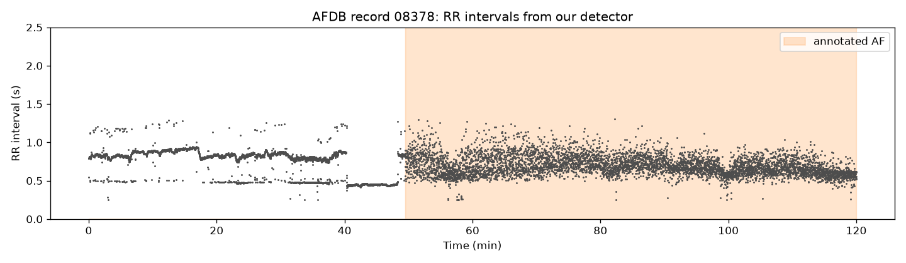
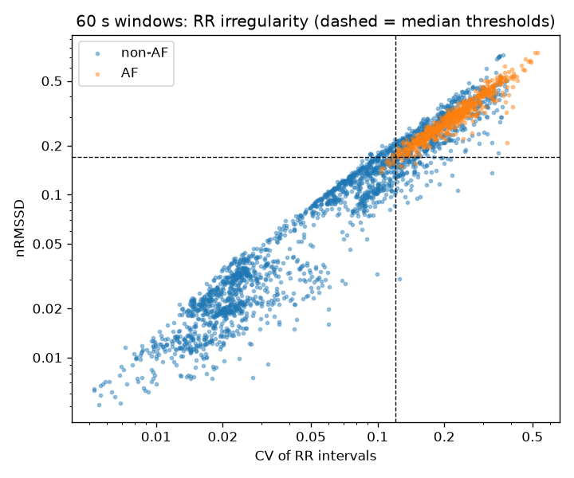

**A wrong reference annotation.** Against PhysioNet's `qrs` beat
annotations for AFDB, our detector scores 96.6%. Those annotations were
made by a computer program and never checked by hand; on record 07162 most
of them fall between heartbeats, while our detections land on each QRS
complex. Excluding 07162, beat detection scores 99.10% sensitivity and
98.93% precision.

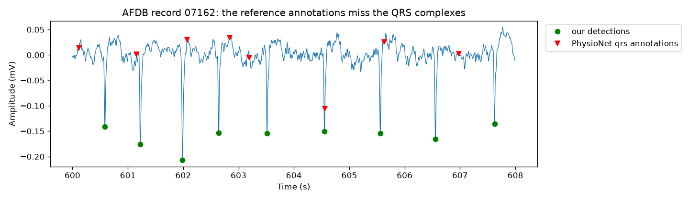

## S4. Atrial ectopy, P waves and handheld recordings (tests 2–5)

AF has no P waves, only chaotic fibrillatory activity. Atrial ectopy is
mostly normal beats *with* P waves. Both attempts below look at the
300–60 ms before each R peak.

**Detecting individual atrial ectopic beats** ([`ecg.flag_atrial_ectopic`](ecg.py))
works poorly on one lead: on the full 30 minutes of 46 MIT-BIH records
(excluding record 232, whose long pauses distort timing) it catches 55% of
supraventricular ectopics but flags 2.3% of normal beats, so only about
10% of its flags are real, and it flags 15% of beats inside AF windows.
**No model uses it.**

**P-wave presence per window** ([`af.p_wave_features`](af.py)): `p_match`
is the fraction of a window's beats whose pre-QRS stretch correlates
> 0.5 with the window's median one. On its own it separates AF from non-AF
development windows with **AUC 0.937** (median 0.94 non-AF, 0.38 AF); as a
model feature it changed almost nothing (AUC 0.985 vs 0.982), but AFDB's
development records contain little atrial ectopy. (A second measure,
`p_snr`, was 85% correlated with it and was dropped.)

### Test 2: SVDB, 78 patients with frequent atrial ectopy

The [MIT-BIH Supraventricular Arrhythmia Database](https://physionet.org/content/svdb/1.0.0/)
(30 minutes each, 128 Hz, 12,188 labelled supraventricular ectopic beats),
[`afib_svdb_test.py`](afib_svdb_test.py):

| Classifier (78 patients, 2340 windows) | Specificity | False alarms |
|---|---|---|
| Threshold rule (CV, nRMSSD) | 59.4% | 951 |
| Logistic (5 features) | 78.4% | 506 |
| **Logistic (5 features, ectopic beats removed)** | **83.3%** | **390** |
| Logistic (5 features + `p_match`, ectopic beats removed) | 82.8% | 402 |

- **`p_match` didn't reduce false alarms.** Removing ventricular ectopics
  did, by 23%.
- **Atrial ectopy drives the false alarms:** 40% in the 14 records where
  over 10% of beats are supraventricular ectopics, 12% in the other 64.
- **Why `p_match` fails:** ectopic beats bring their own, different P
  waves. When 20–30% of beats are ectopic, `p_match` falls to about 0.7,
  which overlaps real AF windows in development (0.4–0.85).
- The beat-level atrial detector catches 54% of supraventricular ectopics
  here and flags 1.8% of normal beats (41% of its flags are real, since
  ectopics are common here); the ventricular detector catches 84% of
  ventricular ectopics, against 97.6% on the MIT-BIH data it was tuned on.

**A caveat I should have caught beforehand:** SVDB has **no rhythm labels**
(one `(N` annotation in all 78 records), and the registered rule counted
unlabelled windows as non-AF. If any patient was in AF (record 804,
flagged in all 30 windows with no ectopic beats, is a candidate), true
specificity is higher than shown. The comparison between models is
unaffected.

### The P-wave override

`p_match` failed because ectopic beats have odd P waves. The *regular*
beats between them (not early, not ventricular ectopic) still share one
sinus P wave, while in AF none do. `p_match_regular`
([`af.regular_beats`](af.py)) has AUC **0.962** alone on AFDB development
windows, and a median of 0.97 in SVDB's high-ectopy records (`p_match`:
0.81). As a model feature it barely helped (SVDB false alarms 409 vs 390),
because AFDB training data has almost no "irregular, but with P waves"
windows to learn from. So, since AF means no P waves, it's applied as a
**rule** ([`af.p_wave_override`](af.py)): a window isn't called AF if at
least 95% of its regular beats share its typical P wave.

| Override threshold | AFDB sensitivity | AFDB false alarms | SVDB false alarms |
|---|---|---|---|
| none | 96.6% | 100 | 390 |
| **0.95** | **96.1%** | **71** | **277** |
| 0.90 | 93.3% | 60 | 251 |
| 0.85 | 89.2% | 47 | 217 |

0.95 is the lowest threshold that keeps AFDB sensitivity above 95%. It was
chosen while looking at SVDB, so SVDB's 29% drop isn't independent
evidence; test 3 is.

### Test 3: PhysioNet/CinC Challenge 2017 (handheld)

8528 single-lead handheld recordings (300 Hz, 9–61 s), labelled Normal,
AF, Other rhythm or Noisy; each scored as one window
([`afib_cinc_test.py`](afib_cinc_test.py)). 7903 scored (279 noisy
excluded, 346 with fewer than 20 usable beats).

| Classifier | Catches AF | False alarms, Normal | False alarms, Other | False alarms | Missed AF | ROC AUC |
|---|---|---|---|---|---|---|
| Threshold rule | 87.9% | 40.5% | 59.5% | 3361 | 84 | – |
| Logistic (5 features) | **79.2%** | 12.3% | 19.1% | 1045 | **145** | **0.881** |
| Logistic (5 features, ectopic removed) | 77.8% | 12.4% | 20.3% | 1077 | 155 | 0.868 |
| **+ P-wave override** | 76.0% | **10.3%** | **16.3%** | **882** | 167 | – |

- **The override does what it was built for:** false alarms on "Other"
  rhythms fall by 20%, for 12 more missed AF recordings.
- **But the pipeline transfers poorly to handheld recordings:** about 78%
  sensitivity, AUC 0.87–0.88 against 0.94–0.99 on Holter data.

**Why sensitivity falls:** not mainly length (81% on 50–61 s recordings,
77% on 20–35 s ones). The missed AF is less irregular (median CV 0.126,
pNN50 0.47, against 0.19 and 0.72). About 30 beats can't fill a 16-bin
histogram the way a minute of Holter beats does, so AF entropy falls from
0.92 to 0.86 for purely technical reasons. And the handheld device shows
more P-wave-like activity during AF (median `p_match_regular` 0.48 vs
0.33), which is probably why the override cost some sensitivity.

### Short recordings and devices

**Two changes, developed on the now-used data** (Challenge 2017 by 5-fold
cross-validation, AFDB leave-one-record-out):

1. **`entropy_norm`**: entropy divided by that of a random series of the
   same length (a random 20-interval series scores only 0.82; 60
   intervals: 0.95). Challenge AF medians by length go from 0.77 / 0.85 /
   0.90 to 0.94 / 0.95 / 0.95. On its own it mostly moved the operating
   point (handheld sensitivity 77.8% → 83.5%, AUC unchanged).
2. **Training on AFDB plus all Challenge 2017 recordings**, with a
   separate cutoff for short recordings
   ([`af.fit_with_source_cutoffs`](af.py)); one shared cutoff cut AFDB
   specificity from 95% to 83–86%, per-source cutoffs kept it at about 91%.
   Handheld development sensitivity with the override: **92.4%** (76.0%
   before), with more false alarms (normal 18.4%, other 30.4%).

### Test 4: CPSC 2018 (clinical, lead I)

From the [PhysioNet/CinC Challenge 2020](https://physionet.org/content/challenge-2020/1.0.2/)
data ([`afib_cpsc_test.py`](afib_cpsc_test.py)): short clinical 12-lead
recordings (500 Hz), lead I only, one window per recording. 931 chosen
(single diagnosis of AF, PAC or normal sinus rhythm, at least 15 s); 777
scored, 154 had fewer than 20 usable RR intervals (mostly slow normal
rhythms).

| Model (777 recordings: 286 AF, 212 PAC, 279 normal) | Catches AF | False alarms, PAC | False alarms, normal | ROC AUC |
|---|---|---|---|---|
| Previous (AFDB only, 5 features) | 92.3% | 18.4% | 4.7% | **0.952** |
| **Previous + P-wave override** | 92.3% | **10.4%** | **3.2%** | – |
| New (AFDB + Challenge, `entropy_norm`, short-recording cutoff) | **98.3%** | 50.5% | 22.2% | 0.917 |
| New + P-wave override | 97.9% | 24.1% | 5.0% | – |

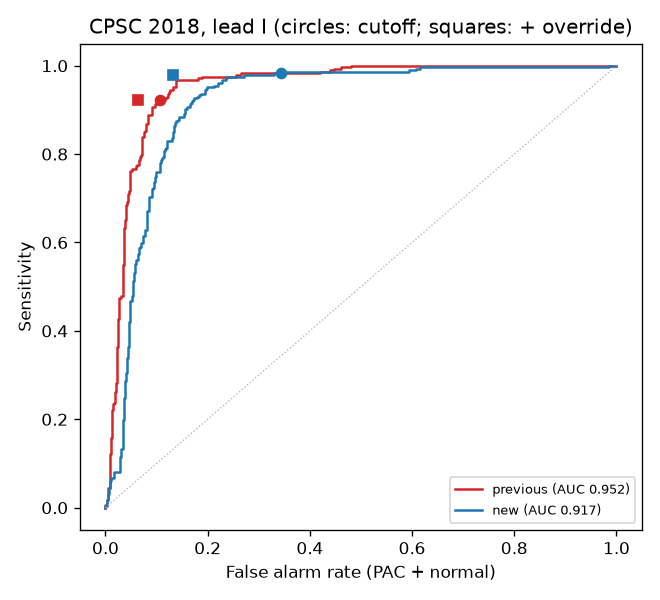

- **The P-wave override is confirmed:** it halves false alarms on PAC
  recordings at essentially no sensitivity cost. Both override points
  (squares) sit above and to the left of their model's whole ROC curve,
  because P waves are information the RR features don't have.
- **The handheld training didn't transfer:** sensitivity 98% but triple
  the false alarms and a *lower* AUC. Grouping recordings by *length* was
  the mistake: these are short like handheld ones, but their signal
  quality is close to Holter. Handheld recordings need their own model by
  *device*.

### Routing by device

| Device | Model | Cutoff |
|---|---|---|
| Holter | AFDB-trained | from AFDB |
| Clinical 12-lead | AFDB-trained (it ranked CPSC best) | 95% sensitivity on the 777 used CPSC 2018 recordings: 0.398, against 0.552 from AFDB |
| Handheld | trained on Challenge 2017 only | from Challenge 2017 |

All three apply the P-wave override. **Handheld** can only be checked by
5-fold cross-validation on Challenge 2017
([`afib_handheld_cv.py`](afib_handheld_cv.py)), since no unused handheld
AF data is left: 92.7% sensitivity, false alarms 14.8% normal and 28.5%
other, against 93.0% / 19.2% / 31.8% for the AFDB + Challenge model.
(`entropy_norm` makes no difference within one device.)

### Test 5: CPSC 2018 extra (clinical cutoff)

A second, unused batch from the same challenge
([`afib_cpscx_test.py`](afib_cpscx_test.py)). AF only occurs alongside
other diagnoses there, so AF = "AF among the diagnoses" and non-AF =
"neither AF nor atrial flutter"; lead I, at least 15 s. *Disclosure:* a
dry run accidentally used the first 25 downloaded test files instead of
stand-ins (19 scored: 1 AF, 18 non-AF, all correct for every model).
Nothing was changed after it.

| CPSC-extra (917 recordings: 45 AF, 32 PAC, 840 other) | Catches AF (95% CI) | Specificity | False alarms, PAC | False alarms, other | Missed AF |
|---|---|---|---|---|---|
| Holter cutoff | 86.7% (74–94%) | 95.0% | 6.2% | 5.0% | 6 |
| Holter cutoff + override | 86.7% (74–94%) | **96.0%** | 6.2% | 3.9% | 6 |
| Clinical cutoff | 88.9% (77–95%) | 94.0% | 15.6% | 5.6% | 5 |
| **Clinical cutoff + override** | **88.9% (77–95%)** | 95.8% | 9.4% | 4.0% | **5** |

The clinical cutoff caught one more AF recording, well within the noise
for 45 AF recordings; neither reaches 95%. The model ranks well (AUC
0.96), and the override cut false alarms by 20–30% for the third time on
unseen data. The missed AF has mixed causes: frequent PVCs (one recording
has 30% of beats flagged ectopic), a fairly regular ventricular response
(CV 0.087), one labelled "AF and flutter", and two just under the cutoff.

*Duplicates (found after the test).* The plan said no CPSC-extra recording
was shared with CPSC 2018, but 40 are exact copies of CPSC 2018 recordings
([`check_duplicates.py`](check_duplicates.py); README, *Duplicate
recordings*). 36 of them were scored here, including 16 of the 45 AF, and
every one's original was among the 777 CPSC recordings the clinical cutoff
was set on. Without them (881 recordings, 29 AF):

| CPSC-extra without CPSC 2018 copies (881: 29 AF) | Catches AF | Specificity | False alarms, PAC | False alarms, other |
|---|---|---|---|---|
| Holter cutoff | 82.8% (24/29) | 95.9% | 4.3% | 4.1% |
| Holter cutoff + override | 82.8% (24/29) | 96.9% | 4.3% | 3.0% |
| Clinical cutoff | 86.2% (25/29) | 95.2% | 13.0% | 4.6% |
| **Clinical cutoff + override** | **86.2% (25/29)** | 96.8% | 8.7% | 3.0% |

Sensitivity on the new recordings is about 3 points lower, so the
conclusion (short of 95%) is, if anything, stronger. The two releases
also label 11 of the 36 copies differently: 7 are AF in CPSC 2018 but
neither AF nor flutter here, and 4 are PAC there and "other" here.

## S5. The road to the 12-lead model (tests 6–8, test 9 development)

### Test 6: Georgia, with lead II P waves and V1 f-waves

Clinical recordings have 12 leads, so atrial activity can be read where
it's clearest: P-wave consistency over regular beats in **lead II**, and
fibrillatory-wave activity in **V1** ([`ecg.f_wave_activity`](ecg.py):
subtract the median beat, then measure the 4–9 Hz activity left, relative
to beat size), in a model trained on clinical recordings
([`af.clinical_features`](af.py)).

**Development** ([`afib_clinical_dev.py`](afib_clinical_dev.py)): the used
CPSC 2018 and CPSC-extra recordings cut into 10 s crops (3942 crops, 654
AF), 5-fold cross-validation grouped by recording.

| Model (development) | AUC | Sensitivity | False alarms |
|---|---|---|---|
| AFDB model, clinical cutoff | 0.959 | 95.6% | 13.0% |
| Clinical model, RR only | 0.950 | 95.4% | 11.5% |
| Clinical model, RR + P waves (II) | 0.976 | 95.7% | 5.1% |
| **Clinical model, RR + P waves (II) + f-waves (V1)** | **0.978** | **95.9%** | **4.7%** |

Lead II P waves work as a model feature here, unlike with AFDB training,
because clinical training data includes PAC and other rhythms. For 10 s
recordings the RR minimum is 6 intervals and `p_match_regular` needs 3
regular beats (with 5, many normal recordings had too few).

**The test** ([`afib_georgia_test.py`](afib_georgia_test.py)): 2942 10 s
recordings from the Challenge 2020 Georgia set. AF = AF among the
diagnoses (570); PAC = PAC without AF or flutter (620); normal = sinus
rhythm as the only diagnosis (1752).

| Georgia (2938 scored: 569 AF, 618 PAC, 1751 normal) | Catches AF (95% CI) | False alarms, PAC | False alarms, normal | ROC AUC |
|---|---|---|---|---|
| Current (AFDB model, clinical cutoff) | **75.2%** (72–79%) | 35.0% | 3.6% | 0.844 |
| Current + P-wave override | 71.0% (67–75%) | 12.9% | 1.1% | – |
| Clinical model (registered primary) | 68.5% (65–72%) | **7.3%** | **0.9%** | **0.881** |
| Clinical model + P-wave override | 67.7% (64–71%) | 6.3% | 0.8% | – |

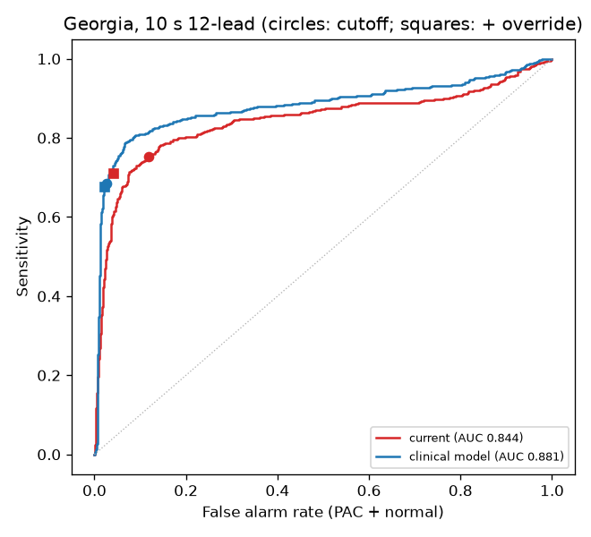

**The fix failed its main goal.** The clinical model ranks better and cuts
PAC false alarms from 35% to 7%, but catches *less* AF, and both models do
far worse than in development (AUC 0.98).

**Why:** many of the missed "AF" recordings don't look like AF. Their
median CV is 0.067 and pNN50 0.23, close to normal rhythm, and their median
`p_match_regular` is 1.000. 67 of the 179 missed are perfectly regular
(CV < 0.05) with consistent P waves. Four of them, at random:

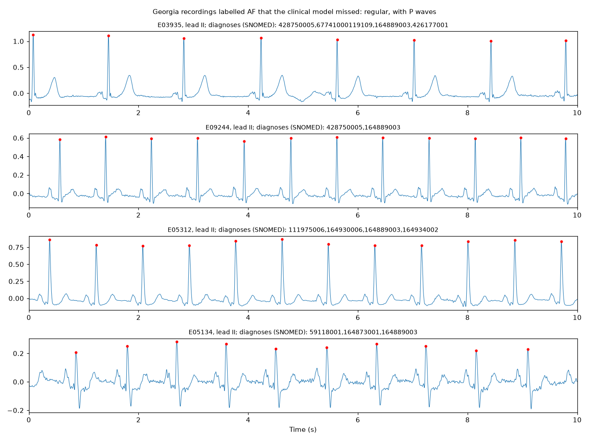

Georgia lists every diagnosis attached to the patient's ECG, so "AF" may
mean AF elsewhere in the patient's history rather than in this 10 s. One
of the four (E03935) is coded with both AF and sinus bradycardia, which
can't both describe one strip. I'm not a cardiologist and haven't excluded
these recordings: dropping them after the fact would remove exactly the
cases the model gets wrong. A fair verdict needs labels that describe the
rhythm in each recording.

### Test 7: PTB-XL, whose labels describe each recording

[PTB-XL](https://physionet.org/content/ptb-xl/1.0.3/)
([`afib_ptbxl_test.py`](afib_ptbxl_test.py)): 10 s 12-lead recordings at
500 Hz, cardiologist-validated reports only, rhythm statements about the
ECG itself. AF = AFIB without atrial flutter (all 984); PAC = PAC without
AF or flutter (all 391); sinus = SR with no AF, flutter, ectopy or pacing
(1500 drawn at random, seed 0). Exactly the Georgia models.

| PTB-XL (2867 scored: 978 AF, 389 PAC, 1500 sinus) | Catches AF (95% CI) | False alarms, PAC | False alarms, sinus | ROC AUC |
|---|---|---|---|---|
| Current (AFDB model, clinical cutoff) | **92.4%** (91–94%) | 46.8% | 6.6% | 0.942 |
| Current + P-wave override | 87.2% (85–89%) | 14.9% | 0.9% | – |
| Clinical model (registered primary) | 87.4% (85–89%) | **10.3%** | **1.0%** | **0.976** |
| Clinical model + P-wave override | 86.2% (84–88%) | 8.7% | 0.8% | – |

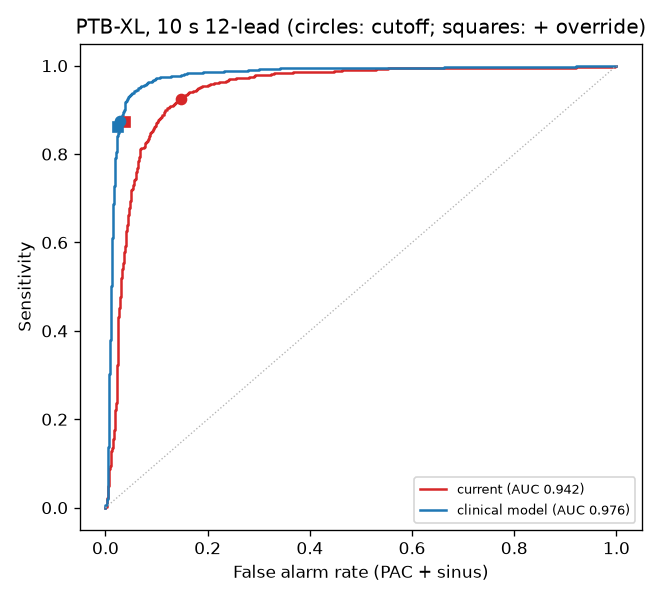

- **The labels explain most of the Georgia gap.** The clinical model's AUC
  is 0.976, as in development, and only 4 of its 123 missed AF recordings
  are regular with consistent P waves (Georgia: 67 of 179).
- **It still misses the 95% target** (87.4%, in line with CPSC-extra's
  88.9%). Catching 95% here would have needed a cutoff of 0.27 instead of
  0.61, raising PAC false alarms to 25% (worked out after the run).
- The missed AF is clearly irregular (median CV 0.13, pNN50 0.56) but
  scores high on `p_match_regular` (0.90; caught AF: 0.43).

### Test 8: Chapman-Shaoxing, with more training data

**Development** ([`afib_pwave_dev.py`](afib_pwave_dev.py)) on CPSC crops
and PTB-XL (6809 units, 1632 AF). [`ecg.p_wave_consistency`](ecg.py)
tested two suspected causes of the high P-wave scores: matching each beat
against a median that includes itself (fixed by leave-one-out), and the
previous beat's T wave passing for a P wave (fixed by subtracting the
median QRS-T complex first).

| Model: RR + P-wave measure + f-waves (CV) | AUC | Sens., CPSC | Sens., PTB-XL | False alarms, PAC | False alarms, sinus |
|---|---|---|---|---|---|
| `p_match_regular`, shared cutoff | 0.975 | 98.2% | 93.1% | 12.3% | 1.3% |
| leave-one-out, all beats | 0.975 | 98.0% | 93.7% | 12.8% | 1.4% |
| leave-one-out + QRS-T removed | 0.973 | 97.9% | 93.9% | 17.9% | 1.6% |
| `p_match_regular`, **strictest per-source cutoff** | 0.975 | 98.5% | **94.6%** | 16.9% | 1.8% |

The P-wave idea was wrong: neither fix helped. Training data mattered
more: with PTB-XL in training, cross-validated PTB-XL sensitivity is
93.1% (87.4% in test 7). Taking the *strictest* of the per-source 95%
cutoffs makes every training source reach 95%, at the cost of more PAC
false alarms.

**The test** ([`afib_chapman_test.py`](afib_chapman_test.py)):
Chapman-Shaoxing from the Challenge 2021 data, 10 s 12-lead recordings at
500 Hz with rhythm labelled per ECG by physicians. Every qualifying
recording: AF without flutter (1780), PAC without AF or flutter (258),
sinus rhythm with no AF, flutter, ectopy or pacing (1777).

| Chapman-Shaoxing (3813 scored: 1778 AF, 258 PAC, 1777 sinus) | Catches AF (95% CI) | False alarms, PAC | False alarms, sinus | ROC AUC |
|---|---|---|---|---|
| **Retrained, strictest-source cutoff (registered primary)** | **98.9%** (98.3–99.3%) | 24.0% | 1.5% | 0.990 |
| Retrained, shared cutoff | 98.3% (97.5–98.8%) | 19.4% | 1.3% | – |
| Previous clinical model | 94.1% (92.9–95.1%) | **9.7%** | **0.8%** | **0.991** |

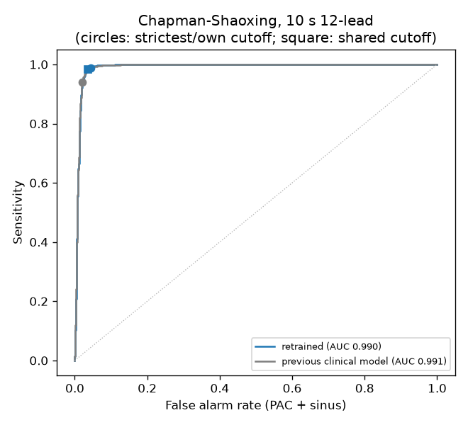

The 95% target is met (20 missed AF, against 105), but it's the same
trade, not a better model: both rank equally well (AUC 0.990 vs 0.991),
the gain comes from a lower cutoff (0.42 vs 0.61), and 24% of PAC
recordings are now called AF. Chapman is also easier than PTB-XL: the
previous model reaches 94.1% here.

### Test 9 development: telling AF from atrial premature beats

**Development** ([`afib_pac_dev.py`](afib_pac_dev.py)) on CPSC crops,
PTB-XL and Chapman (10,628 units, 3416 AF, 1177 PAC), with the strictest
per-source cutoff throughout:

| Model (CV) | Sens. CPSC / PTB-XL / Chapman | False alarms, PAC | False alarms, sinus | False alarms, other |
|---|---|---|---|---|
| Model tested on Chapman (lead II beats) | 98.5 / 94.8 / 98.9% | 18.6% | 1.7% | 8.5% |
| + RR-pattern features ([`af.rr_pattern_features`](af.py)) | 98.5 / 95.0 / 99.0% | 19.9% | 1.6% | 7.7% |
| Beats from three leads ([`ecg.detect_peaks_multilead`](ecg.py)) | 98.8 / 95.4 / 99.2% | 20.1% | 0.9% | 6.4% |
| **+ 12-lead P waves, f-wave ratio in II and V1 (`CLINICAL_FEATURES_12`)** | 98.2 / 94.9 / 98.5% | **11.6%** | **0.4%** | **4.5%** |

- **RR patterns didn't help.** Features for "regular apart from a few
  early beats, each followed by a pause" separate AF from PAC well alone
  (AUC up to 0.88), but the P-wave feature already carried that.
- **Beat detection was causing false irregularity.** Plots of PAC
  recordings called AF showed lead II detection picking up wiggles when
  the lead was small and jumping between the R and S waves of biphasic
  beats. Detecting beats from the combined slope of leads I, II and V1
  halved false alarms on sinus and other rhythms, but not on PAC.
- **More atrial evidence fixed PAC.** `p_match` over regular beats,
  averaged over all 12 leads ([`af.atrial_features`](af.py)), is a
  steadier sign of a real P wave than lead II alone in 10 s; and
  [`ecg.f_wave_ratio`](ecg.py), the share of beat-free activity at AF's
  4–9 Hz, separates fibrillatory waves from slow baseline and P waves.
  Using the 12 per-lead values separately did only slightly better
  (10.5%) with 9 more features, so the mean was kept.

The last row is the model tested in test 9 (main paper).

### Removing frequent atrial premature beats (didn't help)

[`ecg.flag_ectopic`](ecg.py) catches ventricular extra beats but only about
5% of atrial ones, because it judges "early" against the local median
(which frequent PACs pull down) and asks for a long pause afterwards
(which a PAC often doesn't cause). [`af.atrial_premature`](af.py) instead
judges "early" against the recording's longer intervals (70th percentile)
with no pause rule, and [`afib_ectopy_dev.py`](afib_ectopy_dev.py)
removed those beats only in recordings with consistent P waves across the
12 leads (`p_match_mean` at or above a gate), so AF keeps its
irregularity. In development (same data and cutoff rule as test 9) no
gate or threshold changed PAC false alarms beyond noise (10.7–12.5%,
against 11.6%). The reason: in 73% of the PAC recordings still called AF,
about 45% of beats are early, so removing them leaves fewer than 6
intervals in 10 s, too few to measure. Vetoing AF in that situation did
no better than simply raising the cutoff. No test was registered, and the
final model is unchanged.

## S6. Calibration

[`afib_calibration.py`](afib_calibration.py) checks whether predicted
probabilities match how often AF actually occurs, using the saved outputs
of tests 6–9 (an analysis after the fact; nothing was refitted). The
models are trained with balanced class weights, so their raw
probabilities assume AF and non-AF are equally common. They're checked
that way (test data reweighted 50/50), and after the standard shift to
each test's own AF prevalence.

| Test, model | AF prevalence | ECE, 50/50 | Slope, 50/50 | Mean predicted vs observed, at prevalence | ECE, at prevalence | Slope, at prevalence |
|---|---|---|---|---|---|---|
| Georgia, clinical (lead II) | 19.4% | 0.126 | 0.52 | 13.1% vs 19.4% | 0.071 | 0.58 |
| PTB-XL, clinical (lead II) | 34.1% | 0.043 | 1.03 | 29.9% vs 34.1% | 0.045 | 1.00 |
| Chapman, retrained | 46.6% | 0.032 | 1.40 | 46.4% vs 46.6% | 0.032 | 1.38 |
| SPH, retrained | 4.4% | 0.038 | 1.47 | 3.4% vs 4.4% | 0.014 | 1.13 |
| **SPH, 12-lead (final)** | 4.4% | **0.019** | 1.38 | 3.6% vs 4.4% | **0.009** | 1.40 |

ECE is the expected calibration error (10 bins, weighted by recordings;
0 is perfect). The slope comes from regressing the outcome on the
model's log-odds: 1 is ideal, above 1 means the probabilities are too
cautious, below 1 too extreme.

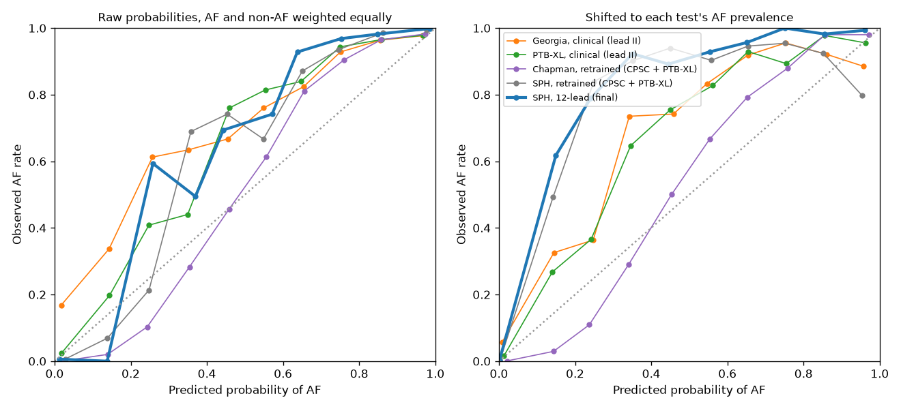

- **Overall error is small but hides the middle.** On SPH the final
  model's ECE is under 0.01 because 14,430 of 15,113 recordings get a
  probability near 0 and almost none of them are AF. The 116 recordings
  it scores between 10% and 50% (after the prevalence shift) are AF 80%
  of the time (93 AF, 19 PAC, 4 normal); at a predicted 15%, the observed
  AF rate is 62%.
- **The newer models are too cautious, not overconfident** (slope about
  1.4): the test recordings separate more cleanly than the harder training
  data (PTB-XL, CPSC's other rhythms) led the model to expect. Georgia is
  the opposite (slope 0.5), as its unreliable AF labels would predict.
- **Calibration depends on the hospital.** The same model is close to
  ideal on PTB-XL and Chapman but not on SPH, and AF prevalence and case
  mix differ between sites. The cutoffs and rankings stand, but the
  probabilities shouldn't be quoted as a patient's chance of AF without
  recalibrating on local data, which would need data from that site.

## S7. Atrial flutter (test 10)

Every test above left flutter out. In flutter the atria beat in a regular
sawtooth at 250–350 a minute, and the ventricles follow every 2nd, 3rd or
4th wave, or a varying number. With fixed 2:1 block the pulse is regular
at about 150 bpm, like sinus tachycardia or SVT; with variable block it's
irregular, like AF. Clinically, flutter matters for the same main reason
as AF (stroke risk, so anticoagulation), and also for its own treatment.

**Development** ([`afib_flutter_dev.py`](afib_flutter_dev.py)), from
sources already used: the AF development units plus never-loaded flutter
and look-alike recordings from Chapman and PTB-XL (488 flutter, 900 sinus
tachycardia, 617 SVT, 120 atrial tachycardia), 5-fold cross-validation
grouped by recording or patient. [`ecg.flutter_features`](ecg.py) blanks
out the QRS complexes and measures, in leads II, aVF and V1: the
autocorrelation at flutter's cycle (0.15–0.27 s), how concentrated the
3–8 Hz spectrum is around its peak, that peak's frequency, and whether any
flat baseline remains.

| Development (CV) | Flutter caught as AF or flutter | Named flutter | AF named flutter | Sinus tach flagged | SVT flagged |
|---|---|---|---|---|---|
| AF model alone | 51.6% | – | – | 2.9% | 2.9% |
| + logistic flutter model, 80% sensitivity | 90.6% | 80.3% | 23.1% | 20.2% | 58.0% |
| **+ boosted flutter model, look-alike budget** | **83.6%** | 62.9% | 6.8% | 7.4% | 20.3% |

- **The AF model already catches half of flutter**, mostly variable block,
  which is irregular like AF, and misses most regular 2:1 flutter.
- **The flutter features carry the signal**: each alone separates flutter
  from the rest with AUC 0.77–0.81, and they lift a flutter model's AUC
  from 0.82 to 0.915 (boosted trees: 0.930).
- **2:1 flutter and SVT can look the same in 10 s.** Plots of the errors
  showed regular narrow-complex rhythms at 150–170 bpm on both sides,
  with flutter waves hidden in the QRS and T waves. So instead of a
  sensitivity target, the cutoff allows at most 10% of sinus tachycardia
  + SVT to be called flutter, and the flutter model is used *alongside*
  the AF model: "AF or flutter" if either fires, "flutter" if the flutter
  model does. Boosted trees were chosen over logistic regression because
  they can learn that a fast regular rate means flutter only with
  continuous atrial activity.

**Test 10** ([`afib_flutter_test.py`](afib_flutter_test.py)): SPH, first
10 s, chosen from `metadata.csv`: flutter without AF (99), sinus
tachycardia without AF or flutter and not in test 9 (711), junctional
tachycardia (13), all never opened; and test 9's AF recordings (675),
reused to measure how often real AF is named flutter. SPH has no SVT code,
so SVT false alarms can't be tested here.

| SPH | n | Called AF (AF model alone) | Called AF or flutter (95% CI) | Named flutter (95% CI) |
|---|---|---|---|---|
| **Flutter** | 99 | 54.5% | **83.8%** (75.3–89.8%) | **70.7%** (61.1–78.8%) |
| Sinus tachycardia | 711 | 0.6% | 3.7% (2.5–5.3%) | 3.1% |
| Junctional tachycardia | 13 | 7.7% | 7.7% | 0% |
| AF (reused) | 675 | 98.4% | 98.7% | 8.9% (7.0–11.3%) |

- **The flutter model works as developed.** With it, the screen catches
  83.8% of flutter instead of 54.5%, close to development's 83.6%, at the
  cost of flagging 3.7% of sinus tachycardia instead of 0.6%.
- **Naming flutter is less reliable.** 70.7% of flutter is named flutter,
  but so is 8.9% of AF; since AF is far more common than flutter, many
  "flutter" calls in practice would be AF. Both need the same urgent
  follow-up, so the combined "AF or flutter" call is the more useful one.
- **About 1 in 6 flutter recordings is still missed**, and with 99 flutter
  recordings the interval is wide (75–90%). Flutter AUC is 0.913 against
  everything, 0.937 against sinus tachycardia and 0.887 against AF.

## S8. Reducing PAC false alarms: hand-made features, then a hybrid (tests 13–15)

Test 11 (main paper) found the interpretable model's weak point: on
atrial premature beats (PACs) both neural networks make far fewer false
alarms. These attempts to close the gap were developed on all seven
sources used by then (CPSC crops, PTB-XL, Chapman, SPH, Ningbo, CODE-15%
part 0, CODE test set) by 5-fold cross-validation grouped by patient
([`afib_fa_dev.py`](afib_fa_dev.py) and the scripts named below).

### Hand-made features (no test registered)

- **PAC false alarms didn't move** with any change (the table is in the
  main paper's test 12 section): not with more varied
  training data (slightly worse), not with RR-pattern features, and not
  with measures of a quiet baseline between beats (which separate AF from
  PAC with AUC only 0.65–0.72 alone). Training on all seven sources with
  the strictest-source rule also let CODE-15%, the hardest source, drag
  the cutoff down (PAC false alarms 41%), so cutoffs stay set on the
  original three. Two later attempts didn't move them either:
  [`ecg.p_concentration`](ecg.py) ([`afib_pconc_dev.py`](afib_pconc_dev.py)),
  how much of each interval's atrial activity sits just before the QRS (a
  P wave of any shape, including a PAC's own), separates AF from PAC with
  AUC 0.82 alone but changed PAC false alarms only from 16.4% to 16.1%;
  and P-wave consistency over each recording's 3 best leads instead of
  all 12 lost discrimination (AUC 0.958 to 0.939), because real AF also
  matches on some leads by chance. Plots of PAC recordings this model
  calls AF but the CNN doesn't show plain sinus rhythm with a P wave
  before nearly every beat; the information the networks use isn't in
  these hand-made features yet.
- **Per-beat P waves helped a little, not enough to adopt.**
  [`ecg.p_presence`](ecg.py) makes the per-beat check a cardiologist
  makes: in leads II and V1, does a wave just before each QRS stand out
  from the quiet part of the same interval? Shape doesn't matter, so it
  counts P waves a consistency score misses, but premature beats
  themselves can't be judged (their P wave sits on the previous T wave).
  Alone it separates AF from PAC well (AUC 0.87–0.89 where scorable;
  median share of beats with a P wave: AF 0.00, PAC 0.65–0.75). In the
  model ([`afib_ppresence_dev.py`](afib_ppresence_dev.py)), AF-vs-PAC AUC
  rose from 0.978 to 0.980–0.981 and, at matched sensitivity, PAC false
  alarms fell by up to about 2 points (at 97%: 13.4% to 11.3%; at 95%:
  8.6% to 8.3%). That's far from the networks' advantage, and too small
  to check on the only fresh PAC data left (INCART: 447 crops, mostly
  from 2 patients), so it wasn't adopted.

### A hybrid: the interpretable model screens, the CNN confirms

Seven attempts with hand-made features left PAC false alarms nearly
unchanged (above; the best, per-beat P-wave presence, gained about 2
points). So [`afib_hybrid_dev.py`](afib_hybrid_dev.py) tried combining the
two models: AF is called only if the interpretable model calls it **and**
the same-data CNN (main paper, test 11) agrees. The CNN can only remove calls, so
every AF call still comes with the interpretable model's named-feature
explanation.

Both thresholds were chosen on the development data only (CPSC crops,
PTB-XL, Chapman; out-of-fold probabilities of both models): the pair with
the fewest false alarms that keeps at least 95% sensitivity in each
source.

| Development (CV) | Sensitivity CPSC / PTB-XL / Chapman | PAC called AF | Sinus | Other rhythms |
|---|---|---|---|---|
| Interpretable model alone | 98.4 / 95.0 / 99.0% | 11.8% | 0.3% | 4.3% |
| **Hybrid** | 95.0 / 95.1 / 99.6% | **5.5%** | 0.2% | 3.3% |

**What the hybrid gives up.** To keep 95% sensitivity, the chosen
interpretable threshold is very low (0.057, against 0.431 when it works
alone): the interpretable model becomes a lenient screen and **the CNN
makes most of the decisions**. An AF call is still explained by named
features, but a recording the CNN rejects has no transparent reason, and
the hybrid inherits the CNN's opacity and its dependence on one trained
network ([`models/cnn_model.keras`](models/)).

**Test 13** ([`afib_hybrid_test.py`](afib_hybrid_test.py)), registered
before the data were opened, hybrid against the interpretable model alone:

- **INCART** (St Petersburg 12-lead Holter database, 257 Hz, beat-by-beat
  annotations): every 10 s crop with at least 2 annotated atrial premature
  beats, excluding the 2 patients described with atrial fibrillation (447
  crops from 14 patients; [`results/incart_selected.txt`](results/incart_selected.txt)).
- **CODE-15% part 2** (Brazil): every exam, for sensitivity and other
  false alarms.

The hybrid was to be offered only if PAC false alarms fell on INCART
(interval of the difference, by patient, entirely below 0) and CODE-15%
sensitivity dropped by no more than 2 points.

| Test 13 | Interpretable alone | Hybrid | Difference (95% CI) |
|---|---|---|---|
| INCART PAC crops called AF | 9.2% (41 of 447) | **2.7%** (12) | −6.5 points (−12.5 to −2.3) |
| INCART, every patient weighted equally | 22.9% | 11.2% | |
| CODE-15% part 2: AF caught (409) | 93.2% | 93.6% | +0.5 points (−1.6 to +2.6) |
| CODE-15% part 2: non-AF called AF (18,447) | 3.8% (699) | **2.7%** (490) | −1.1 points (−1.4 to −0.9) |

- **Both conditions met: the hybrid is offered as an alternative.** It
  cuts PAC false alarms by about two-thirds and other false alarms by
  about a quarter, with no loss of sensitivity.
- **The PAC evidence is thin.** Two patients supply 410 of the 447 crops
  (their false alarms fell from 8.0% to 1.6% and from 12.5% to 5.2%);
  among the other 12 patients, with 1–16 crops each, one got worse. The
  interval is by patient, but 14 patients from one database is little.
- **Which to use** depends on the setting. The interpretable model alone
  explains every decision; the hybrid makes about two-thirds fewer PAC
  false alarms but can't explain the calls it removes. The interpretable
  model stays the main model of this project.

**Test 14** ([`afib_mimic_test.py`](afib_mimic_test.py)), registered
(`9d82cbf`) before any signal was downloaded, repeats test 13 with nothing
changed on far more people. MIMIC-IV-ECG (Beth Israel Deaconess Medical
Center, Boston) is a new hospital, country and ECG machine for this
project. [`afib_mimic_select.py`](afib_mimic_select.py) chose one 10 s
12-lead recording per patient from the machine's report text alone:
2000 patients with sinus rhythm with PACs (no AF, flutter, PVCs, pacing
or other atrial rhythms) and 1000 other patients with atrial
fibrillation. The same two conditions as test 13 applied.

| Test 14 (2952 scored: 1976 PAC, 976 AF; 48 unscorable) | Interpretable alone | Hybrid | Difference (95% CI) |
|---|---|---|---|
| PAC recordings called AF | 14.3% (282) | **8.8%** (174) | −5.5 points (−6.9 to −4.1) |
| AF caught | 85.3% (833) | 84.6% (826) | −0.7 points (−2.5 to +1.1) |
| Interpretable alone at a stricter cutoff (0.479) matching the hybrid's sensitivity: PAC called AF | 12.9% (255) | 8.8% | −4.1 points (−5.4 to −2.8) |

- **The PAC gain holds on 1976 patients:** the hybrid makes about 40%
  fewer PAC false alarms, and most of that gain (4.1 of 5.5 points)
  isn't something a stricter cutoff on the interpretable model alone
  could get.
- **But the plan's sensitivity condition failed, narrowly.** The hybrid
  missed 7 more AF patients (46 caught only by the interpretable model,
  39 only by the hybrid). The interval's lower end, −2.5 points, crosses
  the −2 point limit. By the rule fixed in advance, test 13 is **not
  confirmed**. The hybrid remains an option with this caveat, not a
  confirmed improvement.
- **Both models catch less AF here (about 85%)** than on any earlier
  clinical test set (92–98%), and the interpretable model separates AF
  from PACs less well (AUC 0.904). The labels are the ECG machine's,
  not a cardiologist's, so some "AF" may be other irregular rhythms and
  some "PACs" may be AF. That would lower both models' numbers equally,
  but it hasn't been checked.
- After registration, one code-only fix: the TensorFlow environment has
  no scikit-learn, so `afib_mimic_select.py` defines the 12-lead order
  itself instead of importing it from `af.py` (checked identical).

**A fix: the CNN may veto only less confident calls.** Some AF the hybrid
lost had high interpretable probabilities that the CNN overruled. So
[`afib_hybrid2_dev.py`](afib_hybrid2_dev.py) added an override: AF is also
called whenever the interpretable probability is at least `t_high`, with
no CNN check. The rule fixed first for choosing `t_high` (the highest value
keeping development sensitivity in every source at least the interpretable
model's) **failed**: it gave 0.46, next to the interpretable cutoff (0.43),
which undoes nearly all of the PAC gain (preview on test 14: PAC 15.7%).
I then chose **0.9** by looking at the trade-off on the development grid
(PAC 7.0% vs 11.8% alone) and on test 14's recordings (sensitivity 87.1%
vs 85.3%, PAC 10.5% vs 14.3%). Since test 14's data informed this choice,
it was tested on new patients.

**Test 15** ([`afib_mimic15_test.py`](afib_mimic15_test.py)), registered
(`041a560`) before the new recordings were downloaded: the same selection
rules on MIMIC-IV-ECG, 2000 PAC and 1000 AF patients, none of them in
test 14 (seed 1). The same two conditions, against the interpretable model
alone.

| Test 15 (2959 scored: 1977 PAC, 982 AF; 41 unscorable) | Interpretable alone | Hybrid (test 13) | **Hybrid + override** | Override minus alone (95% CI) |
|---|---|---|---|---|
| PAC recordings called AF | 15.1% (298) | 8.7% (172) | **10.3%** (203) | −4.8 points (−6.1 to −3.5) |
| AF caught | 83.5% (820) | 84.3% (828) | **85.4%** (839) | +1.9 points (+0.3 to +3.7) |

- **Both conditions met.** The hybrid with the override makes about a
  third fewer PAC false alarms than the interpretable model alone *and*
  catches more AF (its sensitivity interval lies entirely above 0). It
  replaces test 13's hybrid as the offered alternative.
- The override gives back part of the PAC gain (8.7% → 10.3%) for 11 more
  AF patients caught.
- On these new patients test 13's hybrid would also have passed
  (sensitivity +0.8 points, −1.0 to +2.7), so test 14's failure was partly
  chance. Its sensitivity is closer to the limit than the override's, though.
- Every AF call still has the interpretable explanation; calls the CNN
  vetoes (interpretable probability 0.43–0.9) still have no transparent
  reason. MIMIC's labels are the ECG machine's, and both models catch only
  83–85% of its AF (see test 14). The interpretable model stays the main
  model.

### Why the model misses AF at the US hospital (MIMIC-IV-ECG)

On MIMIC the interpretable model alone catches about 84% of AF, against
92–98% on every earlier clinical test set.
[`afib_mimic_errors.py`](afib_mimic_errors.py) looks at the 1958 AF
recordings of tests 14 and 15 and the 305 it missed (an analysis after
the fact; nothing was changed). The CNN, trained on the same data, misses
13.9% overall and also misses 190 of these 305, so most of the difficulty
is shared, not a quirk of hand-made features.

| Missed AF (305) | Share of misses | RR spread (CV, median) | 12-lead P-wave match (median) | Heart rate (median) | Also missed by the CNN |
|---|---|---|---|---|---|
| Almost perfectly regular (CV < 0.05) | 38% (115) | 0.017 | 0.90 | 82 | 60% |
| Irregular (CV ≥ 0.05) | 62% (190) | 0.119 | 0.92 | 72 | 64% |
| *For comparison: AF caught* | – | 0.179 | 0.50 | 91 | – |

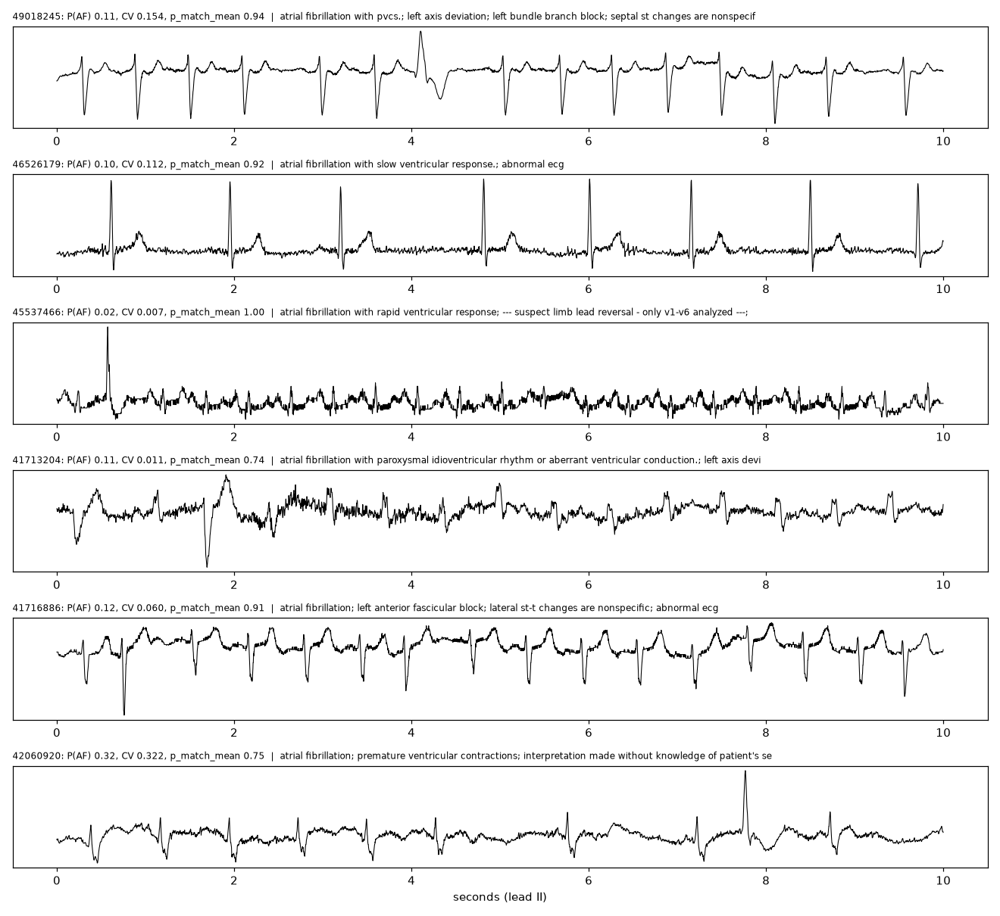

- **Some "AF" labels probably don't describe the strip.** AF is
  irregular by nature, yet 6.8% of MIMIC's AF recordings are almost
  perfectly regular (CV < 0.05). In the cardiologist-labelled data this is
  rare: 0.6–1.7% of development AF (CPSC, PTB-XL, Chapman) and 1.6% at
  SPH. MIMIC's labels are the ECG machine's own statements. Strips in
  this group include a fast regular rhythm whose report itself suspects a
  limb-lead reversal, and noisy, low-amplitude recordings, more likely
  flutter, another regular rhythm or a misread than AF. Leaving the
  regular recordings out (caught and missed alike) raises sensitivity
  only from 84.4% to 89.6%, so this explains part of the gap, not all.
- **Slow, rate-controlled AF is the model's real weakness** (the later
  label check revises this: on confirmed AF the model catches 92.5% under
  80 a minute, so much of this is probably mislabelled slow rhythms). The missed
  irregular AF is slower (median 72 a minute, 65% under 80) and less
  irregular (CV 0.12 against 0.18) than the AF it catches. The miss rate
  falls steadily with heart rate: 27.7% under 60 a minute, 22.3% at
  60–80, 15.1% at 80–100 and 7.2% above 100. Reports that say "slow
  ventricular response" are missed 29% of the time, "rapid ventricular
  response" only 6%. MIMIC is a hospital population where many AF
  patients are on rate-control drugs, which slow and even out the pulse.
- **The P-wave features are fooled in exactly these recordings.** The
  missed AF has a 12-lead P-wave match of 0.92, as high as sinus rhythm,
  against 0.50 for caught AF; 87% of the missed AF scores at least 0.8,
  against 2–8% of development AF. A likely reason (not checked) is that
  with long gaps between beats, the stretch before each QRS is mostly
  quiet baseline or fine fibrillatory waves, which match from beat to
  beat and pass for a consistent P wave. Fibrillatory activity in V1 is
  also lower in the missed AF (f-wave ratio 0.22 vs 0.32).
- Other statements make little difference: PVCs or aberrant conduction
  (13.6% missed), bundle branch block or wide QRS (16.3%), low voltage
  (12.0%), against 15.6% overall.

### Test 16: a fix for slow AF (failed its false-alarm limit)

**The idea.** [`ecg.p_presence`](ecg.py) asks, beat by beat, whether a
wave before the QRS stands out from the quiet part of the same interval,
so a flat baseline can't pass for a P wave. It is scorable exactly where
the problem is, since slow beats leave a quiet stretch. On test 14–15's
(used) recordings it scores the missed AF 0.11 and the PAC recordings the
model correctly clears 0.60. And the original development data has little
slow AF to learn from (133 of 3416 AF units fool the P-wave match), so
[`afib_slowaf_dev.py`](afib_slowaf_dev.py) added a **MIMIC development
set** from patients in no test (1500 AF, 1500 PAC, 1500 sinus-rhythm
patients chosen from the reports; 4439 scored).

**Development** (5-fold CV by patient; cutoffs set by the usual rule on
CPSC, PTB-XL and Chapman only):

| Development (CV) | MIMIC AF caught | under 80/min | MIMIC PAC called AF | MIMIC AF-vs-PAC AUC | MIMIC AF caught at 10% PAC false alarms |
|---|---|---|---|---|---|
| Adopted model | 84.1% | 74.0% | 14.3% | 0.901 | 79.9% |
| + P-wave presence | 86.1% | 78.1% | 15.4% | 0.916 | 82.2% |
| Gated P-wave match only | 87.5% | 80.8% | 23.9% | 0.898 | 75.6% |
| **+ P-wave presence + gated match, + MIMIC training** | 86.5% | 79.5% | 15.1% | **0.922** | **83.0%** |
| as above, MIMIC also a cutoff source | 95.2% | 92.0% | 41.3% | 0.922 | 82.7% |

The chosen model (bold) separated AF from PACs best. Previews on used
data showed a cost on PACs at some hospitals: SPH 8.9% → 8.2%, but Ningbo
25.2% → 27.2% and Chapman (CV) 18.2% → 21.7%. So the test checked it.

**The test** ([`afib_slowaf_test.py`](afib_slowaf_test.py)), registered
(`ba3839e`) before the recordings were downloaded: new MIMIC patients
(none in tests 14–15 or the development set), 1000 AF, 2000 PAC and 2000
sinus rhythm, one recording each. The new model was to be recommended
only if sensitivity rose (interval above 0) and PAC false alarms rose by
less than 2 points (upper bound below +0.02).

| Test 16 (4946 scored: 989 AF, 1971 PAC, 1986 sinus) | Adopted model | New model | Difference (95% CI) |
|---|---|---|---|
| AF caught | 82.5% (816) | **84.6%** (837) | +2.1 points (+1.1 to +3.3) ✓ |
| AF under 80 a minute caught (373) | 73.2% | **76.1%** | +3.0 points (+1.1 to +4.9) |
| PAC called AF | 12.6% (249) | 14.3% (281) | +1.6 points (+0.5 to +2.7) ✗ |
| Sinus rhythm called AF | 0.8% | 0.8% | 0.0 |
| AF-vs-PAC AUC | 0.894 | **0.922** | |

- **Failed: the adopted model stays.** Sensitivity rose as predicted, but
  the interval for PAC false alarms reaches +2.7 points, past the +2
  limit fixed in advance.
- **Most of the sensitivity gain is a shift in operating point, not a
  better model.** The new model ranks AF above PACs better (AUC 0.922 vs
  0.894), but at the adopted model's PAC false-alarm rate (12.6%) it
  catches 83.5% of AF, only 1 point more than 82.5%.
- **Slow AF stays hard.** Even with the fix, about 1 in 4 AF recordings
  under 80 a minute is missed. Part of what's left is probably labels:
  about 40% of misses at this hospital are almost perfectly regular (see
  above), which per-beat P-wave measures can't change. The label check
  below confirms this.

### Better labels: is the machine's AF confirmed by the patient's other ECGs?

MIMIC's AF labels are the ECG machine's. The cardiologist reports for
these ECGs are not openly released (MIMIC-IV-ECG says they will join
MIMIC-IV-Note later, and that module is credentialed), and the
discharge-diagnosis labels (MIMIC-IV-ECG-Ext-ICD) are credentialed too.
One better label is open, though: **real AF usually shows on the same
patient's other ECGs taken within hours**, while a single machine "AF"
between sinus-rhythm ECGs is less certain.

[`afib_mimic_labels.py`](afib_mimic_labels.py) uses only the machine
reports and ECG times, no signals and no model output, and sorts each AF
recording of tests 14–16 (2947, one per patient) by the patient's other
ECGs within 24 hours:

- **confirmed:** another ECG states AF;
- **sinus nearby:** none states AF, but one states sinus rhythm;
- **no comparison:** neither, which mostly means no other ECG that day.

It then re-scores the calls the tests already saved. It was registered
(`e14302f`) before any neighbouring ECG was looked at (the code was
smoke-tested on development recordings only) and run once. It is a
re-analysis of tests 14–16, not a new fresh-data test.

**Primary:** the adopted model's sensitivity on confirmed AF minus on
sinus-nearby AF, with its interval entirely above 0. **Result: +18.6
points (95% CI +14.7 to +22.4). Passed.** With a 6-hour window it was
+13.0 points (+8.2 to +18.2; 273 confirmed, 334 sinus nearby).

| Tests 14–16 AF recordings | Recordings | Adopted model | under 80 a minute | CNN (tests 14–15 only) | Near-regular, CV < 0.05 (tests 14–15) |
|---|---|---|---|---|---|
| **Confirmed** (another AF ECG within 24 h) | 545 | **94.3%** (92.0–96.0) | **92.5%** (161/174) | 95.7% (356/372) | 2.4% |
| Sinus nearby | 623 | 75.8% (72.2–79.0) | 58.3% (120/206) | 77.3% (314/406) | 12.3% |
| No comparison | 1779 | 83.4% (81.6–85.0) | 75.7% (556/734) | 86.1% (1016/1180) | 6.4% |
| All | 2947 | 83.8% (82.4–85.1) | 75.1% (837/1114) | 86.1% (1686/1958) | 6.8% |

- **On AF that the patient's other ECGs confirm, the model catches 94%,
  in line with its 92–98% on cardiologist-labelled data.** The gap at
  this hospital is mostly in the AF calls that nothing else supports.
- **The slow-AF weakness mostly goes away on confirmed AF**: 92.5% under
  80 a minute against 58.3% when sinus rhythm was recorded nearby. So
  much of what looked like slow AF fooling the model is probably slow
  sinus rhythm or another rhythm that the machine called AF. This
  revises the error analysis above, which put slow AF first.
- **The regular strips sit in the unconfirmed groups**: 12.3% of
  sinus-nearby AF is near-regular against 2.4% of confirmed AF.
- **Test 16's fix gains little on confirmed AF**: 93.6% → 95.4% (+1.7
  points, +0.0 to +3.9; 173 recordings), so it mainly changed calls on
  doubtful labels.
- **Labels err the other way too.** Of the PAC recordings whose patient has
  an AF ECG within 24 hours (301 of 5924), the model calls 37.2% AF, against
  12.8% of the rest. Some of these "PAC" strips are probably AF, or
  paroxysmal AF patients' sinus rhythm with very irregular ectopy.

**What this does and doesn't show.** The confirmation comes from the
same machines, which are probably most reliable on obvious, persistent
AF. Confirmed AF is therefore surer AF but probably also easier AF, and
the sinus-nearby group includes real paroxysmal AF. So 94.3% is not
proof that every other miss is a label error. The model's sensitivity on
real AF at this hospital is most likely between 84% and 94%, and only
cardiologist labels can pin it down. The tests' own numbers stand as
reported.

### The P-wave window's shape as inputs (after test 18; not adopted)

**What was tried.** The model sees how well beats' P waves match each
other, not what they look like.
[`afib_pwave_shape_dev.py`](afib_pwave_shape_dev.py) gives it the P wave
itself: in leads II, III, aVF and V1, the median over regular,
non-ventricular beats of the 300 to 60 ms before the R peak (the stretch
[`ecg.pr_segments`](ecg.py) cuts for `p_match`), averaged into 24 bins
of 10 ms, minus its first 20 ms (baseline) and divided by the lead's QRS
height: 96 numbers. They joined the adopted model's 11 inputs in a
balanced logistic regression whose waveform weights were penalised for
differing from their neighbours, so the weights can be plotted over time
and read ([figure](figures/afib_pwave_shape_weights.png); a weight's
effect depends on the sign of the waveform it multiplies, so the
figure's bottom row shows weight × each class's mean waveform: the
positive weights just before the QRS count against AF in PAC and sinus
recordings, whose waveform dips there); the penalty's strength came from
inner cross-validation over 1, 10, 100, 1000 and 10,000, which chose 1,
the weakest, in every fold. A check added after the run (`python
afib_pwave_shape_dev.py widegrid`) put 0, 0.01 and 0.1 into the grid
too: the folds then chose 1, 1, 0.1, 1 and 0, the fit on all the data 1
again (the same weights), and the results barely moved (PAC called AF
−0.3 points, −1.4 to +0.6; AF caught +0.3, 0.0 to +0.6; other non-AF
called AF −0.2, −0.35 to −0.03; AUC +0.002, +0.001 to +0.004), so the
model wasn't held back by the grid. Development data only (CPSC 2018 and
CPSC-extra crops, PTB-XL, Chapman; 10,628 units), 5-fold
cross-validation grouped by patient with the usual cutoff rule, against
the adopted model on the same folds.

**The rule, set before the run (not committed separately):** it would go
on to a registered test only if PAC false alarms fell with the 95%
interval (paired bootstrap over patients) wholly below 0, AF caught fell
by no more than 1 point, and the AF-vs-PAC AUC didn't fall.

| Development (CV, 10,628 units) | Adopted model | + P-wave shape | Difference (95% CI) |
|---|---|---|---|
| PAC called AF (1177) | 11.6% | 11.1% | −0.4 points (−1.5 to +0.5) ✗ |
| AF caught (3416) | 97.6% | 97.9% | +0.3 points (−0.0 to +0.6) |
| Other non-AF called AF (6035) | 1.7% | 1.5% | −0.2 points (−0.4 to −0.05) |
| AF-vs-PAC AUC | 0.980 | 0.982 | +0.002 (+0.001 to +0.004) |

- **Not adopted, and no test registered.** PAC false alarms, the one
  measure it was meant to cut, didn't fall clearly: the interval includes
  0, so it fails the rule. The small gains elsewhere come from
  development data that earlier PAC attempts (above) had already used,
  and weren't checked on new data.
- **The remaining PAC gap isn't in the shape of the regular beats' P
  waves.**

## S9. Reporting details for the supplementary tests

The main paper's TRIPOD+AI section covers tests 9, 11 and 12 and the
final AF model. These are the matching details for the other tests.

### Data sources

| Data | Where | When | Labels | Used for |
|---|---|---|---|---|
| MIT-BIH Arrhythmia, AFDB, LTAFDB, SVDB | Holter recordings, Boston (USA) | 1975–1979 (MIT-BIH); others per their publications | beat and rhythm annotations by cardiologists (AFDB beat positions: automated) | beat detection; Holter AF (tests 1–2) |
| Challenge 2017 | AliveCor handheld device, USA | released 2017 | one label per recording by experts | test 3; handheld development |
| CPSC 2018 + extra | 11 hospitals, China | released 2018 | diagnosis codes per recording | tests 4–5; then clinical development |
| Georgia | Emory University, Atlanta (USA) | released 2020 | diagnosis codes per patient's ECG | test 6 |
| PTB-XL | Physikalisch-Technische Bundesanstalt, Germany | 1984–2001 (recording dates in the database) | cardiologist reports, validated by a second cardiologist | test 7; then clinical development |
| Chapman-Shaoxing | Shaoxing People's Hospital, Zhejiang (China) | not given in the release | rhythm per ECG by physicians | test 8; then clinical and flutter development |
| SPH | Shandong Provincial Hospital, Jinan (China) | August 2019 – August 2020 | AHA statements standardized from physicians' reports | test 10 (flutter; recordings not in test 9) |
| CODE-15% part 2 | Telehealth Network of Minas Gerais, Brazil | 2010–2016 | as in the main paper | test 13 |
| INCART | St Petersburg Institute of Cardiological Technics (Russia), 12-lead Holter | not given in the release | beat-by-beat annotations (automatic, then corrected by hand) | test 13 (PAC crops only) |
| MIMIC-IV-ECG | Beth Israel Deaconess Medical Center, Boston (USA), hospital ECGs | 2008–2019 | the ECG machine's report statements (not reviewed by a cardiologist) | tests 14–16 (different patients in each) and the test 16 development set |

All recordings meeting each test's rules were used, except PTB-XL's
sinus group in test 7 (1500 drawn at random, seed 0) and MIMIC-IV-ECG
(one recording per patient, 2000 PAC and 1000 AF patients drawn at
random, seed 0 for test 14 and seed 1 for test 15; 1500 AF, 1500 PAC and
1500 sinus-rhythm patients for the test 16 development set, seed 2; 1000
AF, 2000 PAC and 2000 sinus-rhythm patients for test 16, seed 3).

### Flow of recordings

| Test | Selected | Excluded before scoring | Too few beats (unscored) | Scored |
|---|---|---|---|---|
| 1 LTAFDB | 84 patients, first 2 h | – | windows with < 20 RR intervals | 9895 windows |
| 2 SVDB | 78 patients | – | as test 1 | 2340 windows |
| 3 Challenge 2017 | 8528 | 279 labelled noisy | 346 | 7903 |
| 4 CPSC 2018 | 931 | – | 154 (mostly slow normal rhythms) | 777 |
| 5 CPSC 2018 extra | 1236 | – | 319 | 917 |
| 6 Georgia | 2942 | – | 4 | 2938 |
| 7 PTB-XL | 2875 | – | 8 (6 AF, 2 PAC) | 2867 |
| 8 Chapman-Shaoxing | 3815 | – | 2 (AF) | 3813 |
| 10 SPH | 1498 | – | 0 | 1498 |
| 13 INCART PAC crops | 447 (14 patients) | 2 patients with AF excluded beforehand | 0 | 447 |
| 13 CODE-15% part 2 | 20,000 | – | 1144 (8 AF) | 18,856 |
| 14 MIMIC-IV-ECG | 3000 (one per patient) | – | 48 (24 AF, 24 PAC; including missing samples) | 2952 |
| 15 MIMIC-IV-ECG, new patients | 3000 (one per patient) | test 14's patients excluded beforehand | 41 (18 AF, 23 PAC) | 2959 |
| 16 MIMIC-IV-ECG, new patients | 5000 (one per patient) | patients of tests 14–15 and the development set excluded beforehand | 54 (11 AF, 29 PAC, 14 sinus) | 4946 |
| 17 CODE-15% part 3 | 20,000 | – | 1117 (18 AF) | 18,883 |
| 18 MIMIC-IV-ECG, new patients | 3000 (one per patient) | patients of tests 14–16 and the development set excluded beforehand | 50 (21 AF, 29 PAC); 51 more "needs review", kept for the AUC | 2950 |

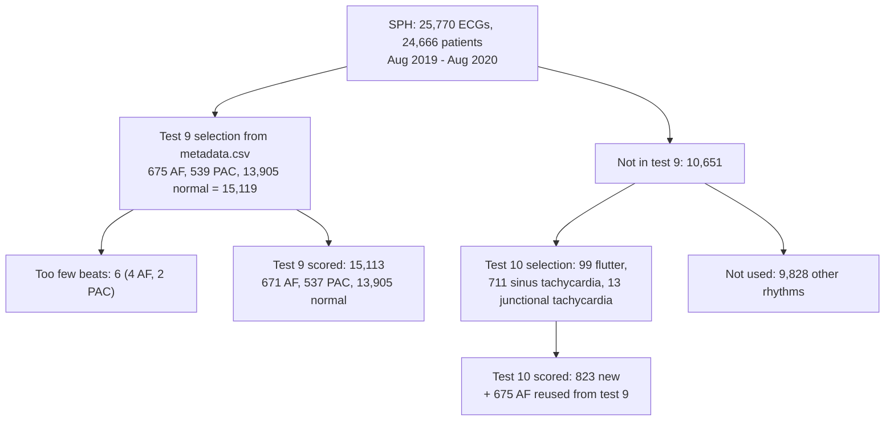

Test 10's new SPH recordings: 823, median age 49 (IQR 33–64), 52% female.

### Flutter subgroups (SPH, test 10)

| SPH subgroup | Flutter caught as AF or flutter | Sinus tachycardia flagged |
|---|---|---|
| All | 83.8% (75–90%), n=99 | 3.7% (3–5%), n=711 |
| Female | 81.2% (65–91%), n=32 | 3.3% (2–6%), n=389 |
| Male | 85.1% (75–92%), n=67 | 4.0% (2–7%), n=322 |
| Age 18–49 | 91.7% (65–99%), n=12 | 3.2% (2–5%), n=403 |
| Age 50–64 | 86.1% (71–94%), n=36 | 3.0% (1–7%), n=166 |
| Age 65–79 | 83.9% (67–93%), n=31 | 3.9% (2–9%), n=128 |
| Age 80+ | 75.0% (53–89%), n=20 | 21.4% (8–48%), n=14 |

In patients over 80, flutter detection is lower (75%) and 3 of 14 sinus
tachycardia recordings were flagged; neither difference is outside its
interval.

### Flutter model specification

[`afib_flutter_dev.fit_flutter`](afib_flutter_dev.py): gradient-boosted
trees (scikit-learn `HistGradientBoostingClassifier`, depth 4, learning
rate 0.05, 400 iterations, balanced class weights, `random_state=0`) on
the 21 `FLUTTER_FEATURES`, trained on 12,753 development units (488
flutter). **Flutter is named when its probability is at least 0.7199**,
the level that calls 10% of development sinus tachycardia + SVT flutter.
Trees can't be written as a table; the model is fully determined by the
code, the training recordings and the library version (scikit-learn
1.9.1). Used alongside the AF model, the output is "AF", "flutter" (which
also counts as "AF or flutter"), "neither" or "unscored".

### Hybrid specification

AF if (interpretable probability ≥ 0.0567 and CNN probability ≥ 0.06308)
or interpretable probability ≥ 0.9. The interpretable model is the main
paper's final AF model; the CNN is [`models/cnn_model.keras`](models/)
from [`afib_cnn.py`](afib_cnn.py).

## S10. Running the supplementary analyses

Setup is as in the main README.

```bash
python qrs_benchmark.py       # beat detection; ~5 min, MIT-BIH streamed from PhysioNet
python afib.py                # Holter development; first run downloads 2 h of each AFDB record (slow)
python afib_test.py           # Holter tests: AFDB later hours + LTAFDB (~2-3 h of downloads the first time)
python ltaf_errors.py         # breakdown of the new-patient false alarms
python afib_svdb_test.py      # test 2; first run downloads ~55 MB
python afib_cinc_test.py      # test 3
python afib_cpsc_test.py      # test 4
python afib_handheld_cv.py    # handheld-only model, 5-fold CV on Challenge 2017
python afib_cpscx_test.py     # test 5
python afib_clinical_dev.py   # clinical model development (CPSC crops)
python afib_georgia_test.py   # test 6
python afib_ptbxl_test.py     # test 7
python afib_pwave_dev.py      # P-wave measure and cutoff development (CPSC + PTB-XL)
python afib_chapman_test.py   # test 8
python afib_ectopy_dev.py     # atrial premature beat removal (development only)
python afib_calibration.py    # calibration of the saved test 6-9 outputs
python afib_flutter_dev.py    # flutter development (also uses results/{chapman,ptbxl}_flutter_dev_selected.txt)
python afib_flutter_test.py   # test 10
python afib_pconc_dev.py      # P-wave concentration (development only)
python afib_ppresence_dev.py  # per-beat P-wave presence (development only)
python afib_hybrid_dev.py     # hybrid thresholds (needs results/afib_cnn_dev_oof.csv from afib_cnn.py)
python afib_hybrid_test.py    # test 13, after `python afib_compare_dnn.py incart code15p2`
python afib_mimic_select.py   # test 14's recordings, from the MIMIC-IV-ECG reports
python afib_mimic_test.py     # test 14, after `python afib_compare_dnn.py mimic`
python afib_hybrid2_dev.py    # the confident-call override (development; preview on used sets)
python afib_mimic_select.py test15   # test 15's recordings (new patients)
python afib_mimic15_test.py   # test 15, after `python afib_compare_dnn.py mimic15`
python afib_mimic_errors.py   # why AF is missed on MIMIC (after tests 14-15)
python afib_slowaf_dev.py select # MIMIC development set (results/mimic_dev_selected.txt)
python afib_slowaf_dev.py     # slow-AF fix development, previews
python afib_slowaf_test.py select # test 16's recordings
python afib_slowaf_test.py    # test 16
python afib_mimic_labels.py   # label check: machine AF confirmed by the patient's other ECGs (after tests 14-16)
python afib_abstain_test.py preview  # test 17 previews on used CODE-15% parts 0-2
python afib_abstain_test.py   # test 17; needs CODE-15% exams_part3 (as part 0)
python afib_afpac_test.py select    # test 18's recordings (machine reports only)
python afib_afpac_test.py download  # their .hea/.dat files from PhysioNet
python afib_compare_dnn.py mimic18  # TensorFlow environment: both networks
python afib_afpac_test.py           # test 18
```

MIT-BIH, AFDB, LTAFDB and SVDB are fetched automatically and cached in
`data/`. The other data, beyond the main paper's:

| Data | Download | Into | Notes |
|---|---|---|---|
| Challenge 2017 | [`training2017.zip`](https://physionet.org/files/challenge-2017/1.0.0/training2017.zip) (99 MB), [`REFERENCE-v3.csv`](https://physionet.org/files/challenge-2017/1.0.0/REFERENCE-v3.csv) | `data/cinc2017/` | unzip there |
| Georgia | [`training/georgia/g1`–`g11`](https://physionet.org/content/challenge-2020/1.0.2/training/georgia/) (2942, ~350 MB) | `data/georgia/` | list: [`results/georgia_selected.txt`](results/georgia_selected.txt) |
| CODE-15% part 2 | `exams_part2.zip` from [Zenodo](https://doi.org/10.5281/zenodo.4916206) | `data/code15/` | unzip to `exams_part2.hdf5` |
| CODE-15% part 3 | `exams_part3.zip` from [Zenodo](https://doi.org/10.5281/zenodo.4916206) | `data/code15/` | unzip to `exams_part3.hdf5` |
| INCART | the `.hea`, `.atr` and `.dat` files of the recordings in [`results/incart_selected.txt`](results/incart_selected.txt) from [PhysioNet](https://physionet.org/content/incartdb/1.0.0/) | `data/incart/` | |
| MIMIC-IV-ECG | `machine_measurements.csv` and `record_list.csv`, then the `.hea` and `.dat` files of the recordings in [`results/mimic_selected.txt`](results/mimic_selected.txt) and [`results/mimic15_selected.txt`](results/mimic15_selected.txt) (3000 each, ~360 MB each), from [PhysioNet](https://physionet.org/content/mimic-iv-ecg/1.0/) | `data/mimic/` | keep the `files/pNNNN/...` paths |

## S11. Limitations of the supplementary work

- Beat detection is scored on the first 5 minutes of each MIT-BIH record.
  One very tall beat or artefact still hides the beats within about 1 s
  of it from the adaptive detector.
- The Holter model is trained on 23 patients and uses one lead; on 84 new
  patients specificity falls to 82–84%, mostly from atrial ectopy, noisy
  recordings and one probable labelling gap.
- The ectopic-beat filter catches ventricular ectopics but almost no
  atrial ones, and its thresholds were chosen on the same MIT-BIH data
  used to measure it.
- On handheld recordings the only evidence for the handheld model is
  cross-validation (92.7%); there's no unused handheld AF data left.
- Flutter: about 1 in 6 flutter recordings is still missed, regular 2:1
  flutter and SVT can't be reliably told apart in 10 s (20% of SVT was
  flagged in development, and the test had no SVT to check this), and
  the flutter test had only 99 flutter recordings from one hospital.
- The hybrid lets the CNN make most decisions below the confident range,
  so the calls it removes have no transparent reason. Its override
  threshold (0.9) was chosen after seeing test 14's data, and all of the
  MIMIC labels are the machine's.
- MIMIC labels: the label check confirms only 18% of AF recordings
  (most patients have no other ECG that day), and the confirmation comes
  from the same machines. Cardiologist reports (credentialed access) would
  settle it.
